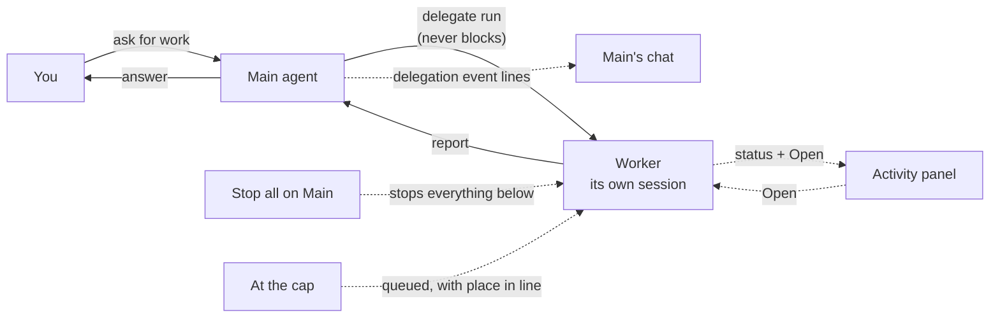

# Agents

Agents do the work in Omnipus. Omnipus ships three built-in chat colleagues—Mia, Jim and the system agent Omnipus—plus the native workers Planner, Researcher and General Purpose. Judge and Plan Supervisor are internal engine agents. You add your own agents by asking Omnipus.

## What it is

A workspace's **Team** is the home of its agents. Open a workspace's **Team** tab: it shows the members as a list first, with a graph view second, and each card offers **Edit**, **Remove from this workspace** and **Delete everywhere…**. The internal agents Judge and Plan Supervisor, and the system agent Omnipus, are edited in [Settings → System agents](settings.md#system-agents).

- **Built-in agents** — Mia, Jim and Omnipus. Their identity and base instructions are protected.
- **Chat colleagues you add** — Main agents.
- **Workers** — shipped and added workers. They are not chat colleagues; other agents delegate work to them, and you can assign workspace tasks to workers on the team.
- **System** — Judge and Plan Supervisor, internal engine agents that cannot be selected for chat or delegation.

There is no separate Agents screen. An old link to it (`#/agents`, `#/agents/<id>`) or to the former Admin chat (`#/admin/chat`) shows the not-found page and does not redirect.

When addressing an agent by its ID, use the exact letter case. For example, `Jim` does not address the built-in ID `jim`; it is an unknown ID. This rule applies to new chats, existing chats and bound channels. The one exception is addressing the system agent Omnipus in chat: its ID comparison ignores case, and an existing chat keeps its stored owner spelling. Display names are labels, not ID aliases.

For an existing chat, a differently cased ordinary ID is refused before the message is saved or sent to the agent. Omitting the ID continues under that chat's stored owner; it does not choose another agent.

For a new chat message, an unknown or differently cased ordinary ID is refused before a session is created or the message is saved. Requests for Omnipus in any letter case point to its canonical main chat rather than creating another conversation.

## When you would use it

- You want a colleague with a fixed job and personality. Ask Omnipus for a Main agent.
- You want focused labor behind your main agents. Ask Omnipus for a worker.
- You already run a command-line agent tool and want Omnipus to delegate to it. Ask Omnipus for an external worker.

## The base agents

The three built-in chat agents cover the everyday jobs.

| Agent | Role | What it is for |
|---|---|---|
| Mia | Assistant | Your everyday starting point. Answers questions and connects you with the right specialist. |
| Jim | Planner and Orchestrator | Turns a complex goal into tasks, delegates them to the right agents, and tracks the work to completion. |
| Omnipus | System agent | Sets up and changes your agents, workspaces, teams, skills, connectors, providers and channels, from one conversation. |

Any chat colleague can ask a teammate for help: start a message with `@` and pick the agent, and the request is delivered to that agent's own chat. Omnipus keeps your conversation with its current agent.

### The Omnipus system agent

Omnipus is your system agent for setup and configuration. It lives in your default workspace only: it cannot be added to another workspace or removed from the default one, and its chats live there. It works from its own folder, and its file tools can still reach the work folders of every workspace (and their mounts) to set them up — never a workspace's record or its private memory folder. Other agents keep to their own workspace.

- **Protected name.** No other agent can be created or renamed to "Omnipus", ignoring letter case and leading or trailing whitespace. A different name such as "Omnipus Helper" is allowed.
- **Workspaces.** On a fresh install with the shipped policies, Omnipus can create a workspace without a tool-approval prompt, but cannot delete one. Delete a non-default workspace in its **Settings** instead. Agent-driven deletion is deferred to [#1363](https://github.com/elicify-ai/omnipus/issues/1363); its per-agent Deny stays in force even under God Mode. These fresh-install defaults do not replace existing saved permissions.
- **Approvals.** Under the shipped non-God-Mode policy, deleting an agent, removing a skill or connector, adding a connector, configuring a provider, and enabling or configuring a channel ask for your approval, as does changing an agent's permissions (`set_agent_permissions`). These calls keep asking when their effective policy is Ask, even with Auto-approve on.
- **No per-agent Ask for Omnipus.** You can set any of Omnipus's tools to Deny, but not to Ask on Omnipus itself; set Ask on the global tool policy instead. Every path that changes per-agent permissions refuses it with "Omnipus takes no per-agent Ask; set Ask globally or use Deny".
- **God Mode.** While God Mode is on, Omnipus is told so in every turn; it then proceeds without approvals.

**Agent ids and names.** Every agent you or Omnipus create gets a generated id — a random identifier such as `3f1c9a2e-…` — that never changes. The name is a free label: it is kept exactly as typed, in any letter case, and two agents may share a name. Built-in agents keep their fixed ids (`omnipus`, `jim`, `mia`, …). Ids match exactly: `Jim` or `JIM` is not the id `jim` and is reported as an unknown agent. A name may be at most 100 characters; a longer one is refused on every path, including the agent tools.

**Where a new agent lands.** `create_agent` takes an optional `workspace_id`: the new agent joins that workspace's team and gets its main chat there, and your current workspace and chat stay as they are. Without it, the agent joins the workspace of the conversation it was created from. Only Omnipus may name another workspace; an unknown workspace is refused before anything is saved.

**What an agent tool can change.** Besides identity, model, skills and the soul, `update_agent` can replace an agent's `AGENT.md` (`agent_md`), under the same rules as the soul: not on the built-in agents and not on external workers, while system agents keep their instructions editable. `get_agent_tools` finds an agent by its exact `name` as well as by its id; when several agents share that name it refuses with `AMBIGUOUS` and lists their ids. When the global tool policy is stricter than a per-agent setting, `set_agent_permissions` still saves the agent's own value but reports it in `clamped` — for example `{tool: "read_file", requested: "allow", effective: "ask"}` — with a sentence in `message`; `get_agent_tools` lists the same `clamped` entries when you read the agent back. Every change tool reports one of four outcomes — see [tools](tools.md#what-a-change-tool-reports).

When an agent changes another agent through its tools, permissions are a separate step: `update_agent` changes identity, model and skills, while per-agent tool permissions and connector assignments change only through `set_agent_permissions`. Under the shipped non-God-Mode policy, that tool asks before it runs, even with Auto-approve on. Omnipus skips those global approvals in God Mode.

Permission and connector-assignment changes apply to subsequent requests and tool calls after successful live activation, without a restart. Saving and activation are separate results: check `persistence_status`, `activation_status` and the reported message. A saved change whose activation failed is not proof that the running agent uses it. Fix the reported problem and reload or restart before relying on the new permissions. A newly created agent can never be granted a management tool (agent, workspace, skill, connector, provider, channel, permission, secret or settings changes) — those stay with Omnipus.

When an agent creates an external worker through its tools, the soul rule depends on the kind: a native agent (Main or Subagent) needs a soul, but an external worker takes none — it runs on its own command-line tool and has no persona prompt, and supplying one is refused with the reason shown. If that request names a `cli_path`, it must point at an existing file this machine can actually run: on macOS and Linux the user running Omnipus must hold execute permission on it, and on Windows its file extension must be one Windows recognizes as runnable (the PATHEXT list — .exe, .cmd and similar). A missing path, a directory, or a file failing this check is refused with the path named in the reason. Leaving `cli_path` out uses the tool's own launcher on the host's PATH.

On Windows, this check uses the `PATHEXT` environment variable, a semicolon-separated list of runnable file extensions. Entries work with or without a leading dot and are matched without regard to letter case: `EXE;CMD` accepts `.exe` and `.cmd` files, just like `.EXE;.CMD`. Empty entries are ignored. A custom list controls which extensions are accepted; when the list is unset or blank, the check uses `.COM;.EXE;.BAT;.CMD`.

## Shared operating rules for native agents

All native agents receive shared operating instructions alongside their own identity. The instructions apply only within each agent's tools, permissions and role; assigning a skill or asking an agent to do something does not grant access.

Agents are instructed to check their assigned skills before a new task, give concise progress updates, use plain language without emoji, and verify results before claiming completion. Structured deliverables and diagrams longer than 15 lines belong in authorized workspace files, with their contents checked and full absolute paths reported. When several questions are needed, agents should use the question tool where available, ask no more than five at a time, explain the options and recommend one.

For every request, agents are instructed to keep their own todo list with `set_todos` and mark the current item `in_progress`. Each call replaces the full list. There is one active checklist for the session: reuse the same `outcome` for updates to the same work; a different outcome closes the previous checklist card. The checklist is re-shown to the agent each turn. This change does not alter its Board card or add a chat status line.

Independent work should run in parallel where supported, with clear ownership to prevent conflicting edits. An agent must distinguish a queued job from a running one, inspect delegated results, and report failed, blocked and untested work honestly. These are instructions to the agent, not a guarantee that a particular result has been tested or that background work is running.

A separate memory guide tells agents to recall notes before starting a task or answering about past work, decisions, people, preferences or project facts. Earlier content from the same conversation that is no longer in view uses `recall_conversation`; durable notes and past retrospectives use `recall_memory`, whose default room is `both`. Historical notes are reference material, not new permission or instructions.

Agents are instructed to remember decisions, preferences, corrections, stable facts, lessons and useful references promptly, not only at the end. Transient progress, chatter, material already in files or docs, guesses and secrets do not belong in saved notes. Saving with `remember` requires an explicit room: `shared` when a teammate could need the note, or `private` for the agent's own working notes. Check the returned receipt for the room actually used and any warning. The guide favors updating notes over duplicates, but `remember` only appends: agents must report a missing update capability rather than invent an operation. See [memory](memory.md) for the tool behavior and its limits.

## How a conversation finds its agent

Every conversation names its agent — there is no global default agent.

- A chat in the sidebar always opens one agent's main chat; you pick the agent by the row you click.
- A new chat names its agent on the first message: pick an agent before you send, because there is no default to fall back to.
- A connector answers through the workspace and agent it is bound to; an unbound connector delivers nothing. See [connectors](connectors.md).
- Omnipus has exactly one conversation, its main chat. Asking for a new chat with Omnipus opens that main chat instead; the server refuses a second Omnipus conversation outright.

## How to create your own agent

In a workspace, select **Add agent** under it in the sidebar, or **Team → Add agent → Create with Omnipus**. In a workspace with no agents yet, the chat area offers **Add agent** too. Omnipus's chat opens with creating an agent for that workspace already started: it asks what the agent is for, shows one summary of what it will create (and any gaps it cannot cover), and creates the agent in that workspace after you choose **Go**. It needs a working model — fix providers in **Settings → Providers** and Omnipus's own model in **Settings → System agents**. There is no manual create form in the app.

Omnipus can create three kinds of agent:

| Type | Runs on | Works for | You can chat with it |
|---|---|---|---|
| Main | The Omnipus engine | You, directly | Yes |
| Subagent | The Omnipus engine | Other agents, through delegation | No |
| Subagent (External) | An external command-line tool | Other agents, through delegation | No |

**Without the app.** Scripts and integrations can still create an agent through the REST endpoint `POST /api/v1/agents`. It is an API only, with no screen in the app.

To change an agent, open its card on the workspace's **Team**, or its row menu in the sidebar, and choose **Edit**. The edit slide-over saves as you type. Its tabs are **Basics**, **Personality**, **Tools**, **Skills**, and **Advanced**; an external worker shows **Runtime** instead of Tools and Skills. **Delete agent** asks you to confirm.

## Where an agent's instructions come from

For a custom native agent, **Personality** edits its `SOUL.md`: the persona and standing instructions that follow that agent. All native agents read the same global `USER.md` profile. Omnipus does not automatically add that profile to external command-line workers' input. A custom native agent with no non-empty `SOUL.md` uses Omnipus's default assistant identity.

Project rules belong in **Workspace settings → Project Instructions**, stored in the workspace's `AGENT.md`, or in a mounted project's root `CLAUDE.md` or `AGENTS.md`. When both project files exist, `CLAUDE.md` takes priority. These workspace and project instructions still apply to native turns.

In native turns, an agent's own folder does not supply instructions from `AGENT.md`, `AGENTS.md` or `IDENTITY.md`. Their contents are not added to the system prompt, and changing those files does not refresh the prompt cache. `SOUL.md` and the global `USER.md` still load for native agents.

## How to delete an agent

**Delete agent** asks you to confirm twice: the first step explains that the agent and its chats, memory and related data are removed permanently, the second is the final confirmation. Dismissing either step deletes nothing. A locked core agent, a System Agent, and an agent that owns an active plan cannot be deleted — stop or reassign the plan first.

Deletion cleans the agent's own data first — its chats, its task assignments, and its references in workspaces — and removes the agent record last. If any part of that cleanup fails, the agent stays in the list and the message says it is only partly deleted; press **Delete agent** again to finish. Nothing is lost by retrying.

## How an agent looks

An agent's mark combines a figure, a small job badge, and a colour. Omnipus shows every agent with this same mark everywhere: the agent list, chat, the sidebar, activity, team and task views, and the agent pickers.

| Choice | What you pick | Default on a new agent |
|---|---|---|
| Look (figure) | Omnipus, Man, Robot, Woman, or Monogram — Monogram takes the name's first character after trimming spaces, uppercases it, and displays the result if it is a single letter or digit; otherwise it displays `?` | Omnipus |
| Role badge | One of the 31 badges below | General assistant |
| Colour | Steel blue, Titanium, Verdigris, Gunmetal, Graphite violet, Rose gold, Bronze, Antique brass, Champagne, or Pewter — ten muted metallic tones, in that order | Pewter |

The role badges are grouped like this:

| Group | Badges |
|---|---|
| Create (6) | Writer; Designer; Image creator; Video producer; Audio and voice; Social media |
| Build (8) | Developer; Data engineer; Data analyst; IT and operations; Automation; Security; Quality and QA; Science and lab |
| Business (10) | Orchestrator; Project manager; Product manager; Sales; Marketing; Finance; Legal and compliance; Customer support; Documents; Researcher |
| People (4) | People and HR; Tutor; Knowledge and library; Translator |
| Personal (3) | General assistant; Personal assistant; Office assistant |

The editor puts the choices around one large live preview of the mark. **Role badge** is a single dropdown: type to search (for example "dev" finds Developer), and each option shows its badge. **Look** shows the five figures as pictures, drawn in your chosen colour and badge, so you can see each one before you pick it. **Colour** is a row of ten colour dots. The editor lives in the edit slide-over's **Basics** tab and saves changes automatically; its preview and the header mark show your selection immediately, before the save completes. With Monogram selected, the mark uses the agent's saved name, so a draft rename is not previewed before its save completes. Check the save indicator before treating an edit as saved. There is no agent-picture or GIF upload; this does not affect attaching files to a chat.

When creating an agent through the API, omitting `figure`, `role`, or `color`, or sending JSON `null` or an empty string for it, chooses that field's create default: `Omnipus`, `general`, or `#8E9196` (Pewter). This applies to Main agents, native workers, and external workers. A non-empty figure or role must match a listed value exactly; a whitespace-only string is not a default request. A listed palette hex accepts either letter case and is saved and returned uppercase, for example `#a97142` becomes `#A97142` (Bronze). An unlisted colour still rejects the request. These rules are the same with optional inbound schema validation enabled or disabled.

When updating an existing agent through the API, omit `figure`, `role`, or `color` to keep its stored value. Sending JSON `null`, an empty string, or another invalid identity value rejects the whole update with HTTP 400: even valid sibling changes are not saved, and the stored fields, display timestamp, and configuration revision stay unchanged. Null does not clear an identity choice or restore a create default. To choose a default again, select it in the editor or send its actual value: `Omnipus`, `general`, or `#8E9196`. Differently capitalised or JSON-escaped field names do not bypass null rejection, and a repeated identity field cannot hide a supplied null. Listed colour hexes accept either letter case on update too and are stored uppercase.

The same visual rules apply when an agent (for example Omnipus) creates or edits another agent through its `create_agent` and `update_agent` tools: the tools accept the same figure, role, and colour catalogs as the API and the editor, an omitted, null, or empty visual on create selects the same defaults (`Omnipus`, `general`, `#8E9196`), and an invalid or empty visual on update refuses the whole call without saving anything — the error names the rejected field and lists every valid choice, instead of an HTTP status code. `get_agent` returns an agent's saved figure, role, and colour, and its `editable_fields` list shows whether each visual can be changed: custom agents can, built-in and system agents cannot (see "Built-in identity is locked" below), and the permission fields `mcp_servers` and `tool_policy_changes` are never listed as editable there because they change only through `set_agent_permissions`.

**Creation results.** When `create_agent` runs in a workspace's turn, it attempts to join the new agent to that workspace. Without a workspace, or if joining fails, the agent can remain **metadata-only**: saved, but on no team. The response's `status` distinguishes `joined_workspace` from `metadata_only`; membership alone does not prove live readiness.

Check `persistence_status`, `activation_status` and any `publish_warning` before saying the agent is runnable. A saved-but-not-live agent needs a configuration reload or gateway restart. Main-chat creation is best-effort and is retried when opened. Report partial results as partial, rather than claiming setup is complete.

When using `create_agent` or `update_agent`, a `context_window_override` must be a positive whole number that fits the server's integer storage. A string, fractional number, zero, negative value, or a number too large to store rejects the whole call without saving other changes. Sending `null` to `update_agent` clears the override.

An incomplete or malformed agent create or update is rejected without saving. Request bodies over 1 MiB (1,048,576 bytes) return HTTP 413, even if their first part looks like complete JSON; a complete valid body at that limit is allowed. A rejected create adds no agent. A rejected update leaves the stored fields, display timestamp, and configuration revision unchanged.

On API create requests, `skills`, `mcp_servers`, and `tool_policy_changes` must not be JSON `null`. Within those fields, `mcp_servers[].tools` and `tool_policy_changes.set` or `.remove` must not be `null` either. Differently capitalised or JSON-escaped keys, and repeated keys at either level, cannot hide a supplied null: the whole create is rejected with HTTP 400 and no agent is saved. Empty arrays and maps remain valid where allowed; omitting these optional fields keeps the server's create defaults. This does not change the intentional null-or-empty default rule for `figure`, `role`, and `color` described above.

### Built-in identity is locked

Open a built-in agent's card, then **Basics**: the role badge, look, and colour choices remain visible but cannot be changed. Omnipus restores their fixed values whenever the server starts. The jobs described in the base-agent table above are distinct from these badge choices.

| Built-in agent | Figure | Role badge | Colour |
|---|---|---|---|
| Mia | Omnipus | General assistant | Steel blue |
| Jim | Omnipus | General assistant | Verdigris |
| Omnipus | Omnipus | General assistant | Bronze |
| Planner | Omnipus | General assistant | Titanium |
| Researcher | Omnipus | General assistant | Graphite violet |
| General Purpose | Omnipus | General assistant | Pewter |

Agent identity is the figure, role badge and palette colour. The legacy icon is not an editable identity field.

A built-in agent keeps working wherever it sits, and the sidebar's row menu treats it accordingly. **Hide from sidebar** is available for every member row, built-ins included — hiding only removes the row from one workspace's list; it never touches membership, tasks or the main chat. **Remove** is different: it ends the agent's membership in that one workspace (the agent stays in the Agents list and in other workspaces, and its chat history is kept — deletion is still the only thing that removes an agent and its data). A built-in agent cannot be removed from the default workspace, because Omnipus re-adds the built-ins there every time the server starts; the row's **Remove** action is disabled and states the reason instead of failing silently.

### Existing agents' identity

Agent identity is the figure, role badge and palette colour. The legacy icon is not an editable identity field. For agents you created, an invalid or missing custom role normalizes to General assistant, not to a badge inferred from an old icon. An invalid or missing figure normalizes to Omnipus. A valid figure or role already chosen stays. Valid palette colours normalize to uppercase. Only the ten palette colours exist: any other colour is refused when you save, and an agent whose stored colour is not one of the ten is shown with the default Pewter (the stored file is not rewritten). Once these choices are saved, later restarts leave them unchanged rather than repeatedly choosing new colours. Built-in agents use their fixed identities instead (`pkg/coreagent/identity.go::migrateUnenforcedAgentIdentity` applies only to agents Omnipus does not enforce).

## How to lower one agent's tool-call limit

Every agent may make at most a set number of tool calls in one turn. The global limit lives in Settings, Performance; see [settings](settings.md#tool-calls-per-turn). One agent can have its own lower limit, for example a worker you want to keep on a short leash. An agent's own limit can equal or be lower than the global limit, never higher.

1. Open the agent's card and go to the **Advanced** tab.
2. Under **Execution**, type a number into **Max tool calls per turn**. It saves by itself.
3. The line under the field says where the agent's limit comes from:

| The line reads | Meaning |
|---|---|
| Using the global limit (200) | The agent has no own value and follows the global limit. |
| Lowered for this agent: 50 (global limit 200) | The agent's own value, 50, applies. |
| Own value 500 is above the global limit (200) and has no effect | See "A stored value above the global limit" below. |

4. To go back to the global limit, click **Use global limit** next to the field. That clears the agent's own value.

You can also give a limit when you ask Omnipus to create the agent. Leave it out to follow the global limit.

A value above the global limit is not saved. On the profile, the field shows the refusal, which names the global limit and suggests raising it in Settings, Performance; your other changes on the profile still save. Values must be whole numbers from 1 to 1000.

The same rules apply everywhere an agent is created or changed, including when you ask an agent in a chat to do it, as you would with Omnipus. The `create_agent` and `update_agent` tools refuse a value above the global limit or outside 1 to 1000, and sending an empty value (`null`) to `update_agent` clears the agent's own value.

**A stored value above the global limit.** A stored per-agent limit above the global limit is kept but ignored: the agent runs at the global limit, and its profile explains that its own value has no effect. The gateway log lists every such agent in one warning at start-up. Type a lower value or click **Use global limit** to clear the warning. Lowering the global limit in Settings asks for confirmation before it lowers affected agents' stored limits.

A change applies from the agent's next turn; a turn already running keeps the limit it started with.

## Workers and delegation

A worker is just a session that another agent owns and steers. The delegating agent hands the worker a task and keeps working; the worker runs in its own session, with its own tools, its own transcript, and a chat you can open to watch it live.

In native Omnipus turns, an agent with available delegation targets sees a compact directory for its current workspace. Each entry gives the target's name, ID, permitted handoff modes and effective maximum chain depth, plus one **Use for:** line from the target's description in the live configuration. An explicit **Use for** or **Use when** sentence takes priority; otherwise the first sentence is used. A small set of common English abbreviations is recognized, including `U.S.`, `e.g.`, `i.e.`, `etc.`, `Inc.` and titles such as `Dr.`/`Mr.`, rather than treating every period as a sentence ending. A blank description shows **(no description)**, never an invented role. The selected sentence can be the whole description. Per-agent tool lists and repeated call examples are omitted. External command-line workers do not automatically receive this native directory.

When a directory is shown, shared call guidance appears once. It covers durable work with both acceptance criteria (`criteria`) and a definition of done (`dod`), helper messages, and targeted status/result checks instead of repeated polling. That shared guidance says to report a missing route as a dependency rather than take over prohibited specialist work. The existing fallback is different: if no targets can be shown, a depth cap is reached for every target, or the workspace, graph, live registry or depth limit cannot be resolved, the context says delegation is unavailable and tells the agent to complete the task itself. Missing live-registry targets and targets at their depth cap are not advertised.

The delegation context is rebuilt each native turn. Its text stays the same between turns when the agent, workspace, chain depth, delegation graph, live agent details and global delegation-depth setting are unchanged. The directory does not grant access: workspace trust lines, modes, depth limits and tool permissions still apply.

What this looks like in practice:

- The worker's own steps, narration and tool calls stay in its session. The parent's non-verbose chat uses muted delegation event lines; Verbose chat also shows delegate tool-call badges.
- The delegating agent can keep many workers running. **Activity** lists each worker's status and an **Open** control for its session, where you can watch it work.
- A **native** worker reports only to the agent that delegated it, never to the person. It uses a separate `message_parent` channel plus the steering surface (`status`, `steer`, `respond`, `redirect`, `resume`, `stop_all`), and nothing else.
- **The parent receives the helper's result.** A helper without a goal hands back its final answer. A helper working on a goal hands back all the text of the turn in which it claimed completion, including what it wrote before the claim — not only the claim's evidence; the Judge still checks the claim. A hand-back carries at most 50,000 characters. When a goal helper's turn wrote more, its longest message is kept (shortened, ending with **[truncated]**, if that message alone is longer), shorter messages are added back while they fit, and **[truncated]** marks the omission when there is room for it. A longer final answer from a helper without a goal is shortened the same way. Once that result has been delivered, `delegate status` reports the helper as finished without repeating it; `delegate result` returns it again. A run of consecutive successful `status`, `peek` or `inbox` calls about the same helper, with no newly observed information, is warned at the fourth poll and requests an end to the parent's turn at the eighth. The turn ends after the current group of tool calls finishes unless new user input supersedes the stop. Changed information or another intervening tool call starts a new run. This is not a guarantee that the helper stays running: if the polling parent is itself a delegated helper, its failed completion can cascade-stop its own helpers. A stopped helper may have no final result yet; an available final hand-back can be read with `delegate result`. Both `criteria` and `dod` items passed to `delegate` may include an optional `provenance` field, using the same values accepted on `set_goal`'s DoD items: `stated`, `workspace`, `floor` or `inferred`. A supplied value is retained in the helper's goal. Unlike `delegate`, `set_goal` requires provenance on each DoD item you explicitly supply.
- **A helper counts as one delegation level.** A worker started by `delegate` runs at delegation depth 1, so a task it creates is one level deeper (depth 2). With `performance.max_delegation_depth` set to `1`, a worker therefore cannot create a task (the attempt is refused with "maximum task delegation depth (1) reached"); your own chat still can. Raise the limit to let workers create tasks.
- **A worker on an external command-line tool behaves differently.** A worker launched with an external-CLI executor (Claude Code, Codex or opencode) runs on that tool instead of the Omnipus engine. It has **no `message_parent`** channel — Omnipus hands its completed command-line output back to its parent. `delegate redirect` and `clear_goal` are unavailable, and `/stop-redirect` is refused with `not_steerable` on a running or stopped external helper (a finished helper is told to use Resume for its next round, which works only under the conditions described below). Steering it is different too: the parent's `delegate steer` — or a message you type directly into the helper's own chat — **interrupts the running tool** and continues the same CLI conversation with the new instruction; with **no live conversation** the request is refused as `not_steerable`, reported rather than silently starting a fresh conversation. Sending a message to a live external helper therefore **kills the tool's subprocess**, exactly as Stop does. `delegate steer` never revives an external helper that has no live conversation; it is refused as `not_steerable`. Whether a stopped or finished external helper can be continued depends on two facts, not on the helper being stopped or finished: has its CLI conversation started, and does the gateway still retain it? If it started and is still retained, `delegate resume`, `delegate respond` and a message typed into the helper's chat continue that same conversation. If it started and is no longer retained (it was released when the helper's episode ended, or the gateway restarted), they are **refused** with a message to start a **new delegation**. If it never started (the helper was stopped before its CLI ever ran), `delegate resume` and a typed message run it for the first time. `delegate steer` is different: it needs a CLI run in flight, and for a helper with none it is refused as `not_steerable` without reviving anything. On a still-running helper, `delegate resume` does nothing and sends no text (use `steer`). `delegate respond` answers one open question by its correlation id; an external helper cannot raise a question with `message_parent`. For a helper with a run in flight the answer is delivered the way `steer` is (interrupting the running tool); otherwise it follows the same revival rules as `resume`. Neither `resume` nor `respond` ever creates a new worker session in the helper's place. What still works: `status` (state and elapsed time before and after completion, but no live CLI progress snapshot), the Stop button, `stop_all`, and the Activity panel's listing and **Open**.
- **A live instruction reaches an external worker running a task too.** While an external-CLI worker has a CLI run in flight for a **task**, a message **you** type into that run's chat interrupts the running tool and the task resumes the same CLI conversation with the instruction, inside the same task run: the task's claim, attempts and result are unchanged. An agent parent's `delegate steer` does **not** reach a task run: task runs carry no steering chain to a parent agent (Omnipus does not invent one), so the call is refused. The one exception is a run that was started in the assignee's own main — only that main can steer it. When no CLI run is in flight, nothing is delivered; a message you type into the chat is not treated as a steer at all and follows the ordinary chat path. Stop still ends the run; it does not deliver the instruction.
- **Changing a worker's runtime does not affect work already running.** An agent's runtime (native, or an external CLI tool) is fixed when a worker is launched. If you change that agent afterwards, work already in flight keeps to the runtime it started on; where the change makes the live runtime disagree with the started work, that work **refuses** rather than silently switching — the recovery is a **new delegation** (or, for a task, **Rerun**).
- The delegating agent never blocks. The tool returns as soon as the worker is launched and dispatched, and the agent carries on. When it needs the worker's answer, the worker wakes it on completion.
- **Stop pauses only the current session.** One Stop-button press or `/stop` ends that session's current turn, including its first turn and turns started by a schedule or heartbeat. It shows as **Stopped**, not failed. Its helpers keep working and send their results into its inbox. **Stopped** is shown after that execution's work and cleanup finish. A storage failure is reported as an error, not claimed as a successful Stop; a failure discovered after the request was accepted is reported when its execution settles. Work so far stays, the session is resumable on the same conversation and generation (the same round of work), and its goal stays active. A stopped helper's status is saved in its parent's session. Re-delivering an older stop notice after Resume does not change the helper's current state.
- **Activity follows the helper's current state.** Stopped helpers leave **Running now** and the running count even though their delegation remains open for Resume. Their stopped rows keep **Open**, and do not keep counting elapsed running time. The **Agents · Activity** control remains available for retained stopped helpers. Resume on the same conversation returns the same helper to Running now when it is running again; a stopped helper is not reported as a failed one.
- **A gateway restart interrupts a main conversation without replaying its old instruction.** A main conversation whose queued or running execution was cut off shows **Interrupted**. Saved history and active goals stay in place, and a Stop already requested keeps its own reason. Native helpers cut off while running or queued can continue from saved history, as described below. If that same restart also interrupted their parent, a fresh helper outcome can wake it; the input is the helper event, not the parent's old interrupted instruction. Your next chat or channel message continues the same conversation and round of work with a fresh execution, including normal delegation. For a standing heartbeat or scheduled conversation, its next normal tick or trigger can likewise continue a restart stop; this is the schedule continuing, not boot replay. After a physical restart, a heartbeat's next interval is counted from gateway startup; recovery does not run a catch-up turn during boot. A human Stop of live work still holds until a person resumes it. Pressing Stop on a conversation already marked Interrupted does not replace its restart reason: a later message or normal scheduled trigger can continue that conversation. A readable prior-boot execution shows Interrupted even if its recovery update could not be saved; the label alone is not proof that the saved stop landed. A main conversation waiting on a lost approval or question is interrupted too; it does not re-ask that old prompt, and your next message continues normally. Prompts from the current gateway process are left alone. Idle conversations and completed answers are not marked interrupted.
- **A previous reply can still be finishing.** If another message reaches the same conversation before its prior execution has settled, Omnipus waits briefly. If that execution is still pending when the wait ends, the message receives **Your previous reply is still finishing — send your message again in a moment.** It is not reported as a generic timeout and does not start a second execution. This wait belongs to that conversation, not every chat with the same agent. An explicitly cancelled caller does not start new work.
- **A helper Stop is a record, not a wake-up.** Whether its parent agent or a person requested the Stop, it leaves a stopped line in the parent chat and does not wake the parent, join a live parent turn or automatically resume the helper. Replaying that saved notice after a restart still does not wake the parent. An intentional Stop of the parent is not overridden by a later helper outcome. Stopping only the parent does not by itself cancel helpers that the Stop did not select. A historical timeout notice can wake the parent, but never resumes the timed-out helper; there is still no new work-lifetime timer.
- **Stop all pauses the whole tree below that session.** In web chat, a first Stop-button press, Escape or `/stop` opens a three-second confirmation window; another Stop activation in that same chat confirms Stop all. The same Stop button stays available during the window—there is no separate Stop-all button. The window closes after three seconds, when the window loses focus, or when you switch chats. `/cancel` is the immediate, explicit Stop-all confirmation: it stops the current session and every helper under it, including helpers queued for a slot. It never reaches a parent or a sibling, and it never clears a goal. The delegating agent's `stop_all` is the same Stop all, with the same downward scope. Every Stop works the same way, whoever presses it: the running work is asked to stop at once, and if it is still going 3 seconds later it is stopped forcibly. That applies only to the run the Stop selected. A helper shows as stopped once its running work has shut down. If you resume the helper in the meantime, the resumed run is a new run and the pending forced stop leaves it alone; a new Stop is needed to stop it.
- **The chat redirect command replaces the current chat's turn.** In a root chat or a native helper chat, type `/stop-redirect <instruction>` (external-CLI helper chats refuse this redirect — use Stop, or the parent's delegate actions described above). It stops that conversation's current turn, then continues that same conversation with the new instruction; its helpers keep working. It does not target a helper below the chat. A stopped helper continues on the same conversation and generation. A finished helper has no turn to replace: use Resume for its next round. A blank instruction returns usage and changes nothing. A chat without an attached active session shows guidance and sends no redirect. Store or control failures are shown, not reported as a successful redirect; an unreadable saved session reports a read error.
- **A message steers too.** For a **native** helper, a message into its working turn is delivered into that turn and never stops it; a message into a stopped helper resumes it on the same conversation and generation, and a message into a finished (done or failed) helper starts its next round. For a helper on an **external command-line tool**, a message you type into its open chat is delivered the same way the parent's `delegate steer` is: it **interrupts the running tool and continues the same CLI conversation**. A message typed into a stopped or finished external helper is handled as a revival (like `delegate resume`), not as a `delegate steer`: it continues the same CLI conversation if that conversation started and the gateway still retains it, runs the helper for the first time if its CLI never started, and is otherwise refused rather than silently starting a fresh one — start a new delegation (see the note above).
- **No person-only wait.** When a helper needs a person, it asks its parent with an ordinary message and keeps working; the parent reaches you through ordinary chat text. There is no special pause and no 24-hour expiry — a helper never fails because a person was unavailable.
- When too many workers are already running, the next one is **queued** — the parent's tool result tells it its place in line, and queued workers start in order as slots free. There is no blocking wait, and `delegate stop_all` stops a queued worker.

The parent's open chat shows its next reply as it is written, without a reload. A helper's finished result, question, blocker or failure also leaves a lasting event line in that parent chat, even when the parent does not repeat it. A Judge ending appears in the parent chat as well as the helper's own chat. Progress, checkpoints and shared artifacts still update **Activity** and are kept when the inbox limits allow; they do not start a parent turn.

When a helper's final result, question, blocker or failure is prepared to wake the parent, the input includes a bounded snapshot of retained, unacknowledged progress, checkpoint and artifact reports with that helper's recorded round identifier. Reports from a different round, or with no recorded round, stay readable through `delegate inbox` but are not presented as current-round evidence. The snapshot considers a page of at most 200 inbox entries and has a separate report-body size budget; it explicitly says when another inbox page or further report bodies remain to be read with `delegate inbox`. Including a report in the snapshot does not acknowledge or delete it. Once an outcome's input is saved, retries keep that original snapshot rather than refreshing it after reports are read or the helper changes state. A restart notice or a saved timeout-stop notice uses its own event input rather than this report snapshot. Not receiving a separate progress wake does not mean a report was dropped.

Event lines and the parent's replies stay after reload. The internal input that prompts the parent to continue is not shown as a message from you, either live or in loaded history. To read a long line in full, click it, or focus it with Tab and press Enter or Space. New helper lines do not move focus from the composer or an open approval or question card; replay and reload do not announce old helper lines again.

One outcome starts at most one new parent turn. If the parent is already working, a new outcome joins that turn at a safe boundary. An open tool approval stays open; the report is not inserted ahead of that tool's result. A parked question card also stays valid. A helper report arriving meanwhile is shown and retained, and is handled together with your answer to that card rather than starting a separate outcome-only turn. A result already read by the parent is not delivered again on every gateway start. If the parent was intentionally stopped, the saved report waits for a legitimate continuation without repeatedly trying to wake it at startup; it is not marked read just because it was saved. A real delivery failure remains visible to the operator and can be retried after its cause is repaired.

A native helper cut off by a gateway restart while running or queued continues from saved history through normal admission. The runtime does not replay a historical tool invocation that already finished; a later new model decision may call the tool again. Both chats show **Interrupted by a restart.** That line records the interruption and does not change when **Activity** later says waiting, running or finished. Separately, the parent agent's restart input identifies the helper and says whether automatic continuation was admitted and what its state was when the notice was saved; it is not an instruction to resume a helper that is already continuing. If continuation cannot start, a second line says **Resume did not start.** The parent is still told once. Continuation also does not start when the workspace the helper was working in has been deleted, or when the helper's agent is no longer a member of it: its saved work is never continued in a different workspace. An external command-line helper is not automatically resumed or replaced after restart; the retained-conversation and new-delegation rules above still apply.

If an event line cannot be saved, chat shows **A helper event could not be saved in this chat. Omnipus will retry. This is not a failure of the helper's work.** A later repair keeps that line and adds the event once. A missing, hidden or removed parent is never replaced with another conversation or workspace.

If a queued worker cannot start and its failure outcome cannot be saved, Omnipus sends its direct parent a nonfatal storage-error notice when the worker's saved record is still readable and the parent's inbox can be written. The notice is not a saved final outcome and does not restart the original instruction. It waits in the parent's inbox; it does not by itself wake or resume that parent. A failed notice save is not reported as successful delivery or recovery.

If a helper is waiting for a slot, separate notifications that wake it are kept in arrival order for the same queued turn. When a slot opens, that turn receives every queued notification once; a later notification does not create another queued worker or replace the earlier input. Retrying the same notification ID does not add its text again. Reusing that ID with different content returns an error and keeps the original input. These inputs remain attached to the original queued execution; the concurrency limit still applies.

An instruction that reaches a helper just as its turn is ending is still delivered to that same helper, in a short follow-up step of the same working session. Omnipus saves the exact instruction text in the helper's own transcript before it counts the instruction as delivered, so opening the helper's chat shows what it was told. A repeated delivery of the same instruction is saved once, and the helper is not run a second time for it.

The limits on all of this — how many may run at once (Performance tab) and how deep a chain may go (`performance.max_delegation_depth` in `config.json`; a workspace **Team** edge can tighten it per agent pair) — are described in [settings](settings.md#delegation-limits). There is no time limit: a child runs until it finishes or someone stops it.

A worker has its own settings — its model, its tools, its limits. The delegating agent hands over the task; the worker supplies everything else. Delegation itself is a per-workspace decision: which agent may delegate to which is set in that [workspace](workspaces.md) **Team** panel, and that rule applies only there.

**Every delegation names its target, including the agent's own.** There is no default target and no "send it back to whoever asked" shortcut: a `delegate` call with `action="run"` must give an `agent_id`, and one that omits it, passes null, or passes a blank value is refused before any work starts. The other actions (`status`, `steer`, `respond`, `resume`, `stop_all` and so on) address an existing worker by its `session_id` and do not need an `agent_id`. Naming the caller itself is allowed, and it forks a **new session running the same agent** — it never injects work into the chat that agent is already in. That fork needs a line from the agent to itself, exactly like any other handoff.

**The built-in General Purpose worker can delegate onward when permitted.** By default, a workspace seeded with General Purpose on its team gets a General Purpose → General Purpose edge for task and background `delegate` calls, capped at depth 3 or a lower configured limit. Custom workers get no automatic **cross-agent** outgoing edge; to let one delegate to another team agent, add the edge in that workspace's Team panel and allow its `delegate` tool. Without an edge, the request is denied; an edge alone does not grant a denied tool, and it does not give an external-CLI worker the ability to create Omnipus helpers. **Any agent can have an edge to itself** — a self-line is an ordinary Team line, so an agent handed a fresh piece of work back to itself needs one exactly like any other pair. A custom worker gets its own self-line the same way a built-in agent does: Omnipus adds one for each agent that newly joins a team, whichever route it joins by, unless its id is on the operator's seed-exclusion list (see [settings](settings.md#which-new-agents-get-a-self-line)). The two hidden engine agents cannot join workspace teams. Omnipus is a hidden member of the default workspace only. Edit or remove a self-line in the workspace Team panel like any other line; a removed self-line is not restored while the agent stays on the team.

An **external worker** runs on a command-line tool installed on the same machine as Omnipus: Claude Code, Codex, or OpenCode. Its model is a free-text name passed straight to that tool. Before it saves changes to an external worker, Omnipus checks the connection automatically: that the tool's program is present, that it answers, and that it is signed in. If the check fails, the save is refused. The check runs on the first save after you open the worker, and after that only when you change the path to the tool's program, or when the previous check failed — not on every save. It spends no model usage. To try the worker by hand, open it and use **Send a test message** on its **Runtime** tab; this runs a real request through the tool, so it spends a small amount of usage.

Two things to watch with external workers:

- The tool choice is fixed when you create the worker. To move to a different tool, create a new worker. The path to the tool's program stays editable.
- Omnipus tool permissions do not reach inside the external tool. It uses its own tools and its own safety settings; the allow, ask, and deny rules govern Omnipus [tools](tools.md) only.
- The tool-call limit does reach it. An external worker follows the same global **Max tool calls per turn**, and can have its own lower limit on its **Advanced** tab like any other agent. Omnipus passes the limit to the tool as its cap on agent turns: Claude Code receives it as `--max-turns`, and for Codex and OpenCode Omnipus counts the turns and stops the run when it goes past the cap. There is no separate built-in default for external workers.

## Agents messaging each other

An agent can send a request to another agent without delegating a worker. It calls `send_message` with the recipient's `agent_id` (and `workspace_id` when the recipient is in another workspace; left out, it means the sender's own workspace). Do not combine this with `channel` or `chat_id`: a request is addressed by agent, not by chat.

- **It lands in the recipient's main chat.** The request is saved there with a request id, and the recipient sees the text under a short header that names the sender and the id. An agent cannot send a request to itself.
- **The recipient answers with `answer_request`** (or `send_message` with `reply_to` set to the request id). A plain reply in the recipient's own chat does not reach the sender.
- **A stopped recipient holds it.** The sender is told the request will be delivered when the recipient runs again; nothing is lost.
- **Policy still applies.** The recipient must be an eligible agent in that workspace, and the recipient's own `send_message` policy decides whether the request is let through (an `ask` policy asks first).
- **New custom agents can talk to each other by default.** An agent you create starts with `send_message` and `answer_request` allowed, so it can send requests and answer them. To switch that off for one agent, set its `send_message` to `deny`; requests to it are then refused.
- **Helpers cannot use it.** A worker that another agent delegated to messages only its own conversation, so it cannot send this kind of request.

You can do the same thing yourself by typing `@` and an agent's name at the start of a chat message; see [the chat window](using-omnipus-ui.md).

## How to set up a heartbeat

A heartbeat is a scheduled check-in for one agent in one workspace. The same agent can have a different heartbeat, or none, in each workspace. Workers cannot have heartbeats.

1. Open the workspace **Team** panel and open the agent from there. The edit slide-over now shows a **Heartbeat** tab.
2. Open **Heartbeat** and switch **Enable heartbeat** on.
3. Set **Interval (minutes)** to five or more.
4. Write the **Heartbeat body**, which is the prompt the agent receives at each check-in. For example: "Check the inbox and start a task for anything new."
5. Click **Save heartbeat**. The agent now runs the prompt on that interval.

If nothing needs attention, the agent records an all-clear. The sidebar lists chat agents, not individual heartbeat sessions. Heartbeat check-ins use that agent's main chat. After a successful check-in, the next interval is counted from that check-in's completion, in the same heartbeat conversation; no gateway restart is needed between check-ins. Scheduled task work is a different feature; the [calendar](calendar.md) page covers it.

## Limits and things to watch

- Ordinary built-in agents' identity and base instructions are protected. Model and supported execution limits remain editable, as do tool policies, connector assignments and skills.
- Workers are not chat targets and have no voice or heartbeat. Every chat names a conversation agent; there is no default agent.
- Other agents need an appropriate workspace delegation edge to delegate to a worker. A worker on the workspace team can also be assigned a task by the user.
- An external worker depends on its tool being installed. If the tool is missing, the create menu shows it greyed out.
- An agent's own tool-call limit can only be lower than or equal to the global limit in Settings, Performance.
- Editing autosaves. A red save indicator means the last change failed; correct the field it names and the next change saves.

## Related pages

- [Workspaces](workspaces.md) — where teams live and delegation trust is set
- [Connectors](connectors.md) — binding a connector to a workspace and its main agent
- [Tools](tools.md) — the allow, ask, and deny rules for Omnipus tools
- [Skills](skills.md) — reusable playbooks an agent picks up
- [Calendar](calendar.md) — scheduled task work, separate from heartbeats
