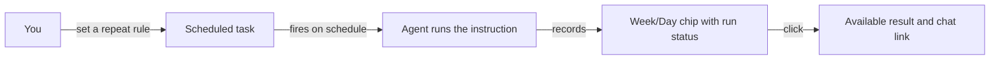

# Calendar and recurring work

The Calendar panel of a workspace is where everything that runs on a schedule lives: one-time runs, repeating series, and the outcome of each run. If work has to happen every Monday at 9:00, you set it up here.

## What it is

Every workspace has a Calendar panel, between Tasks and Library in the top bar. It opens beside Chat on **Week** by default. Choose **Day**, **Week**, or **Month** in its toolbar; Month stays inside the same panel, including the phone full-screen view. There is no Agenda view. Week and Day show scheduled runs as labelled chips at their fire times. Month is a compact day grid with up to three status-coloured dots per date. Dots do not open run details; switch to Week or Day to inspect a recorded run or edit its series. Clicking a Month date creates a new event.

In a narrow panel or on a phone, the toolbar controls wrap onto extra rows so the view choices, agent filter and **New task** button remain visible and easy to tap.

The Board and List hide scheduled tasks; use Calendar to manage scheduled and repeating work. The split keeps a repeating series separate from the task's last-run status: a run can be **Done** while future occurrences remain scheduled. Old web addresses still resolve: `/tasks` redirects to the Tasks panel and `/automations` redirects to the Calendar.

The calendar also records outcomes. In Week and Day, individual recurring-occurrence chips use the recorded run's status icon when a run exists (done, failed, skipped, or missed), or the scheduled or no-record state when it does not — no record means the run's history is unavailable (retention expired or the schedule changed), which is different from a run missed while Omnipus was down. One-time scheduled-task chips use a clock icon, with colour taken from the task's status. Clicking a recorded occurrence lets you inspect its status and, when available, its result and a link to the chat it ran in.

A repeat rule keeps firing on its own; use Week or Day to review recorded runs and how they went.

## When you would use it

- Standing work on a rhythm: a weekly report, a monthly invoice check, a daily scan.
- One run at a chosen future time, without putting a card on the board.
- Reviewing outcomes: did last night's run succeed, and what did it produce?
- Planning a week: filter the calendar to one agent and read only their commitments.

## How to schedule repeating work

1. Open the workspace and choose **Calendar** in the top bar or panels menu.
2. Click a day, or a time slot in Week or Day view. The New task button in the toolbar works too. A New event panel opens with the date filled in: a plain day click defaults to 9:00, a time slot takes that exact time.
3. Fill in the title and pick the agent who runs it. Write the instruction, which is what the agent does each time the task fires, and add at least one acceptance criterion and one Definition of Done item.
4. Open the Repeat dropdown. It offers presets computed from the date you picked: Does not repeat, Daily, Weekly on Monday, Monthly on the third Monday, Annually on July 20, Every weekday, and Custom.
5. Pick Custom for anything else. Choose the frequency, from minutes to years, and a multiplier from 1 to 99. Weekly rules take a weekday selection, monthly rules take a day of the month or an nth weekday. End the rule with Never, On date, or After N occurrences. A plain-English summary of the rule is shown at all times.
6. Save. Week and Day show individual scheduled occurrences as chips, subject to the server's expansion limits; **More not shown** warns when expansion was capped. Month represents the returned event data with status-coloured dots, including the server's per-day groupings of frequent repeats where they apply. The grid itself prints no rhythm or count labels; hovering a date lists its first three event titles and can show a "+N more" count.

Leaving Repeat on Does not repeat, with a time set, creates a one-time task that runs at that moment. The Board and List hide it; use Calendar to manage it.

## How to edit or stop a series

1. In Week or Day, click a chip of the series to open its editor. For a rule-based repeating series, **Upcoming** appears only when future occurrences have loaded. In Month, switch to Week or Day first; clicking a date creates a new event.
2. Change the title or the agent and save. The schedule stays untouched.
3. Change the repeat rule or date/time and save. This starts a fresh occurrence count. A rule-only change to an existing series anchors it at now; a date/time change uses the date/time you selected. The editor warns about restarting the count before you save.
4. To end a series, edit it and set the end to On date or After N occurrences.

You edit a series as a whole: you cannot change one occurrence alone or drag its chip to another day.

## Run a scheduled task now

**Run now** starts a scheduled task before its next time, or runs a past time again. It is `POST /api/v1/tasks/{id}/runs`. An empty body, or a body with no `occurrence_ms`, is the task-level action. A body with `occurrence_ms` names one scheduled time (milliseconds since 1970, UTC). A start that is accepted answers HTTP 202; the run itself begins after that answer.

The **armed** time is the next time the timer is actually set to fire for that task. The Calendar reads it from the server (`armed_occurrence_ms` on the occurrence list). It is not guessed from the repeat rule.

| Where you are | What you can press | What happens |
|---|---|---|
| A repeating chip at the armed time, even when that time is still in the future | **Run now** | That armed time runs now and is used up. It does not also fire when the clock reaches it. |
| A repeating chip for a past time | **Run now** | That past time runs again, as it did before. The armed future time is left alone. |
| Any other future time | Nothing | The button is hidden. A request that names that time is refused: "this time is not the task's next scheduled run, so it cannot be run now; refresh the calendar and try again". |
| A one-time chip | Opens the task panel; the button is **Run now**, not **Start Task** | Task-level Run now, with no `occurrence_ms`. |
| A day bucket whose day contains the armed time | **Run next armed occurrence** | The same task-level Run now. The day's run history is unchanged. If the armed time is on another day, the button is absent. |

On a task-level Run now, an armed time is used up. If nothing is armed, the task runs as an ordinary task. A task that still has a future schedule but whose timer registration is missing is refused: "this task's schedule is out of sync, so Run now cannot use it; save the schedule again, then retry".

Using an armed time early records that scheduled time, not the moment you pressed the button. The series continues from the next time after both "now" and that used-up time. A restart before the original clock time does not bring the used-up time back. If the gateway stops after Run now has been accepted and before the run actually starts, that time stays used up and is not replayed.

These requests are refused and do not start a second run:

| Situation | Message |
|---|---|
| An automatic run of this task is already queued and waiting for a free slot | "an automatic run of this task is already queued and will start shortly, so Run now did not start another run". That queued run still starts once. |
| The schedule changed while Run now was starting | "the task's schedule changed while Run now was starting, so nothing was run; refresh and try again". |
| The task is already running | "this task is already running". |
| Omnipus is shutting down | "Omnipus is shutting down, so the run was not started". |

A task with a schedule cannot be started by changing its status to **Next** or **In Progress**, and it cannot be restarted. Both are refused before anything is saved, with: "this task runs on a schedule, so it cannot be started by changing its status or restarting it; use Run now (POST /api/v1/tasks/{id}/runs) to run its next scheduled occurrence now". The status change answers HTTP 400. Restart (`POST /api/v1/tasks/{id}/restart`) answers HTTP 409. The task panel does not offer those two statuses, and if you try it says "A scheduled task starts with Run now, not a status change." A task with no schedule still starts with **Start Task** and can still be restarted. The Board and List still hide scheduled tasks, so their **Run** and **Restart** buttons are not the way to start one.

An agent's `run_task` uses the same Run now path. A repeating series whose last run is **Done** can still be run now. A finished one-time task cannot.

## Who is told when a run finishes

The agent assigned to the task, and the agent that started the run when one did, get the result in their main chat in that workspace. The message is the same for each of them. The header looks like `Task run done: "title" (run <id>)` — or `failed`, or `stopped` when a person stopped it — and the full result follows.

When an **agent** created the task, that creator gets one copy of the same message, in its main chat in the task's workspace, once that run has actually finished:

- A task a person created sends no creator copy, even if the person's name matches an agent id.
- If the creator is already the assignee or the agent that started the run, they get that one message, not a second copy.
- An agent who is not a member of the workspace the task belongs to gets no result message and no substitute status message.
- A skipped or missed time, where nothing ran, tells nobody.
- If that run recorded no recipient at all (no eligible main chat for the assignee, and no agent starter), the creator is not sent a copy either. The copy is added only alongside at least one recipient the run already had.
- If the creator's chat in that workspace cannot be resolved, the loss is written on the task's own conversation ("The completion notice for … could not be delivered") and nobody else is substituted in.
- If a late result loses to a Stop, the notice is the stopped outcome, once. A conflict while the task is not finished sends nothing.

## What you see on the calendar

Week and Day use labelled chips with the meanings below. Month represents the event data with status dots rather than these chip labels; when a task repeats more than three times in a day, the server groups that day into a single entry for the broader Month range, and the grid shows only its dot. A date's hover text lists up to three event titles and may include that day's grouping label. The toolbar also has an agent filter, set to All agents by default, which narrows the grid to one agent or to unassigned work the moment you pick a name.

| Chip in Week or Day | What it means |
|---|---|
| Recurring occurrence chip | One scheduled occurrence of a repeating task, at its fire time; the icon reflects its recorded run — done, failed, skipped, or a muted missed chip ("Omnipus was not running at this time; the run was skipped and will not be replayed.") — or its scheduled or no-record state |
| One-time chip | A one-time task's scheduled fire, shown with a clock icon and the task's status colour |
| More not shown | The server capped how many runs it expanded for that task; the days beyond the marker are not empty. This marker does not open run details |
| Due chip | A workspace task's deadline, including a task that also has a schedule, shown on its due date |

An agent heartbeat is separate from scheduled task work and does not appear on the calendar. See [agents](agents.md) to configure one.

## Limits and things to watch

- **Heartbeats, chat loops and scheduled tasks share one timer.** They are three kinds of job (`heartbeat`, `loop` and `task`) on one engine, stored in `cron/jobs.json` under the data directory. A settings reload does not stop that timer or rebuild it. Stopping the gateway stops it before Omnipus waits for work already running, so a new heartbeat, loop step or scheduled task does not start during shutdown. A job saved as any other kind, including an old `agent_turn` schedule from the removed schedules API, is dropped once at startup and named in the gateway log. Heartbeats are rebuilt from workspace settings, task schedules from the tasks, and an active chat loop from the chat's saved loop state (see [loops](loops.md)).
- **There is no fixed cap on how many scheduled runs start at once.** `schedules.max_concurrent_runs` is gone. An old copy of that key in `config.json` is ignored and dropped the next time the file is saved. While the machine has memory to spare, no configured number holds scheduled dispatches back. When memory is under pressure, or when it cannot be measured, at most two scheduled dispatches run at the same time and the rest wait. The wait is a gateway warning, `cron: scheduled run waiting for admission: memory limit reached`. A task run that has already been handed to its agent is not cut off when memory tightens; only the next dispatch waits. The retry gaps for a heartbeat (`schedules.retry_backoff_ms`, one minute, two minutes, then five minutes unless you set others) are read only when the gateway process starts. A settings reload keeps the gaps the process started with.
- **A scheduled run has no time limit.** It runs until the agent finishes or someone stops it. Older versions stopped a run after five minutes (`schedules.run_timeout_seconds`, or a per-schedule timeout); those settings are now ignored. Runs recorded with the status **timeout** by an older version keep that status in the history.
- **A failed task occurrence is not retried on a backoff.** The next scheduled time is the retry. A heartbeat that fails for a passing reason (the provider is briefly unreachable, for example) is tried again on the gaps above, then returns to its normal interval. A chat loop records the error and continues; see [loops](loops.md).
- Restarting or reloading the gateway does not add extra triggers for a scheduled task. If earlier starts left duplicate internal triggers, startup keeps one per task and logs each removed duplicate before the scheduler can fire. This cleanup does not change your task definitions or recorded task runs.
- A missed run is skipped, never replayed. If the server was down at the fire time, that occurrence is gone, and After N occurrences counts planned runs, not completed ones. The exception is a one-time run the server actually started and that a gateway crash, shutdown or restart then interrupted in the middle: the next gateway start runs that one again, once. A run you stopped yourself (the Stop button, the `/stop` command, or stopping the task) is not run again.
- After a gateway start, task work begins only once your agents are ready to take it. A scheduled run that comes due after Omnipus has checked its schedule for missed runs, a one-time run that is being run again after an interruption, and tasks in the **Next** column that start on their own wait for that moment. They can start a few seconds late, but each still runs exactly once.
- The first seconds of a start are the exception. Omnipus checks its schedule for missed runs early in the start, before it is ready to serve. A run that comes due between the moment the gateway is launched and that check is marked **missed**, the same as a run that came due while the server was down, and it is not run.
- If you change a task's schedule, or delete the task, while its run is still waiting at start-up, your change wins: the waiting run never happens. Any other edit, such as a new description, is used when the run starts.
- If a waiting run cannot start when your agents are ready, it is not lost silently:
  - If the task cannot be read at that moment, or the run fails to start for another reason, the run is kept. It is not tried again until the next gateway start, so until then the task simply stays where it was. To run it sooner, restart the gateway, or start the task yourself with the Calendar's **Run now**.
  - If the task's agent no longer exists, the task is marked failed and shows a failed run that names the missing agent. Give the task an existing agent and start it again. If the failed result cannot be saved, the run is kept for the next gateway start instead.
  - If the task was deleted while its run was waiting, the run is dropped.
  - Each of these cases is recorded as a warning in the audit log, with the task and a short reason, such as `task_unreadable`, `dispatch_failed`, `agent_missing` or `task_deleted`. The full error is in the gateway log.
- A fire that came due while the server was down is marked **missed** on the Calendar (in the occurrence's chip status), so the gap is visible instead of silent. One record per missed instant, at most the 20 most recent per task per boot; the run itself is never replayed. A one-time task's missed fire shows on the task's run history (the Calendar grid renders recurring schedules).
- A failed run does not stop the series. The next occurrence fires anyway; the failure is shown on its Week/Day chip.
- The fastest repeat is once a minute.
- Monthly on day 29, 30, or 31 lands on the last day of shorter months, so nothing is skipped in February.
- Times hold their wall-clock position across daylight-saving changes. New rules use your browser's time zone.
- Tasks created before this editor existed, or through agent tools, can carry an old internal schedule format. They keep firing and appear on the calendar; opening one shows an old-schedule note with its next run and a fresh repeat picker. Saving a new rule replaces the old schedule, and the fire times may shift.
- A task an agent schedules with `create_task` or `update_task` follows the same Calendar rules. An agent stops its schedule by setting the task's trigger to manual; see [tasks an agent creates or changes](tasks.md#tasks-an-agent-creates-or-changes).
- No schedule syntax is ever shown or typed anywhere in the product. You always work with the repeat picker and its plain-English summary.

## Related pages

- [workspaces](workspaces.md) — what a workspace is; the Calendar is one of its panels.
- [tasks](tasks.md) — unscheduled work on the board, and how it differs from scheduled work.
- [agents](agents.md) — the agents you can assign scheduled work and heartbeats to.
- [goals](goals.md) — ongoing outcomes that outlive any one recurring task.
