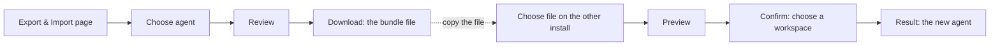

# Export & Import

Move one of your own agents to another Omnipus you run yourself. **Export** saves the agent as a **bundle**, one file ending in `.omnpkg`. **Import** adds the agent from a bundle as a **new** agent in a workspace you choose. Nothing that already exists is changed.

The page is in the sidebar under **Assets → Export & Import**. It is available in the self-hosted edition only. In any other edition, and while the app has not yet learned which edition it runs, the sidebar entry is hidden and the page says "Export & Import is not available in this edition."

The command line does the same with the same bundle file: see [How to move an agent to another install](using-omnipus-cli.md#how-to-move-an-agent-to-another-install). What travels inside the file, and what changes on the way in, is on [Agents](agents.md#how-to-move-an-agent-to-another-install).

## How to export an agent

1. Open **Export & Import** and select **Start export**.
2. **Choose agent.** The list holds only your own agents, sorted by name, each with its kind (Main, Worker or External worker) and description. Type in the filter field to narrow the list. Built-in agents (Omnipus, Mia, Jim, the shipped workers and the internal agents) are on every install and are not listed. Two agents with the same name both appear; the first eight characters of each agent's id tell them apart. A bundle holds one agent in this version.
3. Select **Review**. Omnipus checks the agent and prepares the review. If the agent cannot be exported (for example it has no prompt, or a file of it cannot be read safely), the reason is shown above **Review** and you stay on this step.
4. **Review** shows what goes into the bundle, as Omnipus measured it:
   - the agent's name and kind;
   - each file with a plain label and its size: Settings (`agent.json`), Prompt (`SOUL.md`), Instructions (`AGENT.md`);
   - the bundle size ("About 3.6 KB");
   - **Left out**: memory, chats, workspace files, team membership and delegation lines, skills and connector settings, each with the reason;
   - **Enter again after import**: names of secrets the agent needs, such as an external worker's environment overrides (names only, never values);
   - a warning that text you wrote is copied exactly as it is;
   - the fixed statement of what is never included.
5. Select **Download**. Omnipus checks that the review is still held, creates the bundle and your browser saves it. The step shows "Saved Writer.omnpkg (3.1 KB)." **Download again** saves the same file again without asking Omnipus. **Export another** starts over; **Done** returns to the page.

**Quick Export.** In an agent's edit sheet (open the agent's card on the workspace **Team**, then **Edit**), the **Export** button next to the agent's badges closes the sheet and opens the export with that agent already chosen. Built-in agents have no Export button.

### What is never included

"Never included: passwords, API keys and tokens stored in Omnipus, provider keys, channel tokens, this install's settings file, and an external worker's program path, environment values and extra arguments."

**Text you wrote travels as it is.** The prompt and the instructions are copied exactly. If you pasted a password or key into them, it goes with the bundle. Check them before you share the file.

**Names travel, settings do not.** Skill names and connector names travel inside the agent's settings. Connector settings and secrets do not, and the agent's connector assignments are not restored on import: assign connectors again after import. On the other install, a skill with the same name is used if it is installed there.

## How to import an agent

1. Open **Export & Import** and select **Start import**.
2. **Choose file.** Select **Choose a bundle file** and pick a file that ends in `.omnpkg`. A file over 64 MB is refused in the browser and never sent. Omnipus checks the bundle ("Checking the bundle…"). If it is refused, the reason is shown and you stay on this step.
3. **Preview** shows:
   - **Will be added**: the agent and the name it will get. When an agent with that name already exists, the new one is renamed, for example "Writer → Writer (imported)", with the note "renamed: an agent with this name exists; it is not changed";
   - **Skipped**: parts of the bundle this version does not import;
   - **Warnings** in plain words, for example skills this install does not have;
   - **Enter again after import**: secret names to type again;
   - "Can be imported until" a time 30 minutes after the upload.
4. Select **Continue**. **Confirm** says "Added as new. Existing agents are never changed." Choose the workspace. The default workspace is chosen for you when there is one. With no active workspace the step says "Create a workspace first." and offers no Import.
5. Select **Import**. The **Result** says, for example, "Writer (imported) was added to Marketing." with any warnings and secrets to enter again. **Open Team** opens the workspace's Team. **Open chat** appears only for a Main agent that is active. **Import another** starts over.

**Activation pending.** If Omnipus saved the agent but could not yet confirm it is running, the result shows the activation message and no chat link. The agent is complete and stored. Wait, or restart Omnipus, before you chat with it. Do not import the file again.

**Open it from the Team.** If the app cannot look up the new agent's kind, the result stays and says "Open it from the Team."

## Cancel

**Cancel** on Preview or Confirm, before you select Import, sends one cancel for the upload. Leaving the wizard before you select Import sends that one cancel silently. The answer to the cancel decides what you see:

- The cancel ran: you return to the page.

- The cancel ran but the temporary files could not be removed: you return to the page, which says "The upload was cancelled. Omnipus will try to remove its temporary files at a later upload."
- Any other answer, or no answer, proves nothing. The page says "Omnipus could not confirm what happened to this upload. It may have been imported, for example from another tab. Check the workspace Team before importing again." Check the Team of the workspace you chose before you import the file again.
- "Your session needed refreshing. Select Cancel again." means the cancel did not run. Select **Cancel** again.

After you select Import, the wizard sends no cancel. If the import's outcome is unknown, check the Team of the workspace you chose.

## When the connection drops

The app never sends an import, an upload, a cancel or a download a second time by itself.

- **"The connection dropped before Omnipus answered. The import may have finished: check the workspace Team before importing again."** The import may or may not have happened. Open the Team of the workspace you chose. If the agent is there, the import finished. Only if it is not there, select **Start over** and import the file again.
- **"Your session needed refreshing. Nothing was imported. Select Import again."** The request was refused before anything happened. Selecting **Import** again is safe. The same applies to "…Nothing was downloaded. Select Download again." and "…Choose the file again."
- **"Omnipus did not confirm the upload. Choose the file again."** The upload may have arrived but cannot be used. Choose the file again.

## Reloading the page

The wizard keeps a small note in this browser tab (never the bundle, a password or secret names) so that a reload can tell what happened:

- Reload on Preview or Confirm before you selected Import: the wizard sends one cancel attempt for the upload, and its answer decides the screen. If the cancel ran, the page asks you to choose the file again ("The page was reloaded. Choose the file again."). Any other answer, or no answer, shows "Omnipus could not confirm what happened to this upload…": check the Team before importing again.
- Reload, Back or Forward after you selected Import, while the answer is still awaited or unknown: no cancel is sent and Import is not sent again; the page says the import may have finished. Check the Team of the workspace you chose.
- Reload on the Result when this tab stored the completed import: the summary is shown again under "Import finished".
- A Result address without this tab's note (for example opened in another tab): the export and import page is shown.
- Reload on Review: the review is read again from Omnipus. A review older than 30 minutes, or one lost when Omnipus restarted, returns you to Choose with "The review expired. Check your choice and review again."

## How long an upload is kept

An upload can be imported for 30 minutes. Its temporary files stay on disk until a later upload's clean-up, or a cancel, removes them. Removal is an attempt and can keep failing while a disk problem lasts. There is no timed and no start-up removal in this version.

## Limits

| Limit | Value |
|---|---|
| Agents per bundle | One |
| Import mode | Add as new only; nothing existing is changed |
| Bundle size | 64 MB (256 MB unpacked) |
| Review valid for | 30 minutes |
| Upload can be imported for | 30 minutes |
| Uploads waiting at once | Five |
| Bundles from a newer Omnipus | Refused: update this install first |
| Prompt and instructions on export | 1 MB each; the agent's settings record is not size-limited on export |
| Edition | Self-hosted only |

## Troubleshooting

| You see | What it means | What to do |
|---|---|---|
| This agent has no prompt, so it cannot be exported. | The agent's prompt is empty. | Write a prompt in the agent's edit sheet, then export. |
| A file of this agent could not be read safely (SOUL.md). It is over 1 MB. | The prompt or instructions file is too large or not a plain file. | Shorten or fix the file. |
| This agent no longer exists. | The agent was deleted after the review. | Select **Back to review** and choose another agent. |
| The export was stopped because the audit log could not be written. Nothing was downloaded. | Omnipus could not record the export. | Check the disk and the audit log, then export again. |
| This file is not an Omnipus bundle. | The file is not a bundle. | Choose the `.omnpkg` file you exported. |
| This bundle was made by a newer Omnipus. Update this install to import it. | The bundle format is newer than this install. | Update Omnipus. |
| This bundle is damaged: a file does not match its record. Export it again. | The file changed after export. | Export it again on the first install. |
| This bundle is too large for this version (most is 64 MB, 256 MB unpacked). | The file is over the limit. | — |
| Too many imports are waiting. Each one expires 30 minutes after upload; finish or cancel one, then try again. | Five uploads are waiting. | Finish or cancel one, or wait. |
| This upload expired or was already used. Choose the file again. | More than 30 minutes passed, or the upload was imported or cancelled. | Choose the file again. |
| Another import is running. Try again in a moment. | One import runs at a time. | Select **Try again**. |
| That workspace no longer exists. Choose another. | The chosen workspace was removed. | Choose another workspace. |
| Every "(imported N)" name is taken. Rename one of the existing agents, then try again. | All rename suffixes are used. | Rename an existing agent. |
| The import failed and was undone. Nothing was added. | Omnipus undid the import. | Select **Start over**. |
| The import failed and could not be fully undone. Restart Omnipus to finish the clean-up. | The undo did not finish. | Restart Omnipus. |
