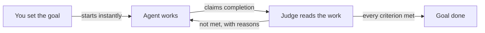

# Goals

A goal is a piece of work with its own definition of done. You state it, work starts in the same turn, and a separate Judge agent reads the work and decides when it is finished.

## What it is

A goal is its own thing, separate from a task and from the chat it arrived in. It owns a record: a restated statement of what you want, acceptance criteria ("Done when"), and a Definition of Done — standing quality checks for any piece of work. The Judge holds the work against that record.

Goals come from two places:

- **Chat.** Type `/goal` and what you want. The goal activates and work starts in the same turn. No form, nothing to confirm.
- **Tasks.** Every task on the Board carries a goal: the task form's required **Goal** field, criteria and Definition of Done become the record when the task runs. See [tasks](tasks.md).

An agent can also start a goal itself with `set_goal`; it then appears like any goal.

From there the two are one machine: same loop, same claim, same Judge. Only visibility differs.

The working agent writes the goal record itself, as its opening move, and shows it in the chat as working assumptions. You do not approve them; if they are wrong you say so, and the agent updates the record and shows what changed. If the agent is unsure it understands you, it asks — one round of questions per goal. On the web app that is a question card; on a connector, a plain question in chat.

When the working agent believes it is done, it claims completion. Only then does the Judge run — after the answer reaches you, so you never wait on a verdict.

### The Judge, in plain language

The Judge is its own agent, under **System** on the Agents screen. You do not chat with it and cannot delegate to it. Its tools are read-only — open files, list folders, search files, read session records — and it cannot write, run commands or go online. During a review it reads only the workspace under review and the folders mounted into it; anything outside them is refused. Only its model and its written instructions are yours to change.

It reads work like a human reviewer: opens the artifact a criterion names, looks at what the agent did, forms a view. A criterion is met when the Judge is persuaded — never because a machine check passed. Each criterion gets its own verdict, met or unmet, with a reason.

One consequence is deliberate: unproven is not done. A criterion the Judge could not verify counts as unmet, even if the work was finished. The reason names the missing evidence.

## When you would use it

- Work you want verified, not only attempted. The agent keeps working until the Judge is satisfied or the try budget runs out.
- Work you want to walk away from. A quiet agent is nudged back to work; a verdict that lands later waits for you.

For a quick answer, plain chat is the right tool. A goal adds verification, and it spends tries to get it.

## How to set and steer a goal

1. In a workspace chat, type `/goal` followed by what you want, for example `/goal build a game portal with tetris and snake`.
2. Press Enter. The goal activates and the reply starts streaming in the same turn; a pill labelled **active** appears bottom-right.
3. Watch for the goal card early in the run: the restated goal, with criteria and the Definition of Done behind collapsed headings such as "Done when · 3 criteria".
4. Answer the question card if one appears.
5. To change direction, send a normal message such as "make it dark-themed only". The agent updates the record and shows what changed. Nothing asks you to confirm.
6. To restate the goal outright, type `/goal` with the new wording; the new intent replaces the working prompt.
7. To check on progress, type `/goal` alone (or `/goal status`) for elapsed time, tries used, the latest Judge reason and the record.
8. To stop it, type `/goal clear`; the words `stop`, `off`, `reset`, `cancel` and `none` do the same.

A goal runs as a loop:

The agent works, claims completion, and the Judge either ends the goal or sends the agent back with the list of what is missing.

## What you see while a goal runs

Each goal shows as a labelled pill at the bottom-right of the chat:

| Pill | What it means | What you can do |
|---|---|---|
| active | Work is under way | Steer by chatting |
| waiting on you | Paused, waiting for you | Reply in chat |
| judge unavailable | Judging is paused because the Judge cannot run | Wait for the Judge to become available; if it still cannot run, you get a **Not verified** conclusion (see below) |
| re-planning | A plan needs your correction before work continues | Review the request and reply |
| judging | The Judge is reading the work | Wait |
| verifying elsewhere | Another judgment of the same work is already running | Wait for that verdict |
| blocked | Something stands in the way | Remove the obstacle |
| claim overturned | The agent said done; the Judge disagreed | Read the reasons |
| done | Every criterion was judged met | Read the verdict |
| failed | Tries ran out with work unmet | Restate or raise the budget |
| cleared | You stopped it | Restart if needed |
| expired | Quiet for seven days with nothing running — a goal whose agent or helper is still working never expires | Restart it |

### Automatic reminders

When an automatic reminder starts another work turn for a goal in your own chat—not a helper or task run—the web app shows **Goal reminder: continuing work toward the goal** as a system event line, not a message from you. The line is saved in that chat's history and remains after you reload it.

There is no lifetime limit on reminders. Instead, Omnipus counts consecutive reminder turns that **finish without progress**. Sending a reminder does not itself use up one of these outcomes, and a turn that is still running is not counted as finished. Progress resets the count to zero.

| Counts as progress | Does not count by itself |
|---|---|
| New goal evidence; a goal-scoped file change; an executed tool call other than `set_todos` or a claim-only `goal_claim` call; activity in a delegated helper; output or completion from background work owned by the goal session | A text-only answer, a prose completion claim, a claim-only message, or a turn that only updates `set_todos` |

After **five consecutive completed reminders without progress**, automatic reminders pause. The chat shows this system line:

> No progress after 5 reminders — goal paused. Reply to continue.

Send a normal reply to resume the goal and reset that count. This is a pause, not a failed or ended goal. The same rule applies before and after the agent writes its working goal record; there is no separate two-nudge fallback.

Omnipus does not send another reminder or advance this count while the goal session's background commands, dispatched tasks or plans, or delegated helpers are still working. Their output or completion counts as progress. A Stop, an unanswered question or a blocked claim also holds automatic reminders; an ended goal receives none.

## What controls a goal

These numbers shape a goal's life:

| Control | Value | Where it lives |
|---|---|---|
| Tries per goal | 20 by default | Settings, Performance, "Goal completion budget" |
| Task attempts | 3 by default | On the task |
| Question rounds | 1 per goal | Fixed |
| Automatic-reminder pause | 5 consecutive completed reminders without progress; no lifetime reminder limit | Fixed |
| Idle expiry | 7 days, never while work is running | Server setting |
| Active chat goals | 16 at a time | Server setting; tasks count separately |

A goal ends one of four ways — met, tries exhausted, expired, cleared by you — and the record is kept in each: what was wanted, and how it was judged, stays readable.

## Limits and things to watch

- The try budget is global. One setting covers chat goals and task goals alike; there is no per-goal override. A running goal keeps the limit it started with.
- On a task, tries bound the work inside one run; attempts bound how many runs the task gets. The task card shows both, for example "attempt 1 of 3 · try 5 of 20".
- Unproven counts as unmet. Finished work can be sent back when the Judge could not verify it; the reason names the evidence that was missing.
- Verdict speed follows the Judge's model — a fast one keeps verdicts quick.
- If the Judge's model is not offered by its named provider, or its named connection cannot be set up, the check reports the provider/model and the settings to fix rather than backing off and repeating the unchanged configuration. This also stops the helper's outer check loop after one adjudication, without a retry wait. An expired provider sign-in likewise needs an operator fix, not another unchanged check. Correct the Judge agent's model/provider pair, its provider's API key and endpoint settings, or sign in again as directed before checking again.
- The work itself has no wall-clock lifetime limit. The Judge's verification turn does: `judge.timeout_sec`, 420 seconds by default and at most 900. When that limit ends the verification turn, the message names the Judge's own check time limit, not a model provider failure.
- If checking is abandoned because the Judge is unavailable, chat, helper, task and plan paths produce **Not verified — the check could not complete**, with the reason and the worker's claimed result labelled **The work result, unverified:**. The embedded result is limited to 8,000 bytes; longer results end with **[truncated]**. Do not treat that conclusion as a complete copy of a long result.
  - In a chat goal, the conclusion is added to the chat and the goal stays active, so the agent can claim completion again later.
  - For a helper working on a goal, its parent agent receives one final conclusion with the helper's claimed result, not a generic provider-error replacement, and the parent chat shows **Not verified — the check could not complete** as a lasting line. A permanent configuration refusal includes the corrective action above. The helper is marked failed, while its goal stays active with no try used. Temporary Judge outages still receive the bounded retries before the final conclusion.
  - For a task, an unavailable-Judge exit ends the task **Failed**, with the conclusion in its result text and no attempt used. Re-run it after fixing the Judge or once it is available.
  - For a plan, the plan's handover carries the same **Not verified — the check could not complete** conclusion with the members' results, and the engine retries the round or parks the plan for a correction. See [Plans](plans.md).
- For a helper working on a goal, the parent chat shows the Judge's conclusion as a lasting row: **Goal met** when the goal ends met, a not-met-yet notice when the helper continues, or **Not verified — the check could not complete** when the check cannot finish. The helper keeps its own existing outcome/check entry. An unmet continuing round and a Not verified conclusion do not become a Goal met card; the goal stays active. One ending starts at most one parent turn, with the verdict condition, Judge reason and hand-back retained together. A Stop or an unanswered question can hold that turn without losing the report.
- An unverified criterion is different from an unavailable Judge. A review that ran but still could not verify a criterion can produce an **unmet** verdict, including after repeated failures following real review progress. That can consume a goal try, send the worker back to work, and eventually consume a task attempt if the run fails. Storage or delivery failures are reported separately; a helper conclusion is not routed to a guessed parent when its saved records cannot be read or do not agree about its parent.
- For an interactive chat goal, a detected failure to save the conclusion in the chat transcript or goal record, resolve the saved chat route, or queue the conclusion for that route produces a separate notice. A helper whose records cannot establish a safe audience uses the same notice: **Omnipus could not fully save or deliver the Judge's conclusion. Check disk space, file permissions and the chat's channel connection, then reload the chat. Open Verbose chat for details.** The notice is not a verdict on the work. It does not end the goal, use a try, or stop a reply that is still running. It is not a guarantee that every later connector-send failure or every plan/helper storage failure is reported this way. Reloading does not itself retry conclusion delivery.
- Ending a goal never erases it, but goal records are swept by the same retention rule as sessions. Keep what you need somewhere durable.

## Related pages

- [tasks](tasks.md) — the visible Board card; its run is judged by this machinery.
- [plans](plans.md) — chains tasks together toward a larger outcome.
- [agents](agents.md) — the roster, plus the System section where the Judge lives.
- [workspaces](workspaces.md) — where chats, boards and goals are scoped.
- [tools](tools.md) — what agents can do while they work toward a goal.
