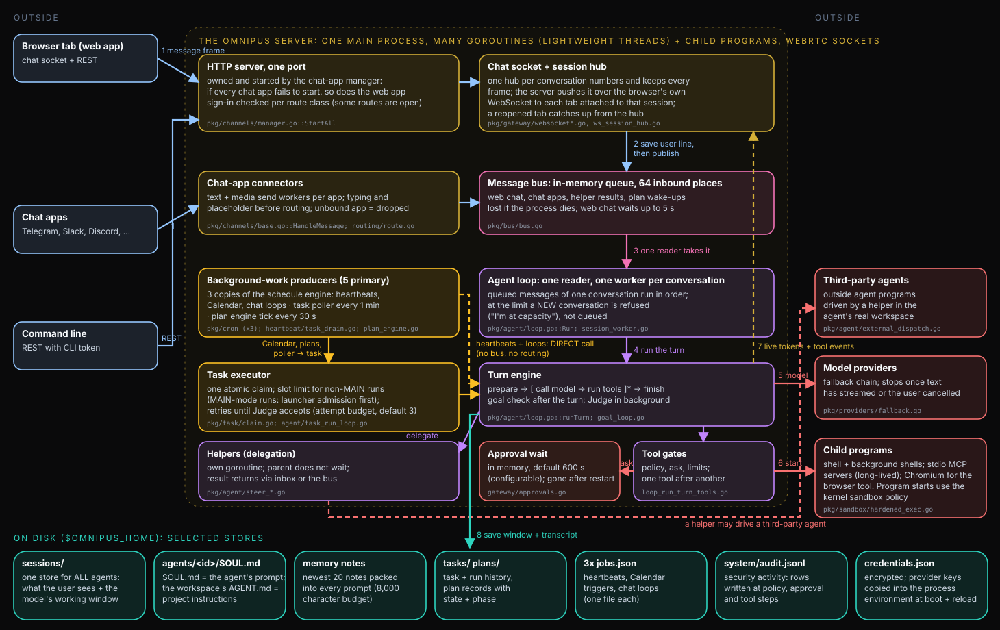
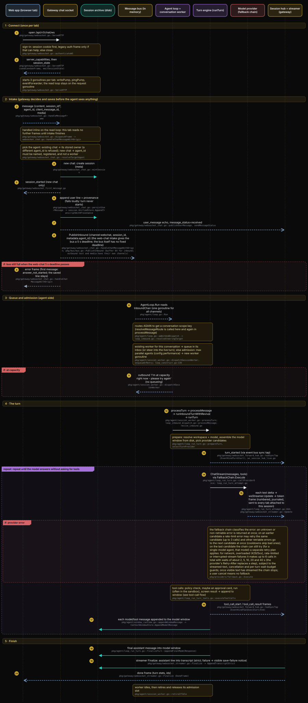
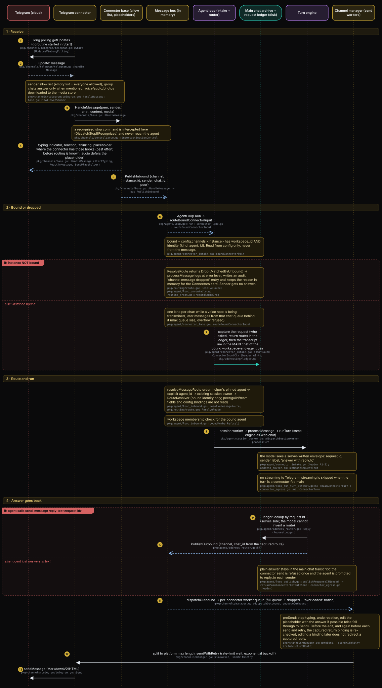
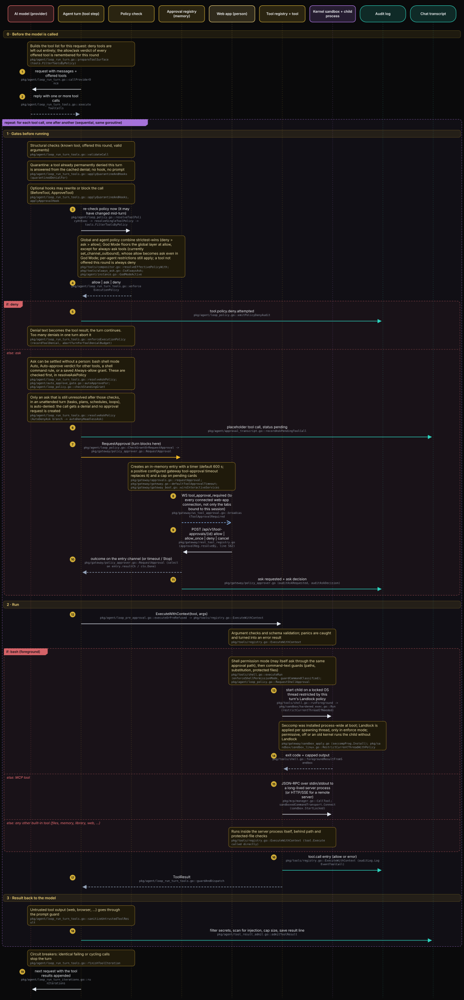
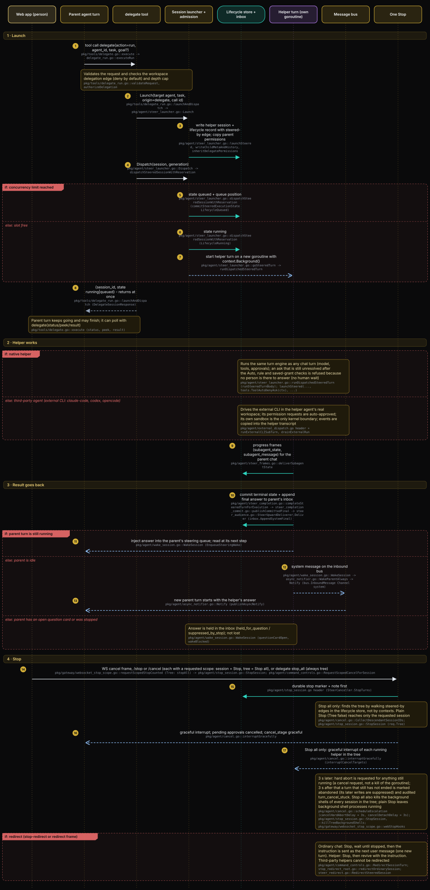
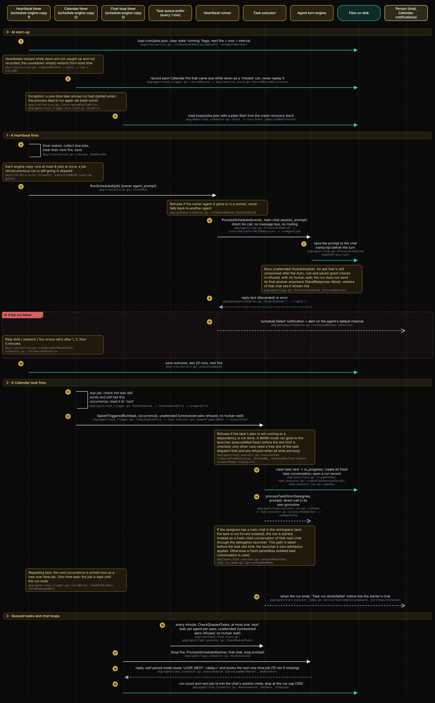
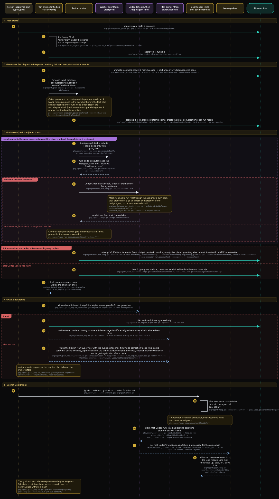
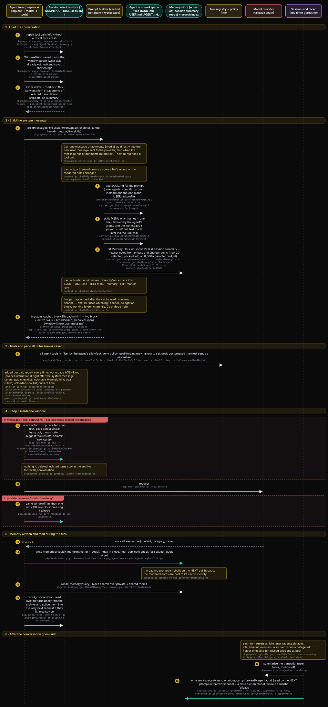
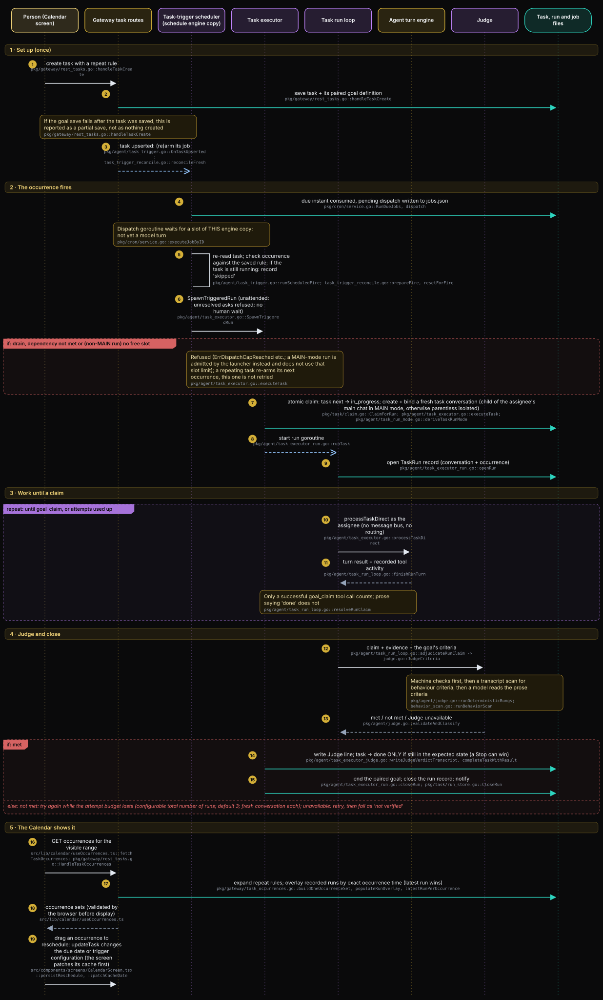

# Omnipus — As-Is Architecture

| | |
|---|---|
| Status | Formal current-state document of the Omnipus runtime |
| Code described | `release/v0.1.1 @ 6fbf4b43c` |
| Date | 2026-11-25 |
| Owner | Chief Architect |
| Rule | The code wins. Where this document and the code disagree, the code is right and this document must be corrected. |

## Bottom line

Omnipus is one main Go server process (plus child programs such as the browser and tool servers). Work enters through one HTTP port (web chat, REST, chat-app webhooks) or starts on its own from one of five primary work producers (three copies of the schedule engine, the task poller and the plan engine tick). Chat messages wait in a 64-place in-memory queue; each conversation gets its own worker, which takes the ordinary queued messages of that conversation one at a time; scheduled runs, task runs and helper launches enter through their own admission paths. A turn builds the prompt, calls the model, and runs the tools it asks for one after another through policy, approval and sandbox gates. Most state is saved under one data folder as JSON or JSONL files; the credential store is encrypted, some indexes are databases, and queues and approvals live only in memory (see "Where data lives"). This document shows that picture once, then 9 flows traced step by step in the code (171 calls, each with its source reference), each with what is saved, what happens on failure, and the key facts that are easy to get wrong.

## Contents

1. [The server while it runs](#the-server-while-it-runs)
2. [Flow 1: Web chat message to answer](#flow-1)
3. [Flow 2: Chat-app message to answer](#flow-2)
4. [Flow 3: One tool call](#flow-3)
5. [Flow 4: Helpers and Stop](#flow-4)
6. [Flow 5: Work that starts on its own](#flow-5)
7. [Flow 6: Plans, tasks and goals](#flow-6)
8. [Flow 7: Start-up and restart](#flow-7)
9. [Flow 8: What the model is sent](#flow-8)
10. [Flow 9: A Calendar task, end to end](#flow-9)
- [Restart: what resumes and what stops](#restart-what-resumes-and-what-stops)
- [Where data lives](#where-data-lives)
- [Sign-in and who may do what](#sign-in-and-who-may-do-what)
- [Wire contracts: REST and WebSocket](#wire-contracts-rest-and-websocket)
- [Secrets and keys](#secrets-and-keys)
- [Audit](#audit)
- [Tools: from registration to execution](#tools-from-registration-to-execution)
- [MCP servers](#mcp-servers)
- [Skills](#skills)
- [Browser](#browser)
- [Knowledge base, Library and media](#knowledge-base-library-and-media)
- [Chat apps (connectors) in general](#chat-apps-connectors-in-general)
- [Configuration and agent records](#configuration-and-agent-records)
- [Chat history and reconnect](#chat-history-and-reconnect)
- [Build and packaging](#build-and-packaging)
- [Concurrency: what runs at the same time](#concurrency-what-runs-at-the-same-time)
- [Scope](#scope)
- [Open points found while tracing](#open-points)
- [Method and evidence](#method)
- [Keeping this document current](#maintenance)

## The server while it runs

One program. Work comes in through one HTTP port or starts from one of five primary work producers. Chat messages wait in a 64-place in-memory queue; each conversation gets its own worker for ordinary queued messages; other entry paths have their own admission. A turn calls the model and runs tools one after another. Selected state is saved on disk (see "Where data lives").

Numbers 1–8 follow one web chat message. Amber = work that starts on its own; it skips the queue and the agent-picking step. Red = outside the server or able to block. Teal = files on disk.

**How to read a flow diagram:** lanes are the parts that act; time runs downward. Solid arrow = a call that waits for its answer; dashed blue = handed over without waiting (a queue or a frame); grey dashed = an answer coming back; teal = written to disk; gold box = what happens inside a part; purple frame = repeats; red frame = only if the condition holds. Each step shows its source file and function; an amber "not verified" badge marks a step that was inferred, not opened in the code.

## Flow 1: Web chat message to answer

**A message typed in the web chat becomes an answer**

The browser sends one "message" frame over the chat WebSocket. The gateway, not the agent, checks who the chat belongs to, saves the user's line to disk, and only then drops the message on the in-memory message bus. The agent loop picks it up, hands it to the one worker that owns this conversation (so queued messages of one chat are taken one at a time through this worker), and runs the turn engine: build the prompt, call the model, run tools, repeat. Every text fragment the model streams goes through a per-conversation "session hub" that numbers it, keeps it in memory and sends it over the WebSocket the browser opened to every tab attached to that session; the gateway's streamer writes the final answer to disk when the turn ends (narration the agent already saved during a tool round is not saved twice). If the tab closes, the turn keeps running; a reopened tab catches up from the hub (or from disk after a restart). Code at 6fbf4b43c; all refs relative to the repo root.

_20 calls; 0 step(s) not verified in the code._

### What is saved, where, when

| What | Where | When | Code |
|---|---|---|---|
| session meta (owner agent, type) | $OMNIPUS_HOME/sessions/<id>/meta.json | new chat, at intake, before the bus | `pkg/gateway/websocket_chat.go::mintSession` |
| user line + provenance | sessions/<id>/transcript.jsonl (today's file; earlier days roll to <YYYY-MM-DD>.jsonl) | at intake, before the bus | `pkg/gateway/websocket_chat.go::persistUserMessage; pkg/session/transcript_partition.go` |
| model window (what the model is sent) + cursor | same day-partitioned archive; cursor in backend_meta.json | per model/tool message during the turn | `pkg/agent/window_runtime.go::appendWindowMessage; pkg/session/archive_backend.go:64` |
| assistant line (what the user sees) | sessions/<id>/transcript.jsonl | at turn end, written by the gateway streamer (narration saved earlier during a tool round is recognised and not duplicated; text streamed but not yet saved is lost on a crash) | `pkg/gateway/websocket_streamer.go::Finalize` |
| token / tool frames | memory only: per-session hub journal + active-turn projection | live | `pkg/gateway/ws_session_hub.go (header)` |

### When it goes wrong

| Case | What happens | Code |
|---|---|---|
| browser tab closes mid-turn | turn keeps running; frames keep going into the hub journal; the reopened tab sends attach_session and gets the missing frames (incremental) or a snapshot (projection + transcript). A tab too far behind is closed with code 4008 and reconnects. | `pkg/gateway/websocket.go::ServeHTTP (deferred cleanup cancels nothing); ws_session_hub.go; websocket_replay.go::handleAttachSession` |
| provider fails | the chain classifies the error: unknown or non-retriable errors end the turn at once; on an earlier candidate rate-limit errors may retry the same candidate and other retriable errors move to the next candidate (cooldowns can skip candidates); on the last candidate still available the retry plan makes up to 6 calls in total for eligible causes; text already streamed ends the chain; a user cancel stops it | `pkg/providers/fallback.go::Execute` |
| gateway restarts mid-turn | the in-memory bus queue, hub journal and partial streamed text are lost; the user line is already on disk; streamed text that was not yet saved is lost (Finalize did not run), while narration already saved during an earlier tool round remains. At boot an ordinary conversation that was running gets a 'restart' Stop and the turn is not re-run (see Restart section); a new hub boot id forces every tab onto a snapshot from disk. | `pkg/bus/bus.go (Go channels); pkg/agent/boot_ordinary_recovery.go::recoverOrdinaryRoot; ws_session_hub.go::newHubBootID` |
| too many conversations at once | refused with a chat reply, not queued | `pkg/agent/session_worker.go::dispatchSessionWorker` |
| transcript write fails at intake | error frame; the turn never starts | `pkg/gateway/websocket_chat.go::persistUserMessage` |

### Key facts

| Fact | Code |
|---|---|
| The agent is chosen in two packages: the gateway resolves and enforces the owner before saving, then the agent loop resolves again, twice (worker key, then the turn). | `pkg/gateway/websocket_chat.go::resolveTargetAgent; pkg/agent/loop_inbound.go::resolveSteeringTarget; loop_inbound_dispatch.go` |
| finalizeTurn writes the model window only. The transcript the user sees is written by the gateway: the user line at intake (persistUserMessage), the answer by wsStreamer.Finalize. More than 20 files in pkg/agent also append transcript entries (notices, goals, cancel). | `pkg/agent/loop_run_turn.go::finalizeTurn; pkg/gateway/websocket_streamer.go::Finalize; grep -l AppendTranscript pkg/agent/*.go` |
| A per-conversation hub numbers, journals and sends every frame once, to the tabs attached to that session. It is what makes reconnect and catch-up work, and it is in memory only. The browser opens the HTTP and WebSocket connections; the server then pushes tokens, tool events and approval cards over the WebSocket that is already open. | `pkg/gateway/ws_session_hub.go::publishMeta, ::bind; websocket_forward_hub.go` |
| Admission counts conversation workers. At the cap a new conversation is refused with a chat reply, not queued. Messages for an existing conversation queue in that worker's inbox. | `pkg/agent/session_worker.go::dispatchSessionWorker` |
| Streaming reaches only the web chat in practice; bound connectors in a main chat never stream and never receive the plain answer (see flow 2). | `pkg/agent/loop_run_turn_attempt.go:67 (mainConnectorTurn guard); connector_egress.go` |
| The channel manager (pkg/channels) owns and binds the single HTTP server; the gateway registers routes on it. | `pkg/channels/manager.go:1283 (net.Listen), SetupHTTPServer manager.go:1004` |
| Two audiences: chat frames go only to connections bound to that session; tool-approval cards are sent to every connected web app (single-account model). | `pkg/gateway/ws_session_hub.go::publishMeta; pkg/gateway/ws_tool_approval.go::broadcastToolApprovalRequired` |
| One worker per conversation serialises the ordinary queued path only. Scheduled runs, task runs and helper launches enter the agent through their own admission paths (see the scheduled-work and delegation flows). | `pkg/agent/session_worker.go::enqueueOrRetry; pkg/agent/scheduled_execution_admission.go::runScheduledTurnWithAdmission` |

## Flow 2: Chat-app message to answer

**A Telegram message reaches an agent and gets an answer**

Telegram is polled by the Telegram connector inside the Omnipus process. A message from an allowed sender gets a typing indicator, a reaction and a "thinking" placeholder where the connector supports them (best effort; audio defers the placeholder), then goes onto the same in-memory message bus the web chat uses. Only a connector instance that the owner has bound to a workspace and an agent is routed; an unbound one is dropped, logged and audited (the old peer/guild/team binding table is no longer read). A bound connector's messages all land in the MAIN chat of its bound workspace-and-agent pair as numbered "requests". The agent's plain answer is NOT sent back to Telegram: the agent must call send_message with reply_to=<request id>, and that reply goes out through the bus and the connector's send worker, which edits the placeholder or sends new messages. Code at 6fbf4b43c.

_13 calls; 0 step(s) not verified in the code._

### What is saved, where, when

| What | Where | When | Code |
|---|---|---|---|
| connector binding (workspace + agent identity), allow list | config.json channels.<instance> | set by PUT /api/v1/channels/{id}/routing | `pkg/agent/connector_intake.go::boundConnectorPair` |
| request capture (sender, return route) | sessions/<main id>/requests.jsonl | before the transcript line; discarded if that append fails | `pkg/addressing/ledger.go; connector_intake.go header A1-4` |
| user line (raw text) and answers | the MAIN chat archive of the bound workspace-and-agent pair (main session id is built from that pair; all chats of one bound instance share it) | at intake / during the turn | `connector_intake.go header A1-6; pkg/session/main_session.go::MainSessionID; pkg/agent/connector_intake.go::admitBoundConnectorInputCtx` |
| drop reasons | memory only | on drop | `pkg/agent/routing_drops.go` |

### When it goes wrong

| Case | What happens | Code |
|---|---|---|
| instance not bound | message dropped (typing, reaction and placeholder hooks run first where the connector has them, best effort, so the sender may have seen them); error log + audit entry + reason on the Connectors card | `pkg/channels/base.go::HandleMessage order; pkg/routing/route.go::ResolveRoute` |
| agent forgets reply_to | nothing reaches Telegram; one automatic prompt asks the agent to answer each sender | `pkg/agent/connector_egress.go` |
| Telegram send fails | retries with backoff; permanent errors (not running, send failed) stop at once | `pkg/channels/manager.go::sendWithRetry` |

### Key facts

| Fact | Code |
|---|---|
| For a bound connector (the only kind that is routed) the reply is not the turn's answer: it is a send_message reply_to tool call resolved through the request ledger. The plain answer never leaves the main chat. | `pkg/agent/loop_publish.go::publishResponseIfNeeded; connector_egress.go; address_router.go::Reply` |
| An unbound instance's messages are dropped. All chats of a bound instance share one main chat and its context (accepted limitation #1206). The main chat identity comes from the workspace-and-agent pair, so two agents in one workspace do not share one universal main chat. | `pkg/routing/route.go::ResolveRoute; pkg/session/main_session.go::MainSessionID; connector_intake.go header A1-6` |
| Where the connector supports them, typing, reaction and placeholder are started on receive, before routing (best effort; audio defers the placeholder); the send worker only stops or edits them (preSend). What clears them for a dropped message was not traced. | `pkg/channels/base.go::HandleMessage; manager.go::preSend` |
| Telegram has BeginStream (needs streaming.enabled), but a connector-fed main turn skips streaming and unbound instances are dropped, so connector streaming is unreachable in the shipped routing. | `pkg/channels/telegram/telegram.go::BeginStream; pkg/agent/loop_run_turn_attempt.go:67` |
| The connector_intake.go header still describes per-chat sessions for unbound instances; that comment is stale, because ResolveRoute drops every unbound instance. | `pkg/agent/connector_intake.go header vs pkg/routing/route.go::ResolveRoute` |
| The model receives a server-built request envelope (request id, sender label, reply instruction); the transcript receives the raw text. The plain final answer is refused as a connector send once, and the agent is prompted to reply to each sender with an explicit addressed send. | `pkg/agent/connector_intake.go::admitBoundConnectorInputCtx; pkg/agent/connector_egress.go::refuseMainConnectorDefaultSend` |

## Flow 3: One tool call

**What happens when the model asks to use a tool**

When the model's reply contains tool calls, the agent turn handles them one by one, in order, inside the same running turn (not in parallel). Each call passes a row of gates: a repeat-denial short-cut, hooks, a fresh allow/ask/deny check, and, if the answer is "ask", Auto-approve, shell rules or a saved "Always allow" before a person is asked. If nothing settles the ask and a person is present, the turn simply waits (default 10 minutes, configurable) while a card is broadcast to every connected web app; an unattended run (task, plan, schedule) is not waited on: an ask that is still unresolved is denied at once; the answer comes back over a normal web request. The server hardens itself with the kernel sandbox at boot (see the Start-up flow), and tools that start a program (bash, background shells, stdio MCP servers, environment setup) additionally re-apply the Landlock policy on the thread that starts the child. All other tools are direct Go calls inside the server process, behind path and protected-file checks. Exact kernel-sandbox coverage is under separate security review. Every result is filtered, size-capped and saved before it is added to the next request to the model.

_19 calls; 0 step(s) not verified in the code._

### What is saved, where, when

| What | Where | When | Code |
|---|---|---|---|
| Pending placeholder, then the settled tool call | the session transcript (day-partitioned JSONL) | before the approval wait; replaced on settle | `pkg/agent/approval_transcript.go::recordAskPendingToolCall, settleAskToolCallTranscript` |
| Tool result line (filtered, capped) | session transcript | after each call | `pkg/agent/tool_result_admit.go::admitToolResult` |
| Pending approvals | memory only (approvalRegistryV2) | while waiting | `pkg/gateway/approvals.go header` |
| Always-allow grants | memory only, per chat | on an allow answer | `pkg/agent/loop_policy.go::checkStandingGrant (ApprovalGrants)` |
| tool.call, policy deny, ask requested/decided, auto-approved, shell decisions | $OMNIPUS_HOME/system/audit.jsonl | at each decision and after execution | `pkg/tools/registry.go; pkg/agent/loop_policy.go; pkg/gateway/policy_approver.go; pkg/agent/auto_approve_gate.go::emitToolAutoApprovedAudit; pkg/tools/shell.go::emitAudit` |

### When it goes wrong

| Case | What happens | Code |
|---|---|---|
| Policy is deny | Model gets a denial as the tool result; turn continues; repeats of the same denied tool are answered from the quarantine cache; an exhausted denial budget aborts the turn | `pkg/agent/loop_run_turn_tools.go::enforceExecutionPolicy, applyQuarantineAndHooks` |
| Nobody answers the card | Timer fires (default 600 s, configurable); the call is denied with reason timeout | `pkg/gateway/approvals.go::fireTimeout` |
| No web app connected (e.g. the turn came from Telegram) | Card is broadcast to nobody; it waits for a reconnect (session_state snapshot) or times out. Chat-app connectors have no approval UI | `pkg/gateway/ws_tool_approval.go::broadcastToolApprovalRequired (warning: no connected audience); no approval code under pkg/channels (grep ApprovalID\|tool_approval: no hits)` |
| Person presses Stop while waiting | Pending approvals of the session are cancelled with reason 'session canceled'; the waiting turn is hard-aborted | `pkg/agent/cancel.go::interruptGracefully (CancelPendingApprovals); pkg/agent/loop_policy.go::CheckGrantOrRequestApproval (requestHardAbort)` |
| Gateway restarts while waiting | The registry is memory-only, so the card is lost; cancelAllPendingForRestart ('restart denies every pending approval') has no production caller. Three separate things follow. (1) The transcript placeholder stays 'pending' and replay treats pending as active. (2) The next time the session is loaded, RecoverOrphanedToolCalls looks for an assistant tool call with no result at the tail of the model-visible history; if it finds one it writes a restart-cancellation record, removes the orphaned call from the history sent to the model and audits an ask-denied row with reason restart. (3) Whether the on-screen placeholder is finally settled by (2): not verified end to end (it depends on whether the pending placeholder counts as a matching result). | `pkg/gateway/approvals.go::cancelAllPendingForRestart (definition only); pkg/gateway/replay.go (pending treated as active); pkg/agent/session_recovery.go::RecoverOrphanedToolCalls` |
| Kernel sandbox not enforcing (permissive, off, Windows, old kernel) | Child runs without Landlock; only the text guards and pre-flights apply. Auto-approve still applies (founder decision 2026-09-24) and its audit row records whether a kernel sandbox was enforcing | `pkg/sandbox/sandbox_linux.go::RestrictCurrentThreadWithPolicy (savedMode != enforce returns nil); pkg/agent/auto_approve_gate.go::autoApproveActive` |
| Tool panics | Recovered into an error result; the turn continues | `pkg/tools/registry.go::ExecuteWithContext (recover)` |

### Key facts

| Fact | Code |
|---|---|
| Programs a tool starts (shell, background shells, stdio MCP servers) are started on a thread that re-applies the Landlock policy just before the start, so the child is confined in enforce mode. Built-in tools are direct calls inside the server process. The server also hardens itself at boot (see the Start-up flow). Exact coverage is under separate security review. | `pkg/sandbox/sandbox_linux.go (comment above currentLinuxBackend); pkg/sandbox/hardened_exec.go::Run` |
| Stdio MCP servers are long-lived processes started at reconcile (start-up or config change) under the start-up base policy, not the per-turn policy the shell gets. A tool call is a JSON-RPC message to the already running process. | `pkg/mcp/manager.go::Connect; pkg/sandbox/sandbox_linux.go::RestrictCurrentThreadWithPolicy; pkg/agent/loop_mcp.go::ReconcileMCP` |
| No production code calls cancelAllPendingForRestart, so pending approvals vanish with the process. The transcript keeps a 'pending' placeholder that replay treats as active, while the next load of the session runs RecoverOrphanedToolCalls (restart-cancellation record, orphaned call removed from the model-visible history, audit row). The final on-screen state is not verified. | `grep cancelAllPendingForRestart (definition and tests only); pkg/gateway/replay.go; pkg/agent/session_recovery.go::RecoverOrphanedToolCalls` |
| The agent turn makes the policy decision before the tool is called. A tool approval is not a question card: ask_user_question parks the turn, while a tool approval blocks the turn's goroutine on a channel for the approval timeout (default 600 s, configurable). | `pkg/agent/loop_run_turn_tools.go::executeToolCalls; pkg/gateway/policy_approver.go::RequestApproval` |
| Request preparation is in loop_run_turn.go (prepareToolSurface) and loop_run_turn_attempt.go. | `ls pkg/agent/loop_run_turn*.go` |
| Audit rows for a tool call are written from several places: pkg/agent (policy deny, auto-approved), pkg/gateway (ask requested and decided), pkg/tools (tool.call) and the shell tool (shell decisions). No fixed maximum per call is established. | `files cited under 'What is saved'` |
| Tool calls of one model reply run one after another in the same turn; a tool that starts asynchronous work (background shell, helper) has its own separate lifetime. | `pkg/agent/loop_run_turn_tools.go::executeToolCalls` |

## Flow 4: Helpers and Stop

**An agent hands work to a helper, and how Stop reaches both**

Delegating is fire-and-forget for the parent. The delegate tool writes a durable record for a new helper session, asks the launcher to start it (or queue it if too many agents run), and returns at once with the helper's session id. The helper's turn then runs on its own goroutine, outside the message bus and outside the parent's turn, so cancelling the parent's turn does not reach it on its own. When the helper finishes, its answer is appended to the parent's durable inbox and the parent is woken: injected into the parent's live turn if one is running, otherwise as a new "system" message on the bus that starts a new parent turn. Stop is one shared function (StopSession) with two scopes. Plain Stop affects the session only: it stamps a durable stop marker, asks that session's running turn to stop, and requests a hard abort 3 seconds later; it leaves its helpers and its background shell processes running. Stop all (the Tree option) does the same for the session and every helper under it, found through the lifecycle store, and also kills the background shells of the whole tree. Redirect is Stop followed by a new instruction.

_17 calls; 0 step(s) not verified in the code._

### What is saved, where, when

| What | Where | When | Code |
|---|---|---|---|
| Helper state history (queued, running, completed, stopped...), steered-by edge, generation | session_lifecycle/<session_id>.jsonl | at launch, dispatch, each state change, stop | `pkg/session/lifecycle.go` |
| Stop intents and control ledger | session_lifecycle/controls/<session_id>.jsonl | on stop, steer, redirect | `pkg/session/lifecycle_control_ledger.go` |
| Child-to-parent messages and final answers | session_messages/<owner_key>.jsonl | on message_parent and on completion | `pkg/session/message_inbox.go; pkg/agent/steer_audience.go::publishUpward` |
| Helper's own transcript | its own session folder under sessions/ | during its turn | `pkg/agent/steer_launcher.go::writeChildMetaAndHistory` |
| Steering queue (messages for a live turn) | memory only | until consumed at the next step | `pkg/agent/steering.go::steeringQueue` |

### When it goes wrong

| Case | What happens | Code |
|---|---|---|
| Too many agents running | Helper is queued, not refused; the parent is told the queue position | `pkg/tools/delegate_run.go::launchAndDispatch (DispatchQueued)` |
| Parent turn is cancelled by its own context (not Stop) | Helper keeps running: it runs on context.Background() and is only reached through the Stop tree walk | `pkg/agent/steer_launcher.go::runDispatchedSteeredTurn (runCtx := context.Background())` |
| Wake cannot be delivered | Answer stays durable in the inbox; delivery progress is recorded and retried at boot | `pkg/agent/steer_completion_commit.go::publishCommittedFinal (recordFinalDeliveryProgress); pkg/agent/boot_sweep.go::Run (pass two: retry pending committed finals)` |
| Gateway restarts while a helper runs | Boot recovery reads lifecycle records. A finished result is delivered upward. An eligible native delegated helper stopped by the restart is revived and dispatched again (resumeRestartHelper); a third-party helper, a task-origin run or a helper with an accepted human Stop still pending is not revived and no refusal row is written for it (these checks return first). If the helper's agent or workspace is no longer valid, or the revival or dispatch fails, the code attempts to save a visible "resume did not start" row; if that save fails the failure is only logged. Other helpers interrupted mid-run are stopped with cause restart by the steer boot recovery (not marked failed). See the Restart section. | `pkg/agent/boot_sweep.go::SteerBootRecovery.Run, recoverSteered, failInterrupted; pkg/agent/boot_helper_resume.go::resumeRestartHelper, recordResumeRefused` |
| Turn ignores the graceful stop | Hard abort is requested after 3 s; after another 3 s it is marked abandoned (later writes suppressed) and audited as stuck | `pkg/agent/cancel.go::scheduleEscalation` |

### Key facts

| Fact | Code |
|---|---|
| The parent turn only launches a helper; the helper runs on its own goroutine with a background context and reports back through the durable inbox and a wake. | `pkg/agent/steer_launcher.go::runDispatchedSteeredTurn; pkg/agent/wake_session.go::WakeSession` |
| A helper's final answer comes back as a new inbound 'system' message on the bus (a new parent turn), or is injected into a live parent turn's steering queue. It does not stream back. | `pkg/agent/async_notifier.go::Notify; pkg/agent/wake_session.go` |
| Third-party helpers run in the agent's real workspace, and their permission requests are approved automatically (recorded operator decision, ADR-032 / issue #488). | `pkg/agent/external_dispatch.go header` |
| Stop is durable-first: it writes a stop marker to the lifecycle store, then interrupts, then requests a hard abort after 3 s. Plain Stop is session-only; Stop all (StopRequest.Tree) finds children through the store, not through running memory, and kills the tree's background shells. | `pkg/agent/stop_session.go::StopSession (StopRequest.Tree), header; pkg/agent/cancel.go::CollectDescendantSessionIDs` |
| A helper is not tied to the cancellation of its parent's own turn context (it runs on a background context). This is separate from Stop scope: only a Stop all reaches the helper tree. | `pkg/agent/steer_launcher.go::runDispatchedSteeredTurn; pkg/agent/stop_session.go::StopSession` |

## Flow 5: Work that starts on its own

**How background work starts on its own: heartbeats, Calendar tasks, chat loops and the task queue**

Nothing in Omnipus runs on a single shared timetable. Five primary background-work producers start work (this is not a count of every timer in the server): three copies of the same schedule engine (pkg/cron), one for heartbeats, one for Calendar tasks and one for /loop chat loops, plus a one-minute poller for queued tasks and the plan engine's 30-second tick. None of these go through the message bus or the "which agent answers" routing. Each one calls the agent turn engine directly as the owning agent. Heartbeats and chat loops use a fixed chat; a task run derives its mode and starts a fresh task conversation (a child of the assignee's main chat when it has one, otherwise an isolated one). Nobody is there to approve, so an "ask" that Auto, a command rule or a saved grant does not settle is refused straight away. A heartbeat missed while Omnipus was down is skipped without any record. A missed Calendar run is recorded as "missed" and is not run again; the one exception is a one-time task whose run had already started when the process died, which runs again (at-least-once, so it can repeat effects).

_19 calls; 0 step(s) not verified in the code._

### What is saved, where, when

| What | Where | When | Code |
|---|---|---|---|
| Heartbeat jobs (one per workspace member with a heartbeat) | <agents.defaults.workspace>/cron/jobs.json (default ~/.omnipus/workspace/cron/jobs.json) | on every workspace change (reconcile) and after every fire | `pkg/gateway/gateway_boot.go::setupCronTool; pkg/gateway/heartbeat_schedule.go::computeDesiredHeartbeats` |
| Calendar trigger jobs (one per scheduled task, rebuilt from the tasks) | ~/.omnipus/tasks_triggers/jobs.json | on task create/edit and after every fire | `pkg/gateway/gateway_boot.go::prepareTaskTrigger` |
| Chat-loop jobs | ~/.omnipus/loops/jobs.json, plus loop state in the chat's session meta | on /loop and after every fire | `pkg/gateway/gateway_boot.go (loopSchedStorePath); pkg/agent/loop_scheduler.go::RunScheduled` |
| Task record and run history | ~/.omnipus/tasks/<id>.json and tasks/<id>/runs/<day>.jsonl | claim, run open, run close, missed/skipped records | `pkg/agent/loop_construct.go (task.New); pkg/task/run_store.go` |

### When it goes wrong

| Case | What happens | Code |
|---|---|---|
| Omnipus down when a heartbeat was due | Skipped, nothing recorded; the next heartbeat is a full interval after start-up | `pkg/cron/service.go::recomputeNextRuns, computeNextRun` |
| Omnipus down when a Calendar run was due | Recorded as a 'missed' run on the Calendar; not replayed | `pkg/agent/task_trigger.go::recordMissed` |
| Process killed while a one-time Calendar task was running | Run again at the next boot (at-least-once) | `pkg/cron/service.go::interruptedOneTimeFire` |
| Process killed while a chat loop was running | INFERRED: the loop engine uses the plain Start, which keeps the dead run's 'running' flag, so every later fire is skipped as an overlap; a self-paced loop whose next time passed while down gets no next fire at all. The loop looks active but never runs again | `pkg/agent/loop_scheduler.go::Start; pkg/cron/service.go::initRunStateReplayingUnsafe (Running cleared only when physicalBoot), executeJobByID, rescheduleSkippedUnsafe, computeNextRun` |
| A scheduled turn needs a tool set to 'ask' | If Auto, a command rule or a saved grant settles it, it runs. Otherwise it is refused immediately and audited with the schedule's id; nobody is asked | `pkg/agent/loop.go::ProcessScheduled (AutoDenyAsk); pkg/agent/task_trigger.go::runScheduledFire (WithAutoDenyAsk); pkg/agent/loop_run_turn_tools.go::resolveAskPolicy` |
| Heartbeat owner deleted or turned into a worker | Run fails with 'owner unavailable', notification raised; no other agent runs it | `pkg/gateway/schedules.go::RunScheduled` |
| All task slots busy at a Calendar fire (non-MAIN run) | Dispatch refused with ErrDispatchCapReached; a repeating task re-arms its next occurrence with no retry of this one. A MAIN-mode run does not use this slot limit | `pkg/agent/task_executor.go::executeTask; pkg/agent/task_trigger.go::runScheduledFire` |

### Key facts

| Fact | Code |
|---|---|
| Calendar fires, queued tasks (the poller), Run-now and plans go through the task executor. Heartbeats and chat loops call the turn engine directly (ProcessScheduled). None of the timer-driven producers goes through the message bus or routing: the owner agent is fixed in the job. | `pkg/gateway/schedules.go::RunScheduled; pkg/agent/loop_scheduler.go::RunScheduled; pkg/agent/loop.go::ProcessScheduled; pkg/agent/task_executor.go::executeTask` |
| The bus carries web chat, chat apps and async follow-ups (AsyncNotifier, goal follow-ups). Schedules and task runs call runAgentLoop directly. | `pkg/agent/scheduled_execution_admission.go::runScheduledTurnWithAdmission; pkg/agent/task_executor.go::processTaskDirect; pkg/agent/async_notifier.go (PublishInbound)` |
| The schedule engine (pkg/cron) is shared plumbing with three separate copies. Heartbeats live in the gateway's own copy and never appear on the Calendar. | `pkg/gateway/gateway_boot.go::setupCronTool vs ::prepareTaskTrigger` |
| Chat loops use a third copy of the engine (loops/jobs.json) and never touch the Calendar or tasks. | `pkg/agent/loop_scheduler.go::NewLoopScheduler` |
| Heartbeat jobs are run by the heartbeat runner in pkg/gateway, which is not part of the Calendar. | `pkg/gateway/schedules.go::scheduledRunner` |
| A task run derives its mode (deriveTaskRunMode) and always starts a fresh real task session: a child of the assignee's main chat through the delegation launcher in MAIN mode, otherwise an isolated parentless session. It is not a reuse of one fixed conversation. | `pkg/agent/task_run_mode.go::deriveTaskRunMode; pkg/agent/task_executor.go::executeTask, executeMainTask` |
| Five primary background-work producers: 3 schedule-engine copies, the 1-minute task poller and the 30-second plan tick, plus a 5-minute task-trigger recovery sweep. This is not a complete timer census: approval timeouts, worker retirement and idle-recap timers are other lifetimes. | `pkg/heartbeat/task_drain.go (defaultTaskDrainInterval); pkg/agent/plan_engine.go (defaultPlanEngineTickInterval); pkg/agent/task_trigger.go (recoverySweepInterval); pkg/agent/session_worker.go::newSessionWorker` |
| Task slot admission has two paths. MAIN-mode runs go to executeMainTask (launcher admission) before dispatchSema.TryAcquire; all other runs take a slot of the shared dispatch limit. The atomic claim (next -> in_progress) is common to both. | `pkg/agent/task_executor.go::executeTask; pkg/agent/task_run_mode.go::deriveTaskRunMode` |
| Scheduled fires do not wait in the message bus. A Calendar fire that comes due before the task executor's session plane is wired is held inside the executor and released once the plane is ready. For heartbeats and chat loops in that early window: not verified. | `pkg/agent/task_trigger_boot_hold.go::holdFire; pkg/agent/loop.go::ProcessScheduled` |

## Flow 6: Plans, tasks and goals

**How a Plan runs its tasks, how a task run is judged, and how a chat Goal keeps an agent working**

A Plan is a set of tasks with dependencies. Once a plan is approved, the plan engine pushes it along by itself. It wakes every 30 seconds and also whenever a task changes status. Each time, it starts any member task that is ready. When every member has finished, it asks the Judge whether the plan's Definition of Done is met. Inside each task run the worker agent keeps trying in the same conversation until it says "done" with the goal_claim tool. The Judge then checks that claim. "Not met" sends the Judge's feedback back to the worker. Too many failed tries ends the run, and the task restarts in a fresh run while its attempt budget lasts (a total number of runs, configurable per task and globally; the shipped default is 3). A chat Goal (/goal) uses the same Judge. There the check is started by the turn engine after the turn in which the agent claimed success. If the verdict is "not met", a follow-up message goes back through the message bus.

_22 calls; 0 step(s) not verified in the code._

### Task states

`inbox, next, in_progress, blocked, done, failed (a set of states, not a sequence)`

- run record extra states: skipped, missed (run records only, never on the task)

- note: The states are not a chain: done and failed are alternative outcomes of in_progress; blocked is a side state for an unmet dependency and is not a compulsory stage; see transitions

| From | To | When | Code |
|---|---|---|---|
| inbox | next | person triages, or the plan engine promotes a plan member | `pkg/agent/plan_engine_play.go::promoteInboxMembers` |
| blocked | next | every blocked_by dependency reached done | `pkg/task/task.go (header); plan_engine_play.go::promoteReadyMembers; plan_engine.go::promoteReadyStandaloneTasks` |
| next | in_progress | atomic claim by the executor | `pkg/task/claim.go::ClaimForRun` |
| in_progress | done | Judge upholds the claim | `pkg/agent/task_executor_judge.go::completeTaskWithResult` |
| in_progress | failed | attempts used up, blocked claim, operator-only error, Stop | `pkg/agent/task_run_loop.go (header)` |
| in_progress | next | failed run with attempts left (restart in a fresh conversation) | `pkg/agent/task_executor_run.go::runTask (redispatch)` |
| done/failed | next | repeating task's next occurrence fires (SpawnReset) | `pkg/task/store.go::SpawnReset; pkg/agent/task_trigger.go::prepareFire` |

### Plan states

`draft, approved, running, done, failed (a set of states, not a sequence)`

- phases while running: six phases: dispatching, judging, synthesizing, idle, awaiting_supervision, stalled (EffectivePlanPhase; an unset phase reads as idle; synthesizing is shown as the plan completes)

- note: running ends in either done or failed (alternative outcomes); done never becomes failed. A failed plan stopped by the user can be restarted back to approved by a separate reason-aware guard; other failures stay failed. See transitions

| From | To | When | Code |
|---|---|---|---|
| draft | approved | person approves | `pkg/plan/plan.go::legalPlanTransitions` |
| approved | draft | allowed by the matrix | `pkg/plan/plan.go::legalPlanTransitions` |
| approved | running | plan engine tick, under the shared cap | `pkg/agent/plan_engine_play.go::tryStartApprovedPlan` |
| approved | failed | allowed by the matrix | `pkg/plan/plan.go::legalPlanTransitions` |
| running | done | plan Judge says met | `pkg/agent/plan_engine_supervise.go::synthesizeAndComplete` |
| running | failed | failure reasons include judge rounds exhausted, stopped by user and idle expiry | `pkg/plan/plan.go::FailedReason` |
| failed | approved | restart, only when the failure reason is stopped_by_user | `pkg/plan/plan.go::ValidateRestartTransition` |

### What is saved, where, when

| What | Where | When | Code |
|---|---|---|---|
| Plan record | ~/.omnipus/plans/<id>.json | every state/phase change | `pkg/gateway/gateway_boot.go (plan.New); pkg/plan/store.go::path` |
| Plan intent log (write-ahead, HMAC-chained) | ~/.omnipus/plan_intents/<planID>.jsonl | before a correction is applied; replayed at engine start | `pkg/agent/plan_engine.go::Start (replayIntentLogs)` |
| Task record | ~/.omnipus/tasks/<id>.json (status, attempts, session id, result) | claim, completion, attempt | `pkg/task/store.go::path; pkg/task/claim.go::ClaimForRun` |
| Task run records | ~/.omnipus/tasks/<id>/runs/<day>.jsonl | run open / close | `pkg/task/run_store.go` |
| Goal record (task- or chat-owned): criteria, round, latest claim and verdict | ~/.omnipus/entities/goals/<goal_id>.json | activation, claim, verdict | `pkg/goal/store.go` |
| Judge verdicts | the run's or chat's session transcript (judge_verdict entries) | after each verdict | `pkg/agent/task_run_loop.go::writeJudgeVerdictTranscript` |

### When it goes wrong

| Case | What happens | Code |
|---|---|---|
| Judge unavailable (provider down, rate limit) | Task: retried without spending a try, then the task fails with 'not verified' and the worker's evidence kept. Plan: the owner is woken; after repeated failures the plan is parked as stalled | `pkg/agent/task_run_loop.go::adjudicateRunClaim (judgeUnavailableRetryBound); plan_engine_supervise.go::applyJudgeRoundOutcomeFor` |
| Settings problem only an operator can fix (bad key, no model) | Task ends Failed at once with the fix; no attempt used, no restart | `pkg/agent/task_run_loop.go (header, classifyOperatorOnlyTurnError)` |
| goal_claim(blocked) or (waiting_on_user) in a task run | Task ends Failed 'Blocked: …' / 'Needs the operator: …'; no Judge, no restart | `pkg/agent/task_run_loop.go (header)` |
| Restart while a plan was running | At start the plan engine re-runs processPlan for every running plan (bootReconcile): a judging round with nothing in flight resumes, an awaiting_supervision plan with an unchanged unmet signature is not re-judged, ready members are dispatched, an already in_progress task is not dispatched twice. Tasks left in_progress by the dead process are set to failed with interrupted-task text before the engine starts (open runs closed best effort). The plan sweep then marks leftover running or queued parentless non-standing sessions failed(interrupted) except exempt ones; steered sessions (helpers and MAIN-mode task sessions) are left to the steer recovery, which stops them with cause restart. The plan record itself is not failed by restart. See the Restart section. | `pkg/agent/plan_engine.go::bootReconcile, ::Start; pkg/agent/plan_engine_play.go::processPlan; pkg/agent/task_interrupted.go::ReconcileInterruptedTasks; pkg/agent/boot_sweep.go::bootSweep` |
| Task slot limit reached (non-MAIN run) | Member dispatch refused and retried on the next 30 s tick. MAIN-mode runs are admitted by the launcher instead | `pkg/agent/plan_engine_play.go::dispatchReadyMembers ('will retry')` |

### Key facts

| Fact | Code |
|---|---|
| The agent turn engine calls the goal keeper after a turn (runAgentLoopBody -> checkGoalLoopAfterTurn). The Judge itself is a separate Judge-agent turn started in the background. | `pkg/agent/loop.go::runAgentLoopBody` |
| The Judge runs only on a claim. The idle path (goalQuietWindowSettle) only sends a reminder and never judges (FR-095 in the code comment). | `pkg/agent/goal_loop.go::resolveClaim (comment); goal_triggers.go::goalQuietWindowSettle` |
| If the plan's origin chat can receive messages, the owner wake goes through the async notifier (message bus); otherwise it is a direct processTaskDirect turn. The Plan Supervisor is always a direct turn. | `pkg/agent/plan_engine.go::wakeOwner, dispatchPlanTurn; plan_engine_supervise.go::wakeSupervisor` |
| Besides plans, three producers dispatch tasks: the 1-minute queue poller, Calendar fires and Run-now. They share one atomic claim (next -> in_progress). They share one task slot limit only for non-MAIN runs: a MAIN-mode run goes to the launcher (executeMainTask) before the slot limit is checked. | `pkg/agent/task_executor.go::executeTask, CheckQueuedTasks, SpawnTriggeredRun, StartOccurrenceRun; pkg/agent/task_run_mode.go::deriveTaskRunMode` |
| The Judge is one entry point (JudgeCriteria) with three callers: the task run loop, the plan engine and the chat goal keeper. It is a shared service, not part of Goals. | `pkg/agent/judge.go::JudgeCriteria` |
| Task and plan lifecycles are explicit state machines: 6 task states, 5 plan states plus 6 plan phases (including awaiting_supervision), and 2 run-only states (drawn above). | `pkg/task/task.go; pkg/plan/plan.go::validPlanPhases; pkg/task/run_store.go` |
| Attempt budgets: the outer task attempt budget is configurable (per task, then global planning setting, then default 3) and counts total runs, not extra restarts. It is separate from the inner goal tries and from the plan judge round cap. | `pkg/tools/task_attempt_budget.go::EffectiveTaskMaxAttempts; pkg/config/planning.go::EffectiveTaskMaxAttempts; pkg/agent/task_run_loop.go::failedRunStep` |

## Flow 7: Start-up and restart

**Starting Omnipus: from `omnipus gateway` to a server that answers, and what it does with work the last run left behind**

One function, RunContextWithOptions, runs boot as a fixed list of stages; any stage that returns "stop" ends the process with an error. The order matters: the credential store is unlocked before the config is read (the config holds only references to secrets); the agent loop is built before the kernel sandbox is switched on (Landlock and seccomp are applied by the server at boot, not only around the commands agents run). Schedulers start before the web server binds its port, and the agent loop starts reading messages last. Scheduled fires call the agent directly rather than waiting in the message queue. What happens to work the previous run left half-done depends on its class: an interrupted ordinary turn is ended with a "restart" Stop and not re-run; an eligible native delegated helper is revived; a running plan is reconciled and processed again; a task left in progress is set to failed with interrupted-task text; a leftover running or queued parentless session that is not a standing root (for example an isolated task session) is swept to failed(interrupted) except exempt ones, while a MAIN-mode task session stays stopped(restart); open question cards are re-armed. See the Restart section for the full list.

_24 calls; 0 step(s) not verified in the code._

### What is saved, where, when

| What | Where | When | Code |
|---|---|---|---|
| panic log, gateway.log | $OMNIPUS_HOME/logs/ | first stage | `gateway.go::initializePanicLog; gateway_boot.go::bootLoggingAndDataModel` |
| master key (auto-generated only on a fresh install) | $OMNIPUS_HOME/master.key (0600, created with O_EXCL) | unlock, mode 4 | `pkg/credentials/keymgr.go::Unlock, ::generateAndPersistMasterKey` |
| encrypted secrets | $OMNIPUS_HOME/credentials.json | read at unlock; orphaned provider keys deleted after the agent loop is built | `gateway_boot_credentials.go::sweepOrphanedProviderCredentials` |
| conversation transcripts and windows for ALL agents | $OMNIPUS_HOME/sessions/ | opened by NewAgentLoop | `pkg/agent/shared_session_store.go; pkg/agent/instance.go:403` |
| restart Stop lines / failed(interrupted) states | session lifecycle records | boot recovery | `boot_ordinary_recovery.go; boot_sweep.go::runBootSweep` |

### When it goes wrong

| Case | What happens | Code |
|---|---|---|
| Whole credential store unreadable | Boot aborts | `gateway_boot_credentials.go::bootCredentials` |
| One secret reference broken | Only that provider/channel/mailbox is unusable; boot continues | `gateway_boot_credentials.go::reportInjectionErrors` |
| Default model missing or its key unusable | Gateway runs in limited mode; every turn answers with the reason | `gateway_boot_credentials.go::createStartupProvider` |
| Agent tool policy invalid | Boot aborts | `gateway.go::validateAndApplySandbox` |
| Landlock fails on a capable kernel | Boot aborts with its own exit code | `sandbox_apply.go::applyLinuxSandbox` |
| Every configured chat-app channel fails to start, or the port is taken | Boot aborts; the web app is down too | `pkg/channels/manager.go::StartAll` |
| Boot recovery hits a damaged session | Session refused and named in the log; boot continues | `boot_sweep.go::SteerBootRecovery.Run` |
| Agent loop panics after boot | Logged to the panic file; /health reports 503 'agent loop exited unexpectedly — gateway requires restart'; nothing restarts it | `gateway.go::startBackgroundServices, ::configureHealthAndWatcher` |
| A scheduled job fires before the agent loop reads the queue | Scheduled fires do not use the bus. A Calendar (task-trigger) fire that comes due before the task executor's session plane is wired is held in the executor and released when it is wired; the queued-task poller likewise dispatches nothing until then. For heartbeats and chat loops in that early window: not verified. | `pkg/agent/task_trigger_boot_hold.go::holdFire; pkg/agent/loop.go::ProcessScheduled; pkg/agent/scheduled_execution_admission.go::runScheduledTurnWithAdmission` |

### Key facts

| Fact | Code |
|---|---|
| Unlocking the credential store starts with a one-time key delivery file (OMNIPUS_MASTER_KEY_SOURCE) that is read and then deleted; a failure there stops start-up. | `pkg/credentials/keymgr.go::Unlock, ::unlockFromDeliveredKey` |
| The server applies the kernel sandbox to itself at start-up (after the agent loop is built, before services start), and again on the thread that starts each child program. Its exact coverage is under separate security review and is not described here. | `pkg/gateway/gateway.go::validateAndApplySandbox; pkg/gateway/sandbox_apply.go::applyLinuxSandbox` |
| The channel manager (pkg/channels) owns and binds the single HTTP server; the gateway registers its routes on it. A channel start failure can therefore stop the web app from coming up. There is one port, not two. | `pkg/channels/manager.go::StartAll; pkg/gateway/gateway.go header lines 10-11` |
| All agents share one session store at $OMNIPUS_HOME/sessions/; per-agent session folders are read only once, by the start-up cutover. | `pkg/agent/instance.go:403; pkg/agent/shared_session_store.go; pkg/agent/loop_construct.go::initializeConvertedSessions` |
| Recovery is by class. Ordinary conversation that was running, queued or waiting: ended with a restart Stop, not re-run. Eligible native delegated helper: revived. Third-party helper, task-origin run: not revived. Running plan: reconciled and processed again (not failed). Task left in_progress: task record failed with interrupted-task text; its open runs closed best effort as failed with abandonment text. MAIN-mode task session: stopped(restart), not revived. Leftover running or queued parentless non-standing sessions (for example an isolated task session): failed(interrupted), except the sweep exemptions. Open question cards: re-armed with timers counted from their creation time. A Calendar one-time fire that had started: replayed. Not distinguished here: the task record, the plan record, the session lifecycle record and one particular execution are four different things. | `pkg/agent/boot_ordinary_recovery.go::recoverOrdinaryRoot; pkg/agent/boot_helper_resume.go::resumeRestartHelper; pkg/agent/plan_engine.go::bootReconcile; pkg/agent/task_interrupted.go::ReconcileInterruptedTasks; pkg/agent/boot_sweep.go::standingRootExemptFromSweep; pkg/gateway/gateway_boot.go::wireInteractiveServices` |
| Processes and sockets: one main Omnipus server process. Separate from it: a Chromium child process when the local browser tool starts, long-lived child processes for stdio MCP servers, and WebRTC media sockets opened by the gateway's browser WebRTC code (purpose not traced here). The server is one operating-system process only for its own work. | `pkg/tools/browser/manager_local_startup.go::runLocalStartup; pkg/mcp/manager.go::ConnectServer; pkg/gateway/browser_webrtc.go::sharedMediaConn, ::sharedMediaTCP` |
| Provider keys are re-injected on config reload, not only at boot: reload preparation calls InjectFromConfig against the live credential store. | `pkg/gateway/gateway_reload.go::prepareReloadConfig` |

## Flow 8: What the model is sent

**What the model is actually sent on one call, how it is kept inside the model's window, and how memory is written and read back**

Every model request is built fresh in four layers. First comes one system message: a cached part (environment, the agent's soul, the user's profile, the skills menu and the newest saved notes (up to 20, packed into an 8,000-character budget) plus this workspace's last-session summary), then a live part (runtime, channel, sender, delegation, working folder). Next come the recalled old turns, if any, and then the conversation window from the session store. Last, a few per-call notes are added and never saved: the workspace's AGENT.md, the scratchpad, the current time, and goal and tool hints. When this is too big, nothing is summarised by a model. The oldest whole turns slide out of the window, large tool results are shortened, and a plain "Earlier in this conversation" list of snippets replaces them. Memory is written only when an agent calls `remember` (one Markdown file per note) and when a conversation goes idle (a model-written recap). Knowledge-base and Library content never enters the prompt by itself; it arrives only through tools. Attachments on the current message are the exception for media: they go directly into the new user message sent to the provider, with no tool call.

_18 calls; 1 step(s) not verified in the code._

### What is saved, where, when

| What | Where | When | Code |
|---|---|---|---|
| conversation window, cursor and archive | $OMNIPUS_HOME/sessions/ (one store for all agents) | every turn; cursor moves on trim | `pkg/agent/instance.go:403; window_trim_checked.go::commitWindowProjections` |
| saved notes (private) | <agent folder>/.omnipus/memories/<uuid>.md | remember | `pkg/memrooms/rooms.go (OmnipusRoomDir, MemoriesSubdir); memory.go::NewMemoryStore` |
| saved notes (shared with the workspace) | $OMNIPUS_HOME/workspaces/<ws>/.omnipus/memories/<uuid>.md | remember with the shared room | `pkg/memrooms/rooms.go:105` |
| search index and duplicate signatures (derived) | <room>/.index/bleve, minhash | on write; rebuilt if damaged | `memory.go::AppendLongTermToScope, ::roomIndexLocked` |
| last-session summary | $OMNIPUS_HOME/workspaces/<ws>/.omnipus/carry-forward/<agent>.md | recap | `memory.go::carryForwardPath` |
| retrospectives | <agent folder>/.omnipus/retros/<date>/<session>_retro.md | recap or run_retrospective | `memory.go::AppendRetro` |
| system prompt cache | memory only | per agent x workspace | `context.go::workspacePromptCache` |

### When it goes wrong

| Case | What happens | Code |
|---|---|---|
| Memory notes cannot be read | The '# Memory' section says 'Error: ...' (or a partial-results warning) inside the prompt; the turn continues | `memory.go::GetMemoryContextForScope` |
| Last-session summary unreadable | Silently left out (treated like a first session) | `context.go::carryForwardContext` |
| Search index write fails | Note is saved; WARN; index rebuilt on next open | `memory.go::AppendLongTermToScope` |
| Window cannot be trimmed enough (immutable residue) | Sent anyway; the provider decides | `window_trim_checked.go ('Immutable residue goes to the provider')` |
| Window store error during assembly or trim | Turn ends with a context-window error event | `loop_window.go::assembleMessages (setContextWindowError); loop_run_turn.go::contextWindowTurnExit` |
| Agent's model has no known window (local model) | Turn refused with context_window_unknown | `loop_run_turn.go::assembleInitialContext (windowSnapshot)` |
| Recap model fails | Heuristic fallback summary keeps the newest user turns | `session_end.go::buildCarryForward, ::writeHeuristicFallbackRetro` |

### Key facts

| Fact | Code |
|---|---|
| The cached system prompt also holds the global USER.md profile. There are two different AGENT.md files. The workspace's AGENT.md (project instructions) is not in the cached system prompt: it is injected per call as a separate system message, never cached or saved. The agent-home AGENT.md (beside SOUL.md) is stored and revisioned by the agent state store (with SOUL.md and the agent record); the prompt-definition loader reads only SOUL.md from the agent folder. Whether the agent-home AGENT.md reaches a prompt by another route: not verified. | `pkg/agent/definition.go::loadAgentDefinition; pkg/agentstore/state.go::readStateFiles; pkg/agent/loop_run_turn.go::prepareCallMessages (injectWorkspaceInstructions); pkg/agent/workspace_instructions.go::buildWorkspaceInstructionsNote` |
| Memory in the prompt is the newest notes (up to 20) across private and shared rooms, newest first, packed into an 8,000-character budget (counted in characters, not bytes). The newest note is always shown even if it alone exceeds the budget; the framing text and the 'older memories not shown' line are outside that count. So 8,000 is a packing budget, not a hard bound on the whole section. There is no relevance ranking. | `pkg/agent/memory.go::GetMemoryContextForScope (maxMemoryContextChars=8000)` |
| The agent turn calls the prompt builder and calls the provider; neither calls the turn. | `loop_window.go::assembleMessages; loop_run_turn.go::callProviderOnce` |
| The prompt builder reads memory; the memory store calls nothing. | `context.go::longTermMemoryContext` |
| recall_conversation reads the conversation's own archive in the session store, not the memory store. | `recall_conversation.go; window_archive.go (memory.ArchivedMessage is a type only)` |
| Memory notes and the last-session summary enter the system prompt. Knowledge base and Library content reach the model only through tool calls. Media attached to the current message goes directly into the user message sent to the provider (no tool call); the review reports that older media references are also resolved when the context is assembled (not verified here). | `pkg/agent/context.go::buildSystemPromptForShelf (no knowledge/library read), ::BuildMessagesForSession; pkg/agent/loop_run_turn.go::assembleInitialContext` |
| Provider keys are not looked up on each ordinary request: they are resolved at start-up and copied into the process environment, which the provider clients read; channels get an in-memory bundle instead. They are also re-injected when the config is reloaded (reload preparation calls InjectFromConfig against the live credential store). | `pkg/gateway/gateway_boot_credentials.go::bootCredentials (InjectFromConfig); pkg/gateway/gateway_reload.go::prepareReloadConfig` |
| The browser opens the HTTP and WebSocket connections; the server pushes events (tokens, tool events, approval cards, state) over the WebSocket that is already open. There is no separate request from the gateway into the web app. | `pkg/gateway/rest.go route registration; pkg/gateway/ws_session_hub.go::publishMeta; pkg/gateway/ws_tool_approval.go::broadcastToolApprovalRequired` |
| When the window is too long, trimming is model-free: whole oldest turns are evicted, long tool results shortened and a literal breadcrumb left. No model writes a summary; forceCompression no longer exists (a test asserts it). | `pkg/agent/window_trim_test.go:638-640; window_trim_checked.go` |
| There is no Dreamcatcher code in pkg/; the recap/retrospective path is what runs. | `grep -ril dreamcatcher pkg (no result)` |

## Flow 9: A Calendar task, end to end

**A repeating Calendar task runs, is judged, and shows up on the Calendar**

The Calendar screen does not run tasks, but it is not read-only: it reads occurrences and it can reschedule a task (drag) through updateTask, which changes the task's due date or trigger settings. A server-side task-trigger scheduler (its own copy of the schedule engine) fires the occurrence, the task executor claims the task and starts a fresh conversation (a child of the assignee's main chat when it has one, otherwise an isolated one), and the agent works in ordinary turns until it calls goal_claim with evidence. The Judge then checks the claim, and only if the task is still in the state it expects (a Stop may have won the race) is the task marked done and the run closed. The Calendar later shows the result by laying recorded runs over the expanded repeat rule.

_19 calls; 23 step(s) not verified in the code._

### What is saved, where, when

| What | Where | When | Code |
|---|---|---|---|
| Task record | ~/.omnipus/tasks/<id>.json | create, claim, terminal state | `pkg/task/store.go` |
| Run history | ~/.omnipus/tasks/<id>/runs/<day>.jsonl | run open, run close, skipped/missed | `pkg/task/run_store.go` |
| Trigger job | ~/.omnipus/tasks_triggers/jobs.json | task change and every fire | `pkg/gateway/gateway_boot.go::prepareTaskTrigger` |

### When it goes wrong

| Case | What happens | Code |
|---|---|---|
| Task still running when the next occurrence is due | Occurrence recorded as skipped; the running task is not overwritten | `pkg/agent/task_trigger_reconcile.go::prepareFire` |
| Stop arrives while the Judge is deciding | The conditional state write fails; the late success does not overwrite the Stop | `pkg/agent/task_executor_judge.go::completeTaskWithResult` |
| A write fails after the task is marked done | Each record is written separately (no shared transaction); errors are handled per record, so task and run history can diverge | `pkg/agent/task_executor_judge.go::completeTaskWithResult; task_executor_run.go::closeRun` |
| Run history cannot be read while the Calendar builds occurrences | The error is logged and that task's occurrences appear without their run overlay; this is not proof that no run happened | `pkg/gateway/task_occurrences.go::populateRunOverlay` |

### Key facts

| Fact | Code |
|---|---|
| The Calendar screen is a read and write control surface: it reads occurrences and can reschedule a task through updateTask. Execution is server-owned: a server-side task-trigger scheduler fires occurrences whether or not anyone has the screen open. | `src/components/screens/CalendarScreen.tsx::persistReschedule; pkg/agent/task_trigger.go::RunScheduled; pkg/gateway/task_occurrences.go` |
| Behaviour criteria are a scan of the recorded transcript, not shell commands. | `pkg/agent/judge.go::runDeterministicRungs; behavior_scan.go::runBehaviorScan` |

## Restart: what resumes and what stops

A restart ends the process, so every running execution (a turn, a helper, a task run) dies with it. What survives is the saved records on disk. At boot, code reads those records and decides, class by class, whether to resume the work, mark it stopped, or mark it failed. Each execution carries an `ExecutionID{RunID, BootSeq}`; `BootSeq` is the "boot epoch" counter (`pkg/session/boot_epoch.go`), so work from an earlier boot can be told apart from work of the current boot.

Three separate recovery paths exist and they do not share a record: the steer boot recovery (`pkg/agent/boot_sweep.go::SteerBootRecovery.Run`), the plan engine's own boot sweep (`pkg/agent/boot_sweep.go::PlanEngine.runBootSweep`), and the task reconciler (`pkg/agent/task_interrupted.go::ReconcileInterruptedTasks`). The same interrupted run can therefore show different words in different records. This is the whole reason restart seems to contradict itself: a session lifecycle record says `stopped(restart)` (steered sessions, such as helpers and MAIN-mode task sessions, and standing roots) or `failed(interrupted)` (leftover parentless non-standing sessions swept by the plan engine), the task record says `failed` with the interrupted-task text, the plan record stays `running`, and the execution itself is simply gone.

| Kind of work | What happens at restart | Record that changes | Code |
|---|---|---|---|
| Ordinary web chat turn in progress | The turn is lost. If the session is an admitted standing root (a long-lived top-level session), it is marked stopped with cause restart through a ledgered "landed stop" step. Running tool calls in its transcript are settled as interrupted. No automatic re-run of the turn. | Session lifecycle record (`stopped`, cause `restart`); transcript tool-call rows with status `running` | `pkg/agent/boot_ordinary_recovery.go::recoverOrdinaryRoot`, `restartStoppedStandingRoot`, `interruptRunningToolCalls`; `pkg/session/transcript_effects.go::InterruptRunningToolCalls` |
| Chat-app turn (Telegram, Discord and similar channels) | Same recovery as an ordinary root, because channel sessions are also standing roots. Messages that were still queued in the bus are lost (see the bus row). The next inbound message revives the session. Whether a channel user is told about the interruption: not verified. | Session lifecycle record | `pkg/agent/boot_ordinary_recovery.go::admittedStandingRoot`; `pkg/agent/ordinary_execution_admission.go` |
| Native delegated helper (a helper agent started by another agent) | Resumed automatically when all of these hold: the record is `stopped` with cause `restart`, it is not a third-party helper, its origin is not a task, no accepted stop is pending for it, its agent still exists, and its workspace check passes. The first three exclusions (third-party, task origin, accepted Stop pending) return silently: no refusal row is written for them. When the agent or workspace check fails, or revival or dispatch fails, the code rolls the helper back to stopped and attempts to save a visible "resume did not start" row; if that save fails the failure is only logged. | Helper session lifecycle record; a resume-refused row when the refusal path is reached | `pkg/agent/boot_helper_resume.go::resumeRestartHelper`, `recordResumeRefused`, `restartResumeWorkspaceRefusal` |
| Third-party helper (an external CLI agent) | Not resumed. It is excluded from helper resume by the `Is3P` check and stays stopped. | Session lifecycle record | `pkg/agent/boot_helper_resume.go::resumeRestartHelper` |
| Task entity and its runs (any mode) | The task record is marked `failed` with the interrupted-task text at the start of boot. Its open runs are closed on a best-effort basis: each is closed with run status `failed` and a result text that says abandoned (there is no separate "abandoned" status); if listing or closing fails the code logs a warning and leaves the run open. Task runs are not re-run by this path. | Task record (`failed`); run records (`failed`, abandonment wording in the result text) | `pkg/agent/task_interrupted.go::ReconcileInterruptedTasks`, `recoverInterruptedTask`, `closeAbandonedRuns`; `pkg/gateway/rest_tasks.go::reconcileStuckTasks` (wrapper only) |
| Task session, MAIN mode | A MAIN-mode task run is a steered child of the assignee's main chat. If it was running or queued, the steer boot recovery stops it with cause restart (`stopped(restart)`). It is not revived: task-origin sessions are excluded from helper resume, and the plan sweep skips steered records. | Session lifecycle record (`stopped`, cause `restart`) | `pkg/agent/boot_sweep.go::SteerBootRecovery.recoverSteered`, `failInterrupted`; `pkg/agent/boot_helper_resume.go::resumeRestartHelper`; `pkg/agent/boot_sweep.go::bootSweep` (skips `SteeredBy` records) |
| Task session, isolated mode, and other parentless non-standing sessions | The session has no parent edge and its origin is not a standing kind (chat, channel, main, heartbeat, scheduled). If its record is `running` or `queued` at boot and no exemption applies, the plan engine's boot sweep writes `failed(interrupted)`. Exemptions: a reconstructable parked `needs_input` session, a stopped plan owner whose plan is `awaiting_supervision`, a goal re-baseline, and any record already `stopped`. | Session lifecycle record (`failed`, reason `interrupted`) | `pkg/agent/boot_sweep.go::bootSweep`, `standingRootExemptFromSweep`, `sweepToFailedInterrupted` |
| Running plan, including the `judging` and `awaiting_supervision` phases | The plan record stays `running`. The plan engine replays its intent logs, rebuilds its correction state, restores the last unmet terminal signature, then processes each running plan again. A plan in `judging` resumes judging. The boot sweep runs once and moves leftover running or queued parentless non-standing sessions to `failed(interrupted)`; standing roots, steered sessions and the exemptions listed in the task-session row are skipped. `awaiting_supervision`: handled by the same re-processing; the exact resume point is not verified. | Plan record (unchanged, re-processed); intent logs replayed; unified meta status reconciled | `pkg/agent/plan_engine.go::Start`, `bootReconcile`; `pkg/agent/boot_sweep.go::replayIntentLogs`, `applyIntentRecord`, `bootSweep`, `standingRootExemptFromSweep`, `sweepToFailedInterrupted`, `reconcileUnifiedMetaStatus`; `pkg/agent/plan_engine_correction.go::reconstructCorrections`; `pkg/agent/plan_engine_play.go::processPlan` |
| Calendar one-time fire (a job that fires once) | If the process died while the fire was running, the fire is replayed after boot (at-least-once: it can run twice). A fire whose time passed while the process was down is marked missed or owed according to the replay decision (Decline, Run or Keep). | Cron job record in `jobs.json` (state and next run) | `pkg/cron/service.go::StartAfterPhysicalBoot`, `StartAfterPhysicalBootReplaying`, `BootReplay`, `interruptedOneTimeFire`; `pkg/agent/task_trigger.go::PrepareAfterPhysicalBoot`, `markBootOwedFires`, `markMissedFires` |
| Calendar recurring occurrence | Missed occurrences are not replayed. The next run time is recomputed from the schedule and the job continues. If a previous run is still marked running, the next fire is skipped as an overlap. | Cron job record (next run time) | `pkg/cron/service.go::computeNextRun`, `recomputeNextRuns`, `rescheduleSkippedUnsafe`, `executeJobByID` |
| Heartbeat (the periodic agent wake-up) | Heartbeats run on the gateway's own copy of the schedule engine, started after a physical boot (`StartAfterPhysicalBoot`). They follow the recurring rule: the next time is recomputed and nothing is replayed. A heartbeat turn is a scheduled turn, which can revive a restart-stopped standing root. | Cron record; session lifecycle if revived | `pkg/gateway/gateway_boot.go::startSchedulers` (`CronService.StartAfterPhysicalBoot`, heartbeat reconcile); `pkg/agent/scheduled_execution_admission.go::runScheduledTurnWithAdmission` |
| Chat loop (the loops in `loops/jobs.json`) | Loaded from `loops/jobs.json` by a separate engine copy started with the plain `Start()`, not the physical-boot start. Whether a loop that was mid-iteration resumes was not traced; that its saved running flag can block later fires is inferred, not run (see Open points). | `loops/jobs.json` | `pkg/agent/loop_scheduler.go::Start` |
| Pending tool approval | The approval registry is in memory and is empty after boot. The tool call that was waiting shows in the transcript as `pending`. Boot settles only tool calls with status `running`, so a `pending` approval placeholder is left as it is. On the next turn, `RecoverOrphanedToolCalls` first tries to append and save a durable `turn_canceled_restart` marker, re-reads the committed history, and only then omits the bound canceled call group from the model's view; the original archived `pending` entry is kept. The final state a browser shows for the old approval card: not verified. | Transcript row stays `pending`; a `turn_canceled_restart` marker is appended and saved (the model-history omission itself is in memory) | `pkg/gateway/gateway_boot.go::wireInteractiveServices`; `pkg/agent/session_recovery.go::RecoverOrphanedToolCalls` (called from `pkg/agent/loop_run_turn.go::assembleInitialContext`); `pkg/agent/approval_transcript.go::recordAskPendingToolCall`; `pkg/gateway/replay.go::emitFlatToolCall` |
| Open question card (`ask_user_question`) | Re-armed. The question registry re-reads open questions for each session and restarts their timers. When the user answers, the answer is dispatched as a new inbound message that resumes the turn. | Question records (kept on disk); timers in memory | `pkg/askuser/registry.go::RearmSession`, `armTimers`; `pkg/gateway/ws_ask_user.go::askUserResumeDispatcher.DispatchResume`; `pkg/gateway/gateway_boot.go::wireInteractiveServices` |
| Queued bus messages | Lost. The message bus is Go channels in memory (buffer of 64 per channel). Scheduled turns do not use the bus: they call the agent directly. | None (nothing was saved) | `pkg/bus/bus.go::MessageBus`; `pkg/agent/loop.go::ProcessScheduled` |
| Durable typed helper and session-message inbox | Held on disk (see the Stores table), so entries survive a restart. Boot recovery reads it to deliver pending committed finals upward and to retry delivery. How a leftover entry that was never acknowledged is shown to a user afterwards: not verified. This is not the ordinary conversation worker's inbox: that queue (8 places plus an overflow list, at most 200 waiting) and the steering queues are in memory only and are lost at restart. | Owner-key JSONL file in the data home's `session_messages` folder | `pkg/session/message_inbox.go::path`, `Append`; `pkg/agent/session_worker.go::newSessionWorker`, `pushInbox`; `pkg/gateway/gateway_boot.go::setupPlans` |

### Order of recovery at boot

`pkg/gateway/gateway_boot.go::setupAndStartServices` wires the services in a fixed order. The task trigger is prepared first (`prepareTaskTrigger`, which calls `PrepareAfterPhysicalBoot` to decide which one-time fires are owed), then the schedulers start (`startSchedulers`), then interactive services such as the approval registry and the question registry with its re-arm step (`wireInteractiveServices`), then plans (`setupPlans`, which opens the session lifecycle, plan intents and session messages stores and installs the boot hook), then steer recovery dependencies (`wireSteerDeps`), then the plan engine (`startPlanEngine`). Inside the plan engine, `Start` replays intent logs, runs `bootReconcile`, runs the boot sweep once, and only then begins its tick loop. Task reconciliation (`ReconcileInterruptedTasks`) runs at the start of boot. The exact interleaving of steer recovery against the task reconciler: not verified beyond this ordering.

## Where data lives

### How the data home is found

Omnipus keeps almost everything under one folder, the data home. The canonical resolver is `pkg/config/home.go::OmnipusHomeDir`: it uses the `OMNIPUS_HOME` environment variable when set, and otherwise a default folder in the user's home (`.omnipus`). Other resolvers exist and are not identical: `pkg/agenthome/agenthome.go::OmnipusHome`, `pkg/app/internal/helpers.go::GetOmnipusHome` and `GetConfigPath`, `pkg/env.go`, `pkg/media/tempdir.go::TempDir`, and a separate one for the Weixin channel (`pkg/channels/weixin/state.go::omnipusHomeDir`). They differ in how they treat a relative path and in their fallback. The sessions folder (`pkg/agent/shared_session_store.go::sessionsHomeFor`) and the user cron store follow the configured `Agents.Defaults.Home` (`pkg/config/config.go`, `pkg/config/defaults.go`) rather than reading `OMNIPUS_HOME` directly. In the default setup these point to the same place.

### Write primitives used below

- Atomic replace: write a temp file, flush it to disk, rename over the target, with the permission mode the caller passes in (`pkg/fileutil/file.go::WriteFileAtomic`). The stores listed below pass 0600 at the call sites checked. A crash leaves the old or the new file, not a half file. It replaces one file only: it is not a transaction across several files, and a failure to sync the directory after the rename is logged as a warning.
- Append plus flush: add one line to the end of a file and sync it (`pkg/fileutil/file.go::AppendJSONL`, `AppendJSONLSync`; both call the file's `Sync`). The session archive writer also truncates the file back if a write fails (`pkg/session/archive_day_store.go::appendLineLocked`).

### Stores

Paths are under the data home unless stated. "Master" means the only copy of the truth; "derived" means it can be rebuilt.

| Store | Location | Writer | Master or derived | Write unit and durability | If lost or failed |
|---|---|---|---|---|---|
| Main config | `config.json` in the data home; the app resolver `pkg/app/internal/helpers.go::GetConfigPath` uses `OMNIPUS_CONFIG` if set, else `<data home>/config.json` | `pkg/config/config.go::SaveConfig` (the target folder must already exist; virtual models are filtered out) | Master | Whole file, atomic replace with mode 0600 | Gateway cannot load settings; a failed save returns an error and keeps the old file |
| Entity records (agents, goals, mounts, delegation, rooms and similar) | one JSON file per record under `<data home>/entities/<kind>/<id>.json` (for example `entities/agents`, `entities/goals`, `entities/mounts`); a sidecar `<id>.lock` file is never removed | `pkg/entity/store.go::Store.write` (generic); `pkg/agentstore/store.go` (agents, outside the agent-writable `agents/<id>/` tree); `pkg/goal/store.go` | Master | One record per write: atomic replace, mode 0600, under an in-process lock plus the sidecar file lock | The entity is gone; no rebuild source |
| Agent-home files (`SOUL.md`, `AGENT.md`, `HEARTBEAT.md`) | agent folder under the data home | `pkg/agentstore/store.go::MutateStateWithAgentMD` (AGENT.md with state); SOUL.md writer not traced | Master | Atomic replace | Agent identity or prompt text is lost |
| Credentials | `credentials.json` | `pkg/credentials/store.go` | Master | Encrypted file (AES-256-GCM); the key is the raw master key, or an Argon2id-derived key on the passphrase path only; atomic replace not individually verified | All stored secrets unreadable if the file or the key is lost |
| Master key | `master.key` (or `OMNIPUS_KEY_FILE`, or `OMNIPUS_MASTER_KEY` in the environment) | `pkg/credentials/keymgr.go` | Master | File mode 0600 | Credentials permanently unreadable without it |
| Session archive: transcript and model window | `sessions/<id>/<YYYY-MM-DD>.jsonl` | `pkg/session/archive_day_store.go::appendLineLocked`; `unified.go` | Master | Append, write and flush; truncate back on failure | History for that day is lost; not rebuilt |
| Session cursor and meta | per-session meta and `backend_meta.json` | `pkg/session/archive_backend.go::saveMetaLocked`; `unified_meta_files.go`; `unified_stats_flush.go` | Master for the cursor; stats are flushed periodically | Written separately from the archive, so a crash can leave archive and cursor out of step | Rebuild from the archive not traced; ordinal offsets table is derived (`pkg/session/ordinal_index.go`) |
| Lifecycle and Stop ledger | `<data home>/session_lifecycle/<session id>.jsonl` (state history; the last good line is the current state) and `<data home>/session_lifecycle/controls/<session id>.jsonl` (Stop control ledger) | `pkg/session/lifecycle.go::persistLocked`; `lifecycle_control_ledger_writer.go::appendControlLineLocked`; `lifecycle_outbox.go` | Master | One appended and synced line per transition; ledger entries are written before the stop takes effect, under the per-session lock | Boot recovery cannot tell what was stopped; an unreadable record is refused and named at boot |
| Durable typed helper and session-message inbox | `<data home>/session_messages/<owner key>.jsonl`, one file per owner key (the key is sanitised into a file name) | `pkg/session/message_inbox.go::Append`, `appendMessage` | Master | One appended and synced line per entry; compaction rewrites the file by atomic replace (mode 0600) | Queued helper and system messages lost; the ordinary worker inbox is not stored (memory only) |
| Tasks and runs | `<data home>/tasks/<task id>.json`; runs in `<data home>/tasks/<task id>/runs/<YYYY-MM-DD>.jsonl`. The home is the parent of the configured agents folder (`pkg/agent/loop_construct.go`, `pkg/agent/shared_session_store.go::sessionsHomeFor`) | `pkg/task/store.go` (task file); `pkg/task/run_store.go::appendRunRecord` | Master | Task: whole file, atomic replace under a sidecar lock. Runs: the day file is read, the new line added in memory and the whole day file replaced atomically (not an in-place append) | Task state lost; run history for that day lost |
| Goals | `<data home>/entities/goals/<goal id>.json` | `pkg/goal/store.go` (wraps the entity store) | Master | One record per write: atomic replace under the entity locks | Goal lost; an unparseable record is skipped by listing and logged |
| Plans | `<data home>/plans/<plan id>.json`; intent logs in `<data home>/plan_intents/<plan id>.jsonl` | `pkg/plan/store.go::write` (plan record); `pkg/plan/intent_log.go` (intent log, `AppendJSONLSync`, chained with an HMAC key derived from the credential store); intent logs replayed by `pkg/agent/boot_sweep.go::replayIntentLogs` | Master | Plan: whole file, atomic replace under a sidecar lock. Intent log: one synced appended line per intent | Plan lost; intent log replay cannot run; boot setup stops if the intent-log folder cannot be created or its key cannot be derived |
| Memory and carry-forward | memory folders per scope | `pkg/agent/memory.go::WriteCarryForward`, `AppendLongTermToScope`, `AppendRetro`; `pkg/memrooms/rooms.go`, `memory_file.go` | Master (text files) | Not traced to the write primitive | Memory text lost; the `.index` is derived and can be rebuilt |
| Knowledge notes | notes under the knowledge folder | `pkg/knowledge/manifest.go`; `knowledge_describe.go` | Master | Not traced | Notes lost |
| Knowledge indexes | folder from `pkg/knowledge/index.go::IndexDirFor` (search index); `properties.db` | `pkg/knowledge/index.go`; `pkg/records/propindex/sqlite.go`; `pkg/vaultprops/sync.go`, `reader.go` | Derived | Search index (bleve) and a pure-Go SQLite properties index, no C library | Rebuilt from the notes |
| Library and mounts | library root and mount list | `pkg/library/root.go`; `pkg/workspace/mountstore.go` | Master | Not traced to the write primitive | Mount list lost; files in the library remain |
| Media library | `<data home>/workspaces/<workspace id>/media/manifest.json` and the media bytes beside it, named by media id | `pkg/media/library/library.go` (upload writes a temp file, syncs and renames it; the manifest is saved by `persistLocked` through `WriteFileAtomic`); `pkg/media/store.go` | Master | Bytes: one file per upload; manifest: whole file, atomic replace | Media files lost; a manifest entry whose bytes are quarantined is reported as stranded, and a hash or size mismatch refuses the read |
| Audit log | `<data home>/system/audit.jsonl` | `pkg/audit/audit.go::writeLine`; set up in `pkg/agent/loop_construct.go::initializeAudit` | Master | One line per row, flushed each time; denials, errors, boot abort and two policy-deny events are also fsynced; allow rows are not, so a hard kill can lose them; rotates at a new UTC day or 50 MB, retention 90 days | Audit trail gap; a tool call can succeed without its row being saved (see the Audit section) |
| App logs | `logs/gateway.log`, `logs/gateway_panic.log` | `pkg/logger/logger.go::EnableFileLogging` | Master for debugging only | Append | Loss costs diagnostics only |
| Scheduler state | three cron copies and `loops/jobs.json` | `pkg/cron/service.go::saveStoreUnsafe`; user cron store at `<workspace>/cron/jobs.json` (`pkg/gateway/gateway_boot.go::setupCronTool`); task-trigger cron copy (derived, disposable); loops file not traced | User cron and loops: master. Task-trigger copy: derived | Cron: saved after each state change; exact primitive not traced | Schedules lost; task-trigger copy is rebuilt |
| Browser profiles | per-profile folders | `pkg/tools/browser/coordinator.go`, `pool.go`, `manager.go` | Master (cookies and logins) | Written by the browser itself | Logins lost |
| WhatsApp session | SQLite file at `session_store_path` (derived default if unset) | `pkg/channels/whatsapp_native/whatsapp_native.go` | Master (pairing) | SQLite (pure Go, `modernc.org/sqlite`) | Re-pair by scanning the QR again |
| Matrix crypto store | folder at `crypto_database_path` | `pkg/channels/matrix/matrix.go` | Master (encryption keys) | Folder created with mode 0700; contents not traced | Encrypted rooms cannot be read from old keys |
| Weixin state | folder from its own resolver | `pkg/channels/weixin/state.go`; `pairing_attempts.go` | Master | Not traced | Re-pair |
| Other chat-app connector state, skills, backups, system state file | see the partial-inventory note below the table | not traced | not traced | not traced | not traced |
| Bus (queued messages) | memory only | `pkg/bus/bus.go::MessageBus` | Not stored | In memory only, buffer of 64 | Lost on restart |
| Session hub journal | memory only (not verified) | not traced | Not stored | In memory | not traced |
| Approval registry | memory only | `pkg/gateway/gateway_boot.go::wireInteractiveServices` | Not stored | In memory only | Pending approvals vanish at restart (see the restart table) |

**Partial inventory.** The table above names the stores traced for this document. These are not covered or are only named: other chat-app connectors' own state files, skill folders and their grant records, backup and export files, and the system state file. Rows that say "not traced" or "Unknown" were not established from the code; the table is not a complete backup list.

### Core stores: retention and failure signals

| Store | Retention | How a failure or damage shows |
|---|---|---|
| Main config | None: one file, overwritten | `SaveConfig` returns an error to its caller; the old file stays. Exact boot message on an unreadable file: Unknown |
| Entity records | None by age; removed only by an explicit delete. The sidecar lock file is never removed | Listing skips an unparseable record and logs a warning, and returns its id as skipped |
| Session archive | Sessions older than the retention days are removed by a sweep at boot and then on a timer; the default is 90 days and retention can be turned off (`pkg/config/config_retention.go::RetentionSessionDays`, `pkg/gateway/retention_goroutine.go::runRetentionSweepLoop`) | Append failure truncates the day file back (see the write primitives) |
| Lifecycle and Stop ledger | No age-based removal found in the code read; whether files go with their session: Unknown | A torn last line is skipped and the last good line is used. A file with no readable line is an error; boot refuses that session and names it (`pkg/agent/boot_sweep.go::Run`) |
| Durable inbox | Unacknowledged entries are capped (default 200 open per session); acknowledged entries are kept up to a cap (default 200) and compacted away beyond it (`pkg/session/message_inbox.go`) | A refused append returns a typed error to the sender; a duplicate message id is accepted once |
| Tasks and runs | Not removed by age in the code read; a task is removed by an explicit delete. Unknown whether runs are pruned | Boot reconciliation sets interrupted tasks to `failed`; failures to close a run are logged as warnings |
| Goals | Terminal goals older than the retention window are removed, and a goal whose session is gone is expired (`pkg/goal/retention.go::Sweep`); where it is scheduled and the window value: not traced | Unparseable records are skipped and logged |
| Plans and intent logs | Not removed by age in the code read; a plan is removed by an explicit delete (`pkg/plan/store.go::Delete`). Intent logs: Unknown | Boot setup fails if the intent-log key or folder is unavailable |
| Media library | Orphaned media is swept hourly by a loop started at boot (`pkg/gateway/gateway_boot.go`); the library's default orphan age is 30 days (`DefaultOrphanAge`) | `ErrIntegrityCheckFailed`, `ErrEntryStranded` or not found on read; a failed sweep is logged as a warning |

## Sign-in and who may do what

**One account, no roles.** The code has a single-account model. A search of `pkg/` and `cmd/` found no role or RBAC (role-based access control) model for people. `pkg/config/config.go::UserConfig` holds a username, password hash, token hashes and session data, and no role field. Other "role" hits are unrelated (chat message roles, browser accessibility roles). The names `adminWrap` and `requireAdminAuthz` are historical: the comment on `pkg/gateway/rest.go::adminWrap` says they gate by authentication plus the dev-mode-bypass guard, "rather than an admin-vs-user role check". Besides account users, the code builds synthetic identities: `cli` (the CLI token), `_dev_bypass` (bypass on, no Bearer header) and `_env_token` (the legacy environment token). They carry no role; no human role hierarchy follows from them.

**Sign-in type is fixed at build time.** `pkg/gateway/auth_mode.go::activeAuthMode` asks `pkg/config/edition.go::EditionAuthMode`. The core edition gets local mode (password login routes). Desktop and hosted get platform mode (a registered provider handles sign-in). An unknown edition gets no sign-in or onboarding routes. No config key switches modes.

**Three ways in.** `pkg/gateway/auth.go::checkBearerAuth` goes in this order:
1. No Bearer header and `dev_mode_bypass` on: allowed as `_dev_bypass`, with a warning.
2. No Bearer header otherwise: the `omnipus-session` cookie (the browser path), else 401.
3. Bearer header: `resolveBearerIdentity` tries account tokens and the CLI token, in an order that depends on token shape. No match while accounts exist gives 401.
4. No match and no accounts: the legacy `OMNIPUS_BEARER_TOKEN` variable, then bypass, then 401.

**Route classes.** `pkg/gateway/rest.go::registerCoreRoutes` does not require a signed-in session on every request.

| Class | Wrapper | Example |
|---|---|---|
| Public | none | `/metrics` |
| Optional sign-in | `withOptionalAuth` | `/api/v1/state` |
| Signed in | `withAuth` | `/api/v1/tasks` |
| Sensitive | `adminWrap` | `/api/v1/gateway/restart` |

`withOptionalAuth` does not reject an unmatched Bearer token. It tries the legacy environment token, then a valid session cookie (a planted-cookie check can still answer a typed 401), and only then lets the request through as anonymous (`pkg/gateway/rest_auth.go::withOptionalAuth`). `adminWrap` is `withAuth` then `middleware.RequireNotBypass`, which answers 503 while bypass is on or the config snapshot is missing. `requireAdminAuthz` applies only that guard inside a handler already signed in. CSRF (`pkg/gateway/middleware/csrf.go`) uses a double-submit cookie on state-changing methods and skips safe methods and Bearer requests.

## Wire contracts: REST and WebSocket

**Sources and generation.** `contracts/openapi.yaml` describes REST. `contracts/asyncapi.yaml` describes WebSocket frames at `/api/v1/chat/ws`. Shared schemas are in `contracts/components/schemas/`. `scripts/gen-contracts.sh` lints both specs, generates TypeScript types and Zod schemas (Zod is a TypeScript validation library), generates Go types, formats them, and copies the schemas into `pkg/gateway/inboundschemas/` for embedding. Outputs are `pkg/api/generated/` and `src/lib/api/generated/`. The script was read, not run.

**Server validation is not uniform.**
- **REST.** `pkg/gateway/rest_inbound_validate.go::decodeAndValidate` takes a `validateEnabled` flag. Off: it only decodes JSON (1 MB limit). On: it checks the named schema first and answers 400 on mismatch. `decodeAndValidateStrict` also refuses unknown fields when validation is off. The config comment says `gateway.validate_inbound` defaults to false. Nine places in `pkg/gateway` still call `json.NewDecoder(r.Body)` directly (count only, not classified).
- **WebSocket.** `pkg/gateway/websocket.go` calls `ValidateInboundFrameJSON` only when `validate_inbound` is on, and skips `attach_session` in that main loop. Attach is checked later, after the session access check: the history options are parsed and, when `validate_inbound` is on, the frame is validated against `AttachSessionFrame` (`pkg/gateway/history_page_websocket.go::validateHistoryAttach`). A bad frame is dropped, counted and answered with an error frame. Browser-input paths call it directly.
- **Boot.** `PreCompileAllInboundSchemas` aborts boot if a schema fails to compile.

**Browser side.** `src/lib/ws.ts::parseFrameSafe` checks every frame with `WsFrameSchema.safeParse`. Bad, unknown or wrong-direction frames are dropped and counted. REST responses are validated in `src/lib/api/http.ts` only when a schema is passed to `request()`.

**Text drift.** The OpenAPI server example uses port 5000. The AsyncAPI example uses `localhost:6060`. The default in `pkg/config/defaults.go` is 5000.

| Family | Path prefix | Handler file |
|---|---|---|
| Chat stream | `/api/v1/chat/ws` | `pkg/gateway/websocket.go` |
| Sessions | `/api/v1/sessions` | `pkg/gateway/rest_sessions.go` |
| Agents | `/api/v1/agents/` | `pkg/gateway/rest_agents.go` |
| Providers | `/api/v1/providers` | `pkg/gateway/rest_providers.go` |
| Channels | `/api/v1/channels` | `pkg/gateway/rest_channels.go` |
| Tasks | `/api/v1/tasks` | `pkg/gateway/rest_tasks.go` |
| Uploads, media | `/api/v1/uploads/`, `/media/` | `pkg/gateway/rest_uploads.go` |
| Credentials, audit log | `/api/v1/credentials`, `/audit-log` | `pkg/gateway/rest_settings.go` |
| Sandbox config | `/api/v1/security/sandbox-config` | `pkg/gateway/rest_sandbox_config.go` |

## Secrets and keys

**Order at boot.** `pkg/gateway/gateway_boot_credentials.go::bootCredentials` unlocks the credential store, loads config with it (`LoadConfigWithStore`), checks the edition, injects provider values, resolves the channel bundle, then checks store health.

**Master key sources.** `pkg/credentials/keymgr.go::Unlock` takes the first that applies:
1. File named by `OMNIPUS_MASTER_KEY_SOURCE` (`unlockFromDeliveredKey`): refused if a persisted `master.key` also exists, if the delivery path is a symlink, or if the key does not decrypt an existing store; those failures are fatal with no fall-through, and the file is left in place. After a successful unlock the file is deleted. If that deletion fails (for example a read-only mount) boot continues, a warning is logged and the key stays readable at that path. This mode does not persist the key, so it must be delivered again on each boot.
2. `OMNIPUS_MASTER_KEY`.
3. `OMNIPUS_KEY_FILE`.
4. `master.key` in the home folder.
5. A newly generated `master.key`, only if no store exists.
6. A typed passphrase; with no terminal, an error.

**The store.** `pkg/credentials/store.go::encrypt` seals each entry with AES-256-GCM and a random nonce. `aadFor` ties the ciphertext to the entry name, so a copy under another name fails to open (`decrypt`). Config holds only `*_ref` references.

**Two routes out.** `credentials.InjectFromConfig` puts provider keys into the process environment. `credentials.ResolveBundle` builds the `SecretBundle` for channels and tools. Resolved values are registered for redaction.

**Reload.** Keys are not only read at start-up. `pkg/gateway/gateway_reload.go::prepareReloadConfig` re-injects from the live store. `pkg/gateway/rest_config.go::refreshConfigAndRewireServices` reloads config, re-resolves and rechecks health.

**Failure scope.** A missing reference degrades only its provider, mailbox or channel (ERROR log). A damaged single entry waits for `HealthCheck()`: if another entry decrypts, only that consumer degrades; if none do, boot or reload fails. Locked store, unreadable document and unknown errors are fatal.

## Audit

**Who writes rows.** Rows are JSON lines in `system/audit.jsonl`, written by `pkg/audit/audit.go::Log` and `writeLine`. Tool registry: `pkg/tools/registry.go::ExecuteWithContext` writes `tool_call`. Policy and approval: `pkg/agent/loop_policy.go` and `pkg/audit/events.go` write deny and ask rows. Shell: `pkg/tools/shell.go` writes `exec`, and `pkg/audit/shell_permission_events.go` covers grants and decisions. The number of rows one call can write was not counted.

**Integrity.** `writeLine` adds an `hmac` field: an HMAC-SHA256 keyed checksum over the previous row's checksum plus this row's canonical JSON. The key is derived from the master key at boot (`pkg/gateway/gateway.go`) and kept in memory. If adding it fails, the row is written without it and the chain does not advance. `pkg/audit/verify.go` checks chains.

**Writing and rotation.** Each write is flushed. Denials, errors, `boot.abort` and two policy-deny events are also fsynced (forced to disk). Allow rows are not, so a hard kill can lose them. The file rotates at a new UTC day or 50 MB; the chain carries across files. Retention is 90 days.

**Failure.** A failed raw write or a failed rotation puts the logger in degraded mode, and later writes return errors. A failed flush or a failed fsync of a critical row returns an error for that call but does not set the degraded latch (`writeLine`). `EmitEntry` counts them as skipped. The registry only logs the error, so a successful tool call does not prove its row was saved. A nil logger is a silent no-op.

**On or off.** `pkg/agent/loop_construct.go::initializeAudit` builds the logger when `sandbox.audit_log` is true, which is the default seed. If construction fails and the config explicitly set it, boot aborts. If audit was only on by default, boot continues without audit, logs an ERROR and `/health` reads degraded.

## Tools: from registration to execution

Two separate lists of tools exist, and only one of them can run anything.

- **The catalog** is the global `BuiltinRegistry` (`pkg/tools/builtin_registry.go::RegisterBuiltin`). It holds descriptions only and backs `GET /api/v1/tools`. `pkg/gateway/central_builtin_registry.go::buildCentralBuiltinRegistry` fills it with five families (system, general, browser, knowledge, grep). The header of that file says its instances are never executed. `RegisterBuiltin` rejects a nil tool, an empty name or a duplicate; the central builder logs a duplicate and skips it, which is not fatal. The reserved `system.` prefix is not checked here: it applies to externally supplied MCP registrations (`pkg/tools/builtin_registry.go::ValidateMCPName`).
- **The execution registry** is one `ToolRegistry` per agent, created in `pkg/agent/instance.go`. Only a tool in this registry can be called.

**Who decides what an agent may use.** Policy has two layers: a global ceiling (`cfg.Sandbox.ToolPolicies`) and sparse per-agent overrides. `pkg/tools/compositor.go::mergeStoredPolicyLayers` merges them strictest-first (deny beats ask beats allow). If both sides are empty the result is deny, with an Error log. God Mode lifts only the global layer to allow; per-agent deny and ask still hold. A tool on the always-ask list never resolves to plain allow (`pkg/tools/always_ask.go::IsAlwaysAsk`). MCP tools also need an assignment (see the MCP section).

**Boot check.** `pkg/config/validate.go::ReconcileToolPolicyCeiling` only adds shipped defaults for builtins missing from the ceiling. It never overwrites. `pkg/gateway/gateway_sandbox.go::repairAndValidateToolPolicyCoverage` then checks coverage. A remaining gap aborts boot; on reload it rejects the new config and keeps the old one.

**Per request.** Before each model call, `FilterToolsByPolicy` drops denied tools and returns the allow/ask map (`pkg/agent/loop_run_turn_iterations.go` calls `prepareToolSurface`).

**Per call, one after another** (`pkg/agent/loop_run_turn_tools.go::executeToolCalls`): validate, quarantine and hooks, approval hook, a second policy check at execution time (a mid-turn change is denied and audited), ask resolution, dispatch.

**Ask resolution.** Auto shell mode, auto-approve verdicts, rules and session "Always Allow" grants settle first. If an ask is still open and the run is unattended (`AutoDenyAsk`), it is denied. Otherwise the turn waits for a person. The wait defaults to 600 seconds (`pkg/gateway/gateway.go::defaultToolApprovalTimeout`, configurable) and a timeout denies. Approval requests are held in memory and sent to every connected WebSocket.

**Execution** (`pkg/tools/registry.go::ExecuteWithContext`): look up, redact arguments, normalise and validate arguments, run inside a panic guard (a panic becomes an error result), turn a nil result into an error, normalise media, log and audit.

## MCP servers

MCP (Model Context Protocol) lets Omnipus use tools served by another program. Servers are configured in `cfg.MCPServers`.

**Connecting** (`pkg/mcp/manager.go::ConnectServer`). If no type is set, a URL means a remote server and a command means a local one. Remote servers use streamable HTTP/SSE, with optional headers, and the code logs that data leaves the machine. Local ("stdio") servers are child processes started once, with a scrubbed environment plus the server's own settings. They are launched through the sandbox start path, so the child inherits the gateway's kernel sandbox where active (`sandboxedCommandTransport`). On non-Linux or with the sandbox off it is a plain process start; exact coverage is under separate security review. After connecting, the manager lists the tools and stores the connection. Calls reuse that session; nothing is spawned per call.

**Lifetimes.** A local child lives until disconnect or `AgentLoop.Close`. Closing sends stdin close, then SIGTERM after 5 seconds, then SIGKILL. `Close` first waits for in-flight calls.

**Who connects, and when** (`pkg/agent/loop_mcp.go`). `ensureMCPInitialized` runs at the start of `Run`, skips when no server is enabled, and has a 15-second connect timeout. `ReconcileMCP` re-runs the difference between wanted and live servers: it disconnects removed, disabled or changed servers, connects the rest (one goroutine each), and re-registers every live connection's tools into each per-agent registry and the central MCP registry. The global switch `tools.mcp.enabled` off disconnects all.

**Failure.** One server failing (including a missing credential) is recorded for `MCPServerStatus` and does not stop the others. A systemic failure or cancelled context returns an error and leaves the running set untouched. In discovery mode, tools register hidden (`serverIsDeferred`).

**Assignment is separate from policy** (`pkg/tools/mcp_assignment.go::mcpAssignmentAllows`). An MCP tool is offered to an agent only if that agent has a binding for its server. An unspecified or `["*"]` tool list means all tools of that server. A binding is checked before the policy merge, so allow in policy does not grant an unbound server. Names starting `system.` cannot be registered (`RegisterMCP`).

## Skills

A skill is a folder with a `SKILL.md`. The model first sees a menu, and loads the full text only when it asks.

**Shelves** (`pkg/skills/loader.go::ListSkills`): workspace, global (`~/.omnipus/skills`) and builtin, in that priority. Duplicate slugs are dropped in favour of the higher shelf. Dot-prefixed folders are skipped. An oversized or unresolvable `SKILL.md` is left out with a warning.

**Menu** (`BuildSkillsSummaryFuncWithProject`): a `<skills>` block with slug, name, description and source. It has no size cap and shows no file paths. Registry and builtin entries pass a per-agent grant filter. Project skills (from a mounted folder's `.omnipus/skills`, then `.claude/skills`, `pkg/skills/project.go`) are gated by mount membership only. If a granted skill has the same slug, the project one is dropped.

**Name resolution** (`pkg/skills/shelf.go::ResolveSkillName`): a granted registry or builtin match wins and the clash is recorded. Otherwise the project shelf is tried (slug, then display name).

**Loading** (`pkg/skills/activation.go::LoadActivation`, reached through the `Skill` tool): validate the slug; find the folder under the registry root, falling back to the builtin root; resolve `SKILL.md` without following links beyond a read-link check; check the grant (`checkBinding`); read (builtin reads are size-bounded, registry reads take a lock and capture a certified revision, or a degraded read if capture aborts); render.

**Grants are bound to a generation.** An agent's grant must equal the folder's current generation. When the agent has a grant table, an unbound or unstamped folder is refused with `SKILL_GRANT_STALE` (`StaleGrantError`). With no table, only an unstamped folder loads. A skill changed after being granted therefore stops loading until re-granted.

## Browser

**One Chrome per workspace.** `pkg/tools/browser/coordinator.go` owns one Chrome process and one profile directory per workspace. Launch is guarded by a lockfile plus an ownership marker. `pkg/tools/browser/manager_local_startup.go::runLocalStartup` creates the profile directory (0700), cleans stale singleton files, finds Chromium and starts it with `launchManagedPipe`. The control channel (CDP) is a pipe on file descriptors 3 and 4 (`--remote-debugging-pipe`), so Chrome opens no debug port.

**Pool and lifetimes** (`pkg/tools/browser/pool.go`). `BrowserPool` keys instances by BrowsingKey. It never launches past a memory admission gate (it assumes about 182 MB per browser). A one-minute sweep closes idle instances after a time-to-live, never one with a live viewer or running call. A manager reload does not kill Chrome. A Chrome process ends on idle retirement (`CloseIdle`), on eviction when memory is needed for another browser, on an explicit close (`Close`) or on `Shutdown`; after any of these a manager re-registers on its next tool call. Profiles survive all of them, and only deleting the workspace deletes a profile.

**Handover.** `browser_handover` (`tools_handover.go`) takes a plain-text reason (up to 200 characters), puts the browser in the operator's hands and ends the turn normally. It is refused if the operator turned the feature off.

**Live video.** WebRTC is the only live-video path. Signalling rides the authenticated `/api/v1/browser/ws`, with offers ordered by epoch (`pkg/gateway/browser_webrtc.go::handleWebRTCOffer`). A separate input-only peer carries pointer and key events (`webrtc/dedicated_input_peer.go::DedicatedInputPeer`). Failures send a `browser_webrtc_state` frame with a reason; there is no silent fallback to still images.

**Listeners besides the main HTTP port.**

- `/api/v1/browser/capture-ingest` is on the main mux, loopback-only (403 otherwise), token-checked (`captureIngestWSHandler`).
- A shared UDP media socket if `tools.browser.webrtc_media_udp_port` is above 0 (otherwise ephemeral ports). On a bind error it tries up to 16 higher ports.
- An optional ICE-TCP listener (`webrtc_media_tcp_port`).
- An optional embedded TURN relay on UDP and optionally TCP (`webrtc/turnserver.go`).
- Loopback proxies: egress (`pkg/sandbox/egress_proxy.go`) and exec (`pkg/security/execproxy.go`).

**Who owns an attachment** (tab, capture and viewer). The pool is keyed by `BrowsingKey`; WebRTC offers are ordered by epoch in `handleWebRTCOffer`, and `/api/v1/browser/ws` is behind the ordinary sign-in. The exact key that ties a tab, a capture stream and a viewer together, and the access check at each hop: not traced (Unknown).

There is no separate preview port (`pkg/gateway/gateway.go` header). Dev-server ports are probed on 127.0.0.1 (`pkg/sandbox/dev_servers.go::portAvailable`); that the children bind them is not verified.

## Knowledge base, Library and media

Three stores, with different rules.

**Library** is a view of the workspace's work folder, not the media store. `pkg/library/root.go::OpenRoot` opens `workspaces/<id>/work` (created 0700) with Go's `os.Root`, which refuses any path that escapes. `CleanRelPath` rejects absolute paths, `..`, NUL and backslash. Each mount gets its own root; a missing target is listed but cannot be entered, so a broken mount can still be removed. It is the same folder the agent's file and exec tools are confined to.

**Media** (`pkg/media/library/library.go`). Each workspace has a `manifest.json` of entries with a UUID, name, type, size, sha256, reference count and source. `Read` rejects non-UUID ids, returns `ErrEntryStranded` or `ErrNotFound`, reads at most size+1 bytes and checks size and sha256; a mismatch is `ErrIntegrityCheckFailed` with no bytes. References look like `media://workspace/<ws>/<id>`; `authorizeWorkspaceRef` requires the caller's workspace to equal the owner's. The path variant skips the integrity check for transport callers. Deletion cascades and an orphan sweep exists. A current-turn attachment goes into the user message passed to the model without a tool call (`pkg/agent/context.go::BuildMessagesForSession`, flow 8).

**Knowledge** has two derived indexes, both rebuildable.

- Full text (`pkg/knowledge/index.go::OpenIndex`): a bleve index under `$OMNIPUS_HOME`, keyed by the hash of the collection's real root, so one folder mounted in several workspaces shares one index. Bodies are indexed, not stored; excerpts are re-read from disk. Attachments are indexed by name and path only. A corrupt or untrusted index is removed and rebuilt.
- Properties (`pkg/records/propindex/sqlite.go::Open`): pure-Go SQLite, owner-only permissions, `schemaVersion = 4`. A version mismatch rebuilds rather than migrates. Build tags can swap it for a stub.

Agents reach knowledge through eight tools (`knowledge_describe`, `_find`, `_read`, `_list`, `_edit`, `_restructure`, `_configure`, `_base_create`), registered in `pkg/gateway/gateway_sandbox.go`.

## Chat apps (connectors) in general

A connector is a compiled-in Go package for one chat app. Each registers a factory in `init()`; blank imports in `pkg/gateway/gateway_reload.go` pull them in. Matrix needs the `goolm` build tag, else a stub factory fails on purpose.

**Start-up order** (`pkg/channels/manager.go::initChannels`). For each configured instance: skip if disabled; default its type to its key; map the type to a factory name (`whatsapp` becomes `whatsapp_native`); run the type's prerequisite check (a failure logs a warning and skips the instance without recording it); call the factory with config, secrets and the bus; inject optional helpers (media store, placeholders, owner, cancel interceptor); publish the instance unless a newer config write won.

**Who is fatal.** `bootFatalError` joins failures that are not WhatsApp or Matrix and not "credential-scoped" (a missing credential reference). A non-nil result aborts boot; the rest degrade and show in `FailedChannels`. An unregistered factory is fatal.

**Running** (`StartAll`). Each started channel gets two queues (text 16, media 16), a rate limiter and two worker goroutines (`newChannelWorker`, `runWorker`, `runMediaWorker`). Shared dispatchers send outbound text and media and a TTL janitor runs. A channel whose `Start` fails is skipped; if all fail, `StartAll` errors. The shared HTTP server binds with 3 attempts at 500 ms and has 30-second read and write timeouts.

**Transports differ.** Only LINE (`line/line.go::WebhookPath`) and Google Chat (`/webhook/google-chat`) serve webhooks on the shared server. Telegram polls, Slack uses Socket Mode, Discord a websocket session, DingTalk Stream Mode, IRC a persistent connection. Feishu, QQ, WeCom, Weixin, WhatsApp and Matrix are not audited here.

**Inbound** (`pkg/channels/base.go::HandleMessage`): sender allowlist (empty allows all; a rejected sender is recorded and dropped), session-control interception, then a `bus.InboundMessage`. Typing, reaction and placeholder hooks are best-effort. It ends in `bus.PublishInbound`. Voice notes needing transcription use a per-chat serial lane of at most 200 queued items, with a refusal reply when full (`pkg/agent/connector_lane.go`).

## Configuration and agent records

Three places hold state, and each has its own writer.

| Kind | Location | Written by |
|---|---|---|
| Settings | `config.json` | settings API, file edits |
| Agent record | `$OMNIPUS_HOME/entities/agents/<id>.json` | `pkg/agentstore` |
| Agent home files | `agents/<id>/SOUL.md`, `AGENT.md` | agent or operator |

`pkg/entity/store.go::Store` keeps one JSON file per entity. `WithLock` takes an in-process lock plus a sidecar file lock (never removed) for create, update, delete and list. Agent records sit outside the agent-writable `agents/<id>/` tree on purpose (`pkg/agentstore/store.go` header). `agentstore/state.go::readStateFiles` reads the record, `SOUL.md` and `AGENT.md` together under one revision (`ErrRevisionConflict`). The prompt loader reads only `SOUL.md` from the workspace plus the global `USER.md` (`pkg/agent/definition.go::loadAgentDefinition`).

**A settings write** (`pkg/gateway/rest_config.go::refreshConfigAndRewireServices`): load config; load agents strictly from the entity store (failure rejects the refresh); resolve credentials (a store-level failure rejects; one integration's missing secret only degrades it); re-arm the secret scrubber; swap the live config under a lock and bump its generation (`SwapWrittenConfig`); apply the log level. The write's hash is registered so the file watcher ignores its own change.

**A reload** (`pkg/gateway/gateway_reload.go`). A watcher polls every 2 seconds; changes coalesce. `executeReload` snapshots services, prepares the config, then `handleConfigReload` stops pollers, locks writes, builds a fresh agent registry (30-second limit, panic-guarded; one with an init error is refused) and swaps it in. `restartServices` keeps cron running (settings re-applied), rebuilds TaskDrain and MailWatch, replaces the media store, keeps the channel manager and re-detects voice transcription.

**Failure.** The old state is restored and `/health` returns 503 until the next success. Chrome and entity files survive a reload.

## Chat history and reconnect

The session archive (day-partitioned JSONL) is the truth. A derived index in `<session dir>/.chat-history` makes paging fast and can be rebuilt.

**Reading a page** (`pkg/session/chat_history_select.go::readChatHistoryPage`): bring the index up to date; under the session lock, load the checkpoint and open the index; retain that generation file and release the lock; run the selection at that fixed cut; re-check the retention generation. If it changed, retry up to 3 times, then report `index_inconsistent`. Storage errors become `storage_error`.

**Healing** (`chat_history_heal.go::healChatHistoryOwned`). The only trigger is `catchup_limit` (index too far behind). Limits: 60 seconds between attempts; 3 counted transient failures, then a latched state; one heal at a time process-wide (busy counts as a transient failure); source up to 32 MiB; 30-second timeout. Boot and retention use a non-healing reconcile.

**On reconnect** (`pkg/gateway/history_page_websocket.go`). `handleHistoryAttachFrame` strips the history options, runs the normal session access check and validates them. `sendPreparedHistorySnapshot` then reads a page.

- Success: a `session_snapshot` frame (sequence, boot id, earlier/later flags, cursors), history state "available", replayed frames (a pending question goes before "done"), the current projection, then catch-up complete with `snapshot`.
- Failure: history state "unavailable" with a reason (`index_missing`, `index_inconsistent`, `catchup_limit`, `projection_error`, `storage_error`; `history_page_http.go::historyStateForError`), the connection marked `live_only`, the current projection, then catch-up complete with `live_only`. The session still works live. Later journal catch-up does not clear an earlier unavailable state.

The hub's own fan-out rules (`ws_session_hub.go`) were not verified.

## Build and packaging

**One binary, in this order.** `make build` depends on `spa-embed` and `generate`, then runs `CGO_ENABLED=0 go build ... ./cmd/omnipus` (`Makefile`).

1. `spa-embed`: `npm ci`, `npm run build`, delete `pkg/gateway/spa`, copy `dist/spa` into it.
2. The npm script is `tsc -b && vite build && npm run test:mail-editor-bundle`; Vite writes to `dist/spa` (`vite.config.ts`).
3. `pkg/gateway/embed.go` has `//go:embed all:spa`. `pkg/gateway/spa/` is gitignored, so it must exist at compile time. The gateway serves it from the embedded files (`fs.Sub(spaFS, "spa")`) with a content security policy.

Node is needed only to build. The running program is Go only, with no CGo.

**Build tags** change what is compiled.

- `goolm,stdjson` are the defaults (`GO_BUILD_TAGS`). Without `goolm` the real Matrix connector is excluded and a stub registers the `matrix` factory, which returns an "unavailable, rebuild with -tags goolm,stdjson" error when that channel is enabled (`pkg/channels/matrix/init_stub.go::init`). No untagged build was run for this document.
- `lite` drops native WhatsApp and WebRTC live-browser video. The Makefile has no `build-lite` target now, but the tag still gates code.
- `nogodmode` is an optional tag.
- `records_no_sqlite` and some operating systems and CPUs select a stub for the properties index (`propindex`).

No build was run for this document. Skipping the SPA copy produces a binary with a stale or missing UI.

## Concurrency: what runs at the same time

Goroutines are Go's lightweight tasks. Ordinary queued intake for one conversation is serialized by that conversation's worker, so its queued messages are taken one at a time. Other entry paths (scheduled runs, task runs, helper launches, the system-message fallback) go through their own admission (`scheduled_execution_admission.go::runScheduledTurnWithAdmission`, the steer launcher), and this document does not prove that no two turns of one session can overlap across all of them (not verified). Different sessions run in parallel.

| Producer or worker | Owner | Queue and size | Admission gate | Cancellation source | On shutdown/reload |
|---|---|---|---|---|---|
| Message bus (inbound, outbound, outbound media, session) | `pkg/bus/bus.go::NewMessageBus` | 64 each; a full queue blocks the publisher | none | context or done | shutdown only |
| Session worker | `pkg/agent/session_worker.go` | inbox 8 plus overflow; at most 200 waiting, then a busy reply | `AdmissionController.TryAdmit` | Stop, deletion, 60 s idle exit | stopped on shutdown (5 s); a reload does not end a turn |
| Non-main task dispatch | `pkg/agent/dispatch_sema.go::DispatchSemaphore` | none | non-blocking `TryAcquire`, else `ErrDispatchCapReached` | task cancel | shutdown |
| Steered or delegated turns | `steerAdmission` | FIFO, never refused | same cap plus memory cap | its own registered cancellation (the turn runs on a background context, so cancelling a parent turn does not reach it); an explicit tree Stop reaches descendants | shutdown |
| Connector workers | `pkg/channels/manager.go` | text 16, media 16 per channel | rate limiter | `StopAll` | manager retained across reload; worker and dispatcher generations can be stopped and restarted on reload (`restartExisting`) |
| WebSocket tab | `pkg/gateway/websocket.go` | read loop plus 3 goroutines; forwarder buffer 256 | lagging tab closed with 4008 | disconnect | shutdown |
| Cron services (three copies, 8 runs each) | main, task trigger, `/loop` | lane semaphore | lane limit | stop | shutdown; reload re-applies settings |
| TaskDrain, MailWatch | `pkg/heartbeat` | 1-minute poll | one cycle at a time | `Stop` waits, never cancels mid-cycle | stopped and rebuilt on reload |
| Plan engine | agent package | 30 s tick | none | `Stop` drains up to 30 s | shutdown only |
| Browser pool | `pool.go` | none | memory gate | idle sweep, eviction, `Close`, `Shutdown` | a Chrome process ends on idle retirement, eviction, explicit close or shutdown; profiles persist |
| MCP children | `loop_mcp.go` | none | 15 s connect | `ReconcileMCP`, `Close` | closed on shutdown; healed after reload |

**Admission.** The cap on active sessions comes from `OMNIPUS_MAX_PARALLEL_AGENTS`, then `MaxParallelAgents`, then a backstop of 2000 used only when neither is set (`pkg/config/config_defaults_apply.go::EffectiveMaxParallelAgents`). An explicit value is honored, with a warning when it is above 2000. A memory check can only lower a larger cap, to 2; it never raises a smaller configured cap (`pkg/agent/admission.go::applyMemoryCap`). A refused new session gets "I'm at capacity right now". A message for a session already in a turn is steered into that turn. Waits for tool approval last 600 seconds by default and deny on timeout.

**Shutdown** (`pkg/gateway/shutdown.go::runGracefulShutdown`, 70 s budget): stop channels and HTTP; stop background writers; stop the loop and wait for active turns, then force-cancel; `Close` (MCP, memory, sessions); stop media, browser transport, health, providers; wipe key material; remove the PID file.

**Reload** (`gateway.go::stopAndCleanupServices(isReload=true)`) stops only the two pollers and the media store. It leaves channels, cron, plan engine, task trigger, `/loop`, knowledge and boot writers running, so a settings save never ends a running turn.

## Scope

This document covers how the running server works: the nine traced flows above, and the sections on restart, data, sign-in, contracts, secrets, audit, tools, MCP, skills, browser, knowledge base and media, chat apps, configuration, chat history, the build and concurrency.

It does not trace the inside of every product feature, so this is a partial map of the product surface, not a complete one. The surfaces below are served by the REST routes registered in `pkg/gateway/rest.go::registerCoreRoutes` and are not drawn step by step here. Each row names the package that owns the behaviour and the gateway file that holds the handler; what happens inside them is not described. The individual chat-app transports are covered only at the level of the connectors section. Exact kernel-sandbox coverage per tool, platform and mode is under separate security review and is not described here. Performance, memory use and platform certification are not covered.

| Product surface | Route prefix | Owning package | Handler file |
|---|---|---|---|
| Rooms | `/api/v1/rooms/`, `/api/v1/workspaces/{id}/rooms` | `pkg/rooms` | `pkg/gateway/rest_rooms.go` |
| Workspaces management | `/api/v1/workspaces` | `pkg/workspace` | `pkg/gateway/rest_workspaces.go` |
| Library and its previews | `/api/v1/library`, `/api/v1/library/preview-token` | `pkg/library` | `pkg/gateway/rest_library.go`, `rest_library_preview.go` |
| Mail previews and mailboxes | `/api/v1/mail/html-preview-token` and the mail preview routes, `/api/v1/mailboxes` | `pkg/email`, `pkg/email/mailhtml` | `pkg/gateway/rest_mail_preview.go`, `rest_mailbox.go` |
| Export and import of agent packages | `/api/v1/packages/export`, `/api/v1/packages/import` | `pkg/omnpkg` | `pkg/gateway/rest_packages.go`, `rest_packages_export.go`, `rest_packages_import.go`, `rest_packages_apply.go` |
| Setup wizard (onboarding) | `/api/v1/onboarding/complete`, `/api/v1/onboarding/probe-provider` | `pkg/onboarding` | `pkg/gateway/rest_onboarding.go` |
| Secrets and secret requests | `/api/v1/secrets`, `/api/v1/secret-requests/` | `pkg/credentials`, `pkg/secretrequest` | `pkg/gateway/rest_secrets.go` |
| Schedules and notifications | `/api/v1/schedules`, `/api/v1/notifications` | `pkg/cron`, `pkg/notifications` | `pkg/gateway/schedules.go` |
| Automations | `/api/v1/automations` | `pkg/cron` | `pkg/gateway/rest_automations.go` |
| Voice | `/api/v1/voice/...` | `pkg/voice` | `pkg/gateway/rest_voice.go`, `rest_integrations_auth.go::HandleTranscribe` |
| Integration providers | `/api/v1/integrations/providers` | not traced | `pkg/gateway/rest_integrations_auth.go` |
| Plans and tasks screens (REST side) | `/api/v1/plans`, `/api/v1/tasks` | `pkg/plan`, `pkg/task` | `pkg/gateway/rest_plans.go`, `rest_tasks.go` (the run behaviour is traced in the flows) |
| Settings, security and performance screens | `/api/v1/settings/...`, `/api/v1/security/...`, `/api/v1/performance` | `pkg/config`, `pkg/security`, `pkg/sandbox` | `pkg/gateway/rest.go::registerSettingsAndAccountRoutes` and the handler files it names |
| Other small routes (status, activity, storage stats, devices, token statistics, about, metrics, version) | various | not traced | `pkg/gateway/rest_status.go`, `rest.go` |

## Open points found while tracing

These are behaviours the tracing found that look like defects or stale text. They are recorded so the document stays honest; this document fixes none of them.

| Point | Status | Code |
|---|---|---|
| A pending tool approval lives only in memory and is lost at restart; nothing in production calls the restart-cancel function. The transcript keeps a "pending" entry that replays as active. A separate repair removes orphaned tool calls from the model's history on the next turn. Whether the screen ever settles the entry was not run | ✅ Verified (mechanisms); 🔶 Inferred (what the user sees) | `pkg/gateway/approvals.go::cancelAllPendingForRestart`; `pkg/gateway/replay.go::emitFlatToolCall`; `pkg/agent/session_recovery.go::RecoverOrphanedToolCalls` |
| A crash can leave a chat loop marked "running", so later fires are skipped as overlap | 🔶 Inferred, not run | `pkg/agent/loop_scheduler.go::Start` uses the plain start; the running flag is cleared only in `pkg/cron/service.go::initRunStateReplayingUnsafe` |
| The `connector_intake.go` header still describes per-chat sessions for unbound chat-app instances, which are in fact dropped | ✅ Verified | `pkg/agent/connector_intake.go` header vs `pkg/routing/route.go::ResolveRoute` |
| The server examples in the two contract files disagree (REST 5000, WebSocket 6060); the running server has one HTTP port | ✅ Verified (text only) | `contracts/openapi.yaml` servers; `contracts/asyncapi.yaml` servers |

## Method and evidence

Each flow was traced in the code at `release/v0.1.1 @ 6fbf4b43c` by a reader who opened every file cited; flow 9 was first traced by a ChatGPT reviewer. An independent ChatGPT review (2026-11-25) then checked 65 claims across all flows against the code and listed missing areas. Every finding it marked as wrong was re-checked in the code and corrected, and the missing areas were added as the sections above. A second independent check re-read the revised document against the code; its findings were again checked in the code and the text and pictures were corrected where the code agreed.

What the labels mean:
- A diagram step without a badge was opened in the code by the tracer. An amber "not verified" badge marks a step that was inferred.
- "What happens when it goes wrong" rows are read from the code; none was produced by running the system.
- Nothing in this document comes from a build, a test run or a live system. A statement marked "not verified" or "Unknown" was not established from the code, and a statement about behaviour after a crash is read from the code, not reproduced.
- The "Where data lives" table is a partial inventory: its Unknown and not-traced cells are real gaps, not omissions of detail.

Claims re-checked by the Chief Architect on 2026-11-25:

| Claim | Evidence |
|---|---|
| The turn calls the goal check, not the other way round | `pkg/agent/loop.go:1786` calls `checkGoalLoopAfterTurn` (`goal_loop.go:680`) |
| Heartbeats and loops call the turn directly, not through the bus | `pkg/agent/loop.go::ProcessScheduled`; called from `pkg/gateway/schedules.go:174` and `pkg/agent/loop_scheduler.go:215` |
| The inbound bus holds 64 messages in memory | `pkg/bus/bus.go:15 defaultBusBufferSize = 64` |
| Task poller every minute; plan engine tick every 30 s | `pkg/heartbeat/task_drain.go:20`; `pkg/agent/plan_engine.go:147` |
| Tool approval waits 600 s by default | `pkg/gateway/gateway.go:89 defaultToolApprovalTimeout`; config override in `gateway_boot.go::wireInteractiveServices` |
| In a workspace main chat, a chat app gets no plain answer | `pkg/agent/loop_publish.go::publishResponseIfNeeded` → `refuseMainConnectorDefaultSend` |
| Unbound chat-app instances are dropped | `pkg/routing/route.go:84 Drop: true` |
| No model-written summary when history is too long | `pkg/agent/loop_window.go:240`; `window_trim_test.go:640` asserts `forceCompression` does not exist |
| One HTTP port | `pkg/gateway/gateway.go:11`; server built in `pkg/channels/manager.go:1030` |
| Eligible native helpers are revived after a restart | `pkg/agent/boot_helper_resume.go:17 resumeRestartHelper`, called from `boot_sweep.go:301` |
| Running plans are processed again at boot | `pkg/agent/plan_engine.go::bootReconcile` calls `processPlan` for running plans |
| Plain Stop is session-only; Stop all walks the tree | `pkg/agent/stop_session.go::StopSession` (`if !req.Tree`) |
| MAIN-mode tasks bypass the task slot limit | `pkg/agent/task_executor.go:708` returns `executeMainTask` before `dispatchSema.TryAcquire` at `:713` |
| Attachments go straight into the model message | `pkg/agent/context.go:1748` `msg.Media = media` |
| The Calendar screen writes when you reschedule | `src/components/screens/CalendarScreen.tsx:260-272 persistReschedule` → `updateTask` |
| Plans have six phases | `pkg/plan/plan.go:284-291 validPlanPhases` |

## Keeping this document current

- The code wins. Anyone who finds a disagreement reports it to the Chief Architect, who corrects this document.
- The diagrams in `as-is/` are generated from the flow files; change the flow, not the picture.
- Each flow names the commit it was traced at. When a structural change lands (a new queue, timer, gate, store or process), the affected flow is traced again.
- Where the system should go is in the target architecture and the ADRs, not here. This document describes only what is.
