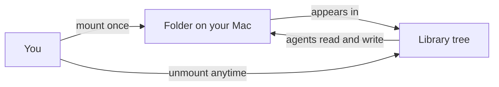

# Library and files

The Library is the file surface of every [workspace](workspaces.md): the images, videos, PDFs, audio, documents, and code that you and your agents put there. Use it to hand files to your team, to keep what your agents produce, and to share real folders from your Mac.

## What it is

A file explorer with a preview pane. The tree shows each workspace and everything inside it: folders, files you upload, files your agents create, and any folder you mounted from your Mac. Click a file and the pane renders it: pictures display, video and audio play, PDFs open for filling and signing, HTML pages run live.

Ordinary files belong to the workspace. Mounted folders are your real files, shown where they live on your Mac; every edit writes to the actual disk. The text side of the Library is the [knowledge base](knowledge.md); this page is about files.

Files arrive three ways:

- You upload them with the **Upload files** action.
- You attach them in chat: each attachment also becomes a real file, filed in a hidden `.library` folder and kept for reuse.
- Agents create them as they work; everything an agent writes shows up here.

## When you would use it

- Upload a document the team should work on, then mention it in chat.
- Preview or download what an agent produced: a chart, a report, a built page.
- Fill in a form or sign a PDF without leaving Omnipus.
- Mount a folder your project already lives in, instead of copying it in.
- Review which folders a workspace can write to, and revoke one.

## How to open the Library

1. Click **Library** in the sidebar. The panel opens with every workspace listed as a top-level folder.
2. From a workspace, select its **Library** panel toggle in the workspace bar (or the panels menu on a narrow bar). The panel opens already inside that workspace's files. The sidebar **Library** entry is different: it lists every workspace. There is no Library button in the chat header.
3. Select **Expand Library panel** in the panel heading for a full-screen Library. In a normal browser tab, this opens a new tab or switches to a tab Omnipus recognises as already showing it. In an installed app or standalone Chrome window, it uses the same window instead; **Back to chat** returns there with Library re-docked. A newly opened tab carries the current workspace and the selected file, if any, in its address. With no file selected, the browsed subfolder is not carried over. The docked panel closes after the handoff. Use **Back to chat** to leave the full-screen view; [panels beside chat](using-omnipus-ui.md#panels-beside-chat) explains how the panel is restored and the same-tab fallback.

## Links from chat

When an agent mentions a file in its reply, the file name can be a link. Select it (or press **Enter** on it) and the Library opens beside the chat on that file. Knowledge notes and bases work the same way: a note opens with its side rail and a `.base` file opens as its preview. The link works the same while the reply is still being written and after it has finished.

- **Which workspace.** A link written as `omnipus://file/<workspace>/<path>` names its own workspace. A plain file path such as `notes/plan.md` opens in the workspace the chat belongs to. In Omnipus's own chat, and in a chat that belongs to no workspace, a plain path stays plain text; full `omnipus://file/` links still work there.
- **What the link really opens.** If the words you see are not the file's name or path, the real location follows them in muted text, for example **W / secrets/payroll.xlsx**, so you can check it without hovering.
- **New tab.** Ctrl-click or Cmd-click, Shift-click, or a middle click opens the full-page Library in a new browser tab instead of the panel.
- **Unsaved edits.** If the Library or Mail has unsaved changes, you are asked before it moves; **Cancel** leaves everything as it was. While that question is open, further link clicks are ignored.
- **Missing or not yours.** A file that is gone shows the Library's usual "file not there" landing. A workspace you cannot open shows the Library's usual message and no file content.
- **Not every path is a link.** Ordinary relative links that do not name a file (such as `README`, `docs/` or `#section`), web links that are not `https`/`http`/`mailto`, and names containing invisible or direction-changing characters stay as plain, struck-through text. A file outside every Library, such as an agent's private folder, is given as its full path with no link. Web links still open in a new tab.
- **Only in chat.** These links work in agents' chat replies and question cards. A received email, and a document you open in the Library, never turn `omnipus://` or plain file paths into Library links.

## When an agent opens the Library for you

An agent can ask to show you a file in its own workspace while it is answering.

- **You are looking at the chat** (the browser tab is visible and this chat is on screen): the Library opens beside the chat on that file. Your typing position stays where it was, and screen readers hear **Opened &lt;name&gt; in Library**. It replaces another side panel such as Calendar or Mail, unless that panel has unsaved changes. On a phone it opens the same way and covers the chat.
- **You are not looking, or there are unsaved edits** (the tab is in the background, another app is in front, you are on another page such as Settings or in another chat, or the Library or Mail has unsaved changes): nothing opens. A notice at the top of the chat reads **The agent wants to show you &lt;name&gt;** with **Open** and **Dismiss**. **Open** asks about unsaved edits first, then opens the Library. **Escape** dismisses the notice while your focus is inside it. Each chat shows at most one notice; a newer one replaces the older.
- **Never later, never on reload.** Notices are not saved: reloading the page clears them, and reloading or reconnecting never opens the Library by itself. A tab that was offline when the agent asked does nothing when it reconnects. A request for another chat leaves its notice in that chat, where you see it when you return.

The tool call behind this is hidden in the conversation when it succeeds; a refusal stays visible, and **Verbose chat** shows every call.

## Open in Library on sent files

When an agent sends you a file from its workspace, the file card has **Open in Library** next to the download link. It opens the docked Library on that file, asking first if there are unsaved edits. Images keep their own toolbar and get no extra button. A file that is not in any Library only downloads. Files sent over other channels, such as Telegram or email, arrive on their own with no Omnipus link.

## How to add files

1. Open the Library and navigate into the workspace and folder you want the files in.
2. Click the **+** create menu and choose **Upload files**.
3. Pick one or more files. They land in the folder you were viewing and keep their names. A name collision gets a numbered suffix: `report (2).pdf`.

The chat composer's **Attach from library** button lists what this workspace already holds, so a new conversation can reuse an earlier upload. Turn on **Show hidden** in the panel header to see the `.library` folder where chat attachments are filed.

## How to fill in and sign a PDF

1. Click a PDF in the tree. It renders page by page, with zoom controls.
2. Switch to **Edit** with the pencil toggle at the top of the pane. Fillable form fields become active: type into text fields, tick checkboxes, pick from dropdowns.
3. Click the signature button to draw one and place it on the page you are viewing; it shows a remove control until you save.
4. Click **Save**. Entries and signatures are written into the PDF itself, so it re-opens everywhere showing them.

A PDF with no fillable form fields says so, and drawing a signature is still offered.

## How to mount a folder from your Mac

1. Open the Library inside the workspace that should get the access; mounts belong to one workspace.
2. Click the **+** create menu and choose **Add a folder from your Mac**.
3. Browse the folders Omnipus lists, or type the path; a web page cannot open the Mac's own folder picker.
4. Read the verdict shown before you commit:
   - **Scoped**, the normal case: this folder and what is inside it.
   - **Broad**: your home folder, the disk root, or `/tmp`; adding one takes a second, explicit **Add anyway** click.
   - **Refused**: Omnipus's own data folder and system folders such as `/etc` and `/usr`.
5. Click **Add folder**. The folder appears in the tree with the mount icon and its real path. The workspace's agents can now read and write it; everything else on your disk stays read-only to them.

Mounting wires a real folder into the workspace; unmounting removes access without deleting anything.

To review grants, open the **+** menu and choose **Manage mounted folders**: each mount is listed with its real path and a **Broad grant** mark. **Unmount** removes access; your files stay exactly where they are.

## What the preview shows

The preview pane picks its surface by file type.

| File type | What you see | What you can do |
|---|---|---|
| Images (PNG, JPEG, GIF, WebP, SVG, and more) | The picture | Download |
| Video (MP4, WebM, MOV, and more) | Plays inline | Download |
| Audio (MP3, M4A, WAV, FLAC, and more) | Plays inline | Download |
| PDF | The rendered document | Fill fields, sign, save into the file |
| HTML page | The page running live, in a sandbox | Edit shows the markup source |
| Text and code | Highlighted text | Edit and save in place |
| Notes, records, views | The knowledge surface | See the knowledge base page |
| Everything else | A details card | Download |

## Mail attachments: temporary previews

Opening an attachment from [Mail](mail.md#attachments) previews it here **temporarily**: no file is created, it has no path, and it vanishes when you go back, close the panel, or reload. A bar reading **From mail: \<subject\>** stays above the preview with **Back to mail** and **Save to Library**; stored-file actions (edit, rename, move, download) are disabled with **Save to Library first.** until you actually save. Saving puts a real copy in the workspace (mail → mailbox → month) and enables **Open in Library**, which opens the Library on the saved file.

## Limits and things to watch

- **No Office preview.** Word, Excel, and PowerPoint files, and other binaries such as ZIP archives, show the download card; they open in the applications you already use.
- **Chat attachments are capped** at 100 MB per file.
- **Mail attachment previews are capped** at 25 MB per file; larger attachments download from Mail instead.
- **Saved mail HTML keeps its guard.** An HTML file saved from mail keeps its original bytes and renders with scripts off, with a notice saying so; **Allow scripts** turns scripts on for that one file only. An ordinary workspace HTML file is unaffected.
- **Mounts are real disk.** Edits inside a mounted folder change your actual files, the same ones your other apps open. Deleting one in the Library deletes the real file.
- **A mount's location is recorded once.** If you move or rename the folder on your Mac, its contents disappear from the workspace. Unmount and add the folder again at its new location.
- **Broad grants are wide.** Mounting your home folder gives every agent on the workspace write access to everything under it. The warning and the second click exist to catch exactly this mistake.
- **Ordinary deletes are permanent.** Removing a file from the workspace has no trash to recover from. A note inside a knowledge base moves to that knowledge base's trash instead.
- **HTML previews run scripts in a sandbox** that cannot read your Omnipus session or call the API as you.

## Related pages

- [knowledge base](knowledge.md) — notes, records, and views: the text side of the Library.
- [workspaces](workspaces.md) — what a workspace is, and the panels around the Library panel.
- [previews](previews.md) — agent-built sites for review; unrelated to this preview pane.
- [agents](agents.md) — the agents who read and write these files.
