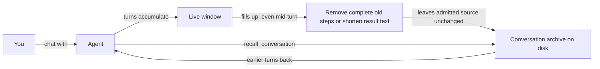

# Memory

Memory is what your agents keep between conversations. **Shared notes belong to the workspace of the chat**, not whichever workspace the agent used most recently. Private notes belong to one agent and stay private to that agent across its chats. This page explains what agents remember, where it lives, and which settings control it.

## What it is

Three kinds of memory, all stored as plain files on your machine:

- **Saved notes.** An agent saves a fact, decision, reference, or lesson with the `remember` tool. A shared note goes to the current chat's workspace, where teammate agents can read it in their chats in that workspace. A private note is available only to the agent that saved it.
- **Recaps and retrospectives.** When a conversation has been idle for a while, a background call summarizes it — what it was about, what went well, what to improve. The recap is loaded back into the same agent's context in the same workspace, so it picks up where it left off.
- **The transcript.** The full conversation stays on disk. Only the recent part sits in the agent's live view; the rest can be read back on demand.

When memory is enabled for the agent, a prompt includes that workspace's last recap for the agent, when available, plus a size-limited selection of up to twenty saved notes: the agent's private notes and only the current chat's workspace's shared notes. Selected notes are displayed newest first; this is not a guaranteed latest-twenty list. If the chat has no resolvable workspace, no shared notes are included and Omnipus logs a warning; the agent's private notes remain available. Notes are read again at each prompt build, without requiring a local memory-tool call. A newly saved teammate note can still be left out by selection or size limits; use `recall_memory` to search beyond the injected notes. If a room cannot be read, the prompt shows an error diagnostic and Omnipus logs a warning instead of presenting missing notes as an empty memory. If individual notes cannot be read or parsed, readable notes can still appear, but the prompt explicitly warns that its saved-note results are partial. Missing results are not evidence that the saved facts do not exist. If building the search index fails, Omnipus can search the note files directly; the failed build is not treated as a completed refresh and is tried again on a later read.

## When you would use it

- You ask an agent to save a shared note — "Remember for this workspace that we invoice on the 15th" — and a teammate can recall it in a later chat in that same workspace.
- You return the next day and the agent already knows what happened yesterday, without you restating it.
- A conversation runs long, and the agent reads an earlier exchange back instead of guessing at it.
- You change how often recaps happen, or which model writes them, in Settings.

## How to save and recall a fact

1. In a chat, tell the agent what to keep: "Remember that the staging server is called elm." The agent calls `remember`, and the tool call appears in the thread.
2. Every `remember` call explicitly chooses **shared** or **private** memory; the tool has no room default. Ask for a shared note when the workspace team should recall it, or a private note for the agent alone. A shared choice outside a workspace is stored privately, and the tool explains that fallback.
3. In a later chat in the same workspace, ask about a shared note. The agent searches with `recall_memory` and answers from that workspace's shared notes, its own private notes, and its past private retrospectives. A chat in another workspace cannot recall the first workspace's shared notes. The agent's private notes remain available across its own chats.
4. For something said earlier in the same conversation, the agent uses `recall_conversation` instead. That tool never crosses into other conversations.

The two rooms:

| Room | Who can read it | Good for |
|---|---|---|
| Shared (chosen explicitly) | Teammate agents in chats in the note's workspace | Project decisions, conventions, references |
| Private | Only the agent that saved it, across its own chats | Personal working notes, individual lessons |

## Workspace boundaries

An existing conversation or helper keeps its workspace. To work in another workspace, open that workspace's conversation instead. A request to reuse an existing chat or helper in a different workspace is refused with a visible error; its old messages and shared-note results are not transferred.

Changing a connector's workspace binding sends subsequent input to a separate conversation scoped to the new workspace, not the old conversation with a new label. The original conversation and its archive remain in the original workspace. Private notes remain available to their owning agent across its own conversations.

**Glossary.** The shared and private rooms on this page are **memory rooms**, where agents save and recall notes. They are not **group-chat rooms** (team rooms, squads or ad-hoc rooms), which hold conversations between you and several agents; see [group chats](group-chats.md).

## The four memory tools

Omnipus provides these four memory tools. Which an agent can use depends on its effective tool policies and runtime. Catalog presence does not grant access. Check the agent's Tools tab before relying on a manual retrospective or another memory action. Automatic recap is a separate setting and is not evidence that `run_retrospective` is granted to every agent. An agent calls the tools it has on its own judgment; you trigger them by asking in chat.

| Tool | What it does | Bounds |
|---|---|---|
| `remember` | Saves a note as a decision, reference, or lesson | Up to 4,096 characters; every call chooses shared or private memory |
| `recall_memory` | Keyword search over saved notes and past retrospectives | Current chat's shared room plus the agent's private room by default. `limit` defaults to 20 and accepts at most 50; it applies separately to saved notes and private retrospectives. Before normal result-size/context handling, the combined result can contain up to 40 entries by default, or 100 with `limit: 50`. A directory-scan failure returns an error, not successful empty results. If individual saved notes cannot be read or parsed, readable matches are returned with an explicit partial-results warning and the call is marked as an error, not a complete search. Repair file access or format and retry. |
| `recall_conversation` | Reads back earlier context from the current conversation | By keyword, turn numbers, time window, an addressed tool result, or an inclusive archive-line range |
| `run_retrospective` | Records what went well and what to improve | Always the agent's private room |

## What happens when a session ends

With Auto recap on (Settings → Memory; it is on by default on a new install):

1. The idle timer triggers recap after the timeout you set — 30 minutes by default. After a gateway restart, catch-up runs only when **Bootstrap recap** is also enabled. That one-time pass considers sessions with no retrospective marker and a usable owning agent. It requires a readable transcript with at least one valid, nonzero entry timestamp, and the newest such timestamp must be at least 30 minutes old, independently of your configured idle timeout. This is a transcript-entry time check, not a file-modification-age check. Sessions without a usable transcript timestamp are skipped, and delegated sessions do not get an automatic recap. Starts are spread out according to the bootstrap rate limit — five per minute by default.
2. A background model call uses recent user messages and is asked for a recap of at most 150 words, up to five wins, up to five items to improve, and up to five items worth remembering. These are instructions to the model, not validated word or list-size limits; a successful response can be longer.
3. The recap, followed by any items worth remembering, is stored per agent **and per workspace** — at `workspaces/<workspace>/.omnipus/carry-forward/<agent>.md` — and injected into that agent's next session **in the same workspace**. A summary written in one workspace never follows the agent into another workspace, and a conversation that had no workspace stores no summary at all. If writing the carry-forward summary fails, no retrospective success marker is filed. The session can be considered for a bootstrap recap after a gateway restart, subject to recap settings and eligibility checks. The current process retains its recap claim, so another recap pass in that process is not a guaranteed retry. Check the gateway log and repair the storage problem first. The retrospective is filed under its date and appears in `recall_memory` results.
4. If summary generation fails or produces an unusable reply, Omnipus tries to carry forward a bounded verbatim tail of recent user text. It keeps up to 1,500 Unicode characters of user-message text, plus formatting; an oversized final message contributes only its tail, and surrounding whitespace is trimmed. The fallback summary names the failure reason, and its retrospective is marked as a fallback. The workspace and storage requirements above still apply, so this is not a guarantee that every recent message or fact survives.
5. The items worth remembering reach the agent's next session in that workspace through the carry-forward file, so a fact you gave in the last conversation is still in front of the agent. They are not saved as notes: only the agent's `remember` tool creates a note. Each recap replaces the workspace's carry-forward file, so the carried items last until the next recap is written; a note made with `remember` stays. Deleting an agent (or a workspace) removes its carry-forward files with it.

Delegated sub-task sessions never get a recap — only real conversations do.

## How long conversations stay in view

The live window is the part of the conversation sent to the model. Omnipus can shorten it between your messages **and during one long turn**, after each tool result and just before the next model request. It checks the assembled request, including tool definitions, notes and media, rather than treating a result's initial size limit as proof that everything fits.

| What changes under pressure | What stays |
|---|---|
| An injected block of recalled conversation can leave first. | Its source remains in the conversation archive. |
| Old whole turns, or older complete assistant steps within the current turn, can leave the live view. A step includes the assistant's calls and all their matching results. An older assistant reply that made no tool calls can leave the same way — Omnipus always removes the oldest of the two first, and the user message that started that part of the conversation leaves with it. | The newest and incomplete call/result groups stay together. The newest assistant reply stays even when it is plain text. |
| Retained tool-result text can shrink to its beginning and end, with an addressed recall mark between them. Even newest results can eventually become mark-only. | The call, its arguments, the result slot and its correlation identity remain. Full admitted, filtered result text stays in the archive. |
| The model receives a short notice identifying what left or was shortened. | The original message that started the turn, including media, instructions and not-yet-consumed steering messages remain. The relief notice is model context, not a new chat message. |

This is literal removal and text projection, not a summary, and it makes no extra model call. The same saved projection is applied when the live window is loaded again. `recall_conversation` can retrieve addressed earlier results; shortened text is not presented as a complete result.

Even when older steps leave during one turn, without another user message, the agent receives a breadcrumb naming the full evicted prefix as a **zero-based, inclusive archive-line range**. Its bounded list shows recent literal snippets first. Tool-result entries pair `tool_call_id` with `archive_line`, so repeated call IDs still identify the exact result. The full range address stays available even when some entries cannot fit in the breadcrumb.

| Address the agent can use with `recall_conversation` | What it retrieves |
|---|---|
| `archive_range: {"from": 0, "to": 3}` | The archive's literal JSON Lines text for records 0 through 3, including both endpoints. These are archive-line numbers, not turn numbers. |
| `tool_call_id` together with `archive_line` | One exact archived tool result, including text that was shortened or removed from the live view. |

The agent uses one recall mode at a time. Range pages are **quoted archive data in the current tool result**, not revived historical instructions or tool calls. Both range and addressed-result recall support `offset` and `length` paging by Unicode characters (runes). Each page reports the total size and the next offset when more remains. Pages still pass through normal result caps and context-pressure handling; a shortened page is not proof that the whole range or result reached the model.

By default, combined tool results trigger relief above an estimated **50% of the model's context window**. The separate total-request budget also reserves space for the reply, safety margin and core instructions. These are estimates, not a promise that the provider will accept the request. See [settings](settings.md) for the tool-result share setting and [troubleshooting](troubleshooting.md#the-provider-rejects-your-model-requests) for provider rejections.

Relief deletes no admitted archive bytes. If the turn is aborted, its window metadata is rolled back to the actual turn-start snapshot and the aborted turn's appends are kept out of the model's view — but the bytes stay in the conversation archive, so `recall_conversation` can still reach them.

When the window fills, older turns or complete steps can leave the live view while their admitted source text stays available for recall. Aborted-turn rollback and session retention still apply.

## After interrupted tool work

If the gateway is killed before a tool-call group finishes, Omnipus checks for unfinished calls when the conversation is next used. It records restart cancellation rather than resuming that abandoned group. The original assistant calls, any partial tool results, and the cancellation records remain in the conversation archive, subject to normal retention. Only that canceled group and its recovery records are left out of the model's view; other messages, including steering instructions, remain. Reloading the conversation or shortening its context does not bring the canceled group back.

Cancellation applies to one assistant step, not to every use of its tool-call ID. If a later interrupted step reuses that ID, it gets its own cancellation record; checking the same canceled step again does not add another. Users, completed steps, narration and unrelated controls stay in their original order, including controls after the interrupted step. Surviving results keep their original archive-line addresses for recall.

Restart recovery is different from context pressure. An unfinished group in a running turn is not silently removed to make a request valid. Malformed cancellation records or invalid call/result structure do not authorize removal: those messages remain visible at their original archive addresses. Without a valid recorded cancellation, an incomplete group can still stop a model request with a visible error.

Cancellation is not proof that an action never happened: a tool may have acted before the gateway stopped without saving its result. Before retrying work that changes something outside the conversation — such as sending a message or editing a file — check its actual state.

## Limits and things to watch

| Limit | What it means for you |
|---|---|
| Search matches words, not meaning | A note saved as "invoice" will not surface for "billing" unless the words overlap. There is no meaning-based search. |
| No memory browser | No screen in the app lists saved notes, and no tool deletes one. To remove a note, delete its file under `~/.omnipus/`. |
| Retrospectives expire | A nightly sweep deletes retrospectives older than the retention setting — 180 days by default. |
| Transcripts expire | Session retention defaults to 90 days (Settings → Data). The sweep removes eligible transcript files by file-modification age, not a strict per-message read cutoff. A main chat's current transcript file is protected, while eligible older rolled files can expire. `recall_conversation` can read content that remains in the archive, including content older than 90 days; it cannot recover files the sweep removed. |
| Saved notes never expire | Nothing prunes them; a workspace in use for years keeps every note. |
| Writes are rate-limited | An agent can save at most 60 notes per minute, and one caller at most 600. Beyond that the save is rejected and the agent is told to wait. |
| Sharing needs a workspace | The shared room exists only for work in a workspace. Outside one, every note is saved privately and the agent is told so. |

Recap settings live in Settings → Memory: the Auto recap switch, the idle timeout in minutes, the restart catch-up pass and its per-minute cap, and the summarization model with its fallbacks.

## Related pages

- [workspaces](workspaces.md) — the team that shares the shared memory room
- [agents](agents.md) — who reads and writes memory
- [tools](tools.md) — the tool catalog the memory tools belong to
- [knowledge](knowledge.md) — notes and records you write yourself, separate from agent memory
- [settings](settings.md) — where recap and retention are configured
