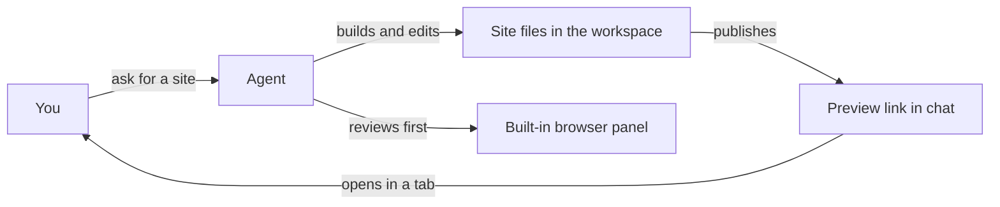

# Previews of agent-built sites

When an agent builds a website for you, Omnipus publishes it and hands you a link. This page covers opening the link, which address a preview gets, how logins and cookies behave inside it, the two risks worth knowing about, and the one setting an operator behind a reverse proxy must add.

## What it is

An agent can build a site inside its workspace — a landing page, a report, a small interactive app — and publish it with its serving tool, called `serve_web`. The result is served on the same single port as Omnipus itself: either on its own address (a random name ending in `.localhost`) or on Omnipus's address under a private path. There is no second port to open in a firewall, no DNS record to create, and no separate preview server to run.

The link looks like one of these:

```
http://<random-name>.localhost:5000/                    (isolated address, example)
https://your-omnipus-address/preview/<agent>/<token>/   (shared address)
```

The full link — including its long random part — is the only credential. Anyone who can reach this Omnipus installation and holds its complete, unexpired preview link can open it without signing in to Omnipus. A localhost link points to the computer running the browser; sending it to another person does not make your local installation remotely reachable. The previewed app may have its own sign-in.

## Which address a preview gets

Omnipus chooses the available preview addresses from its configured browser-facing address: `gateway.public_url` when set, otherwise its configured host and port. Opening Omnipus through a different name does not change that choice.

| Configured address | Available preview addresses |
|---|---|
| `http://localhost`, with an optional port | An isolated `http://<random-name>.localhost[:port]/` link plus the shared fallback. The isolated link keeps the configured port. Whether the isolated address opens depends on the browser and local setup; use the shared fallback if it does not. |
| HTTPS, an IP address or another concrete hostname | The shared `/preview/<agent>/<token>/` link. |

Chat prefers the isolated link when its browser signal and address checks pass; otherwise it selects the shared link. These checks do not test whether the isolated address actually opens. If it does not, ask the agent for the shared fallback link.

Both addresses of one preview serve the same published site.

An agent can have a finished-files preview and a live development server open at the same time. Each one gets its own link, and each link shows only its own site: the link to the finished files never shows the development server, and the reverse.

The two addresses differ in separation, and in what the site may do. Both open the site as a full browser page, but their limits differ.

- On the shared address, resource files fetched over HTTP or HTTPS must use URLs inside that preview's `/preview/<agent>/<token>/` directory. A URL relative to the page, such as `./app.js`, is suitable if it stays inside that directory; `../` can leave it. A URL beginning with the complete preview directory is also permitted. A website-root URL such as `/assets/app.js` is outside it and is blocked. Embedded images and fonts (`data:` URLs) and browser-created workers (`blob:` URLs) have separate allowances and do not need that directory prefix; these do not permit service workers on the shared address. If an essential file is blocked, the page may look blank. Configure the build so its resource URLs stay inside the preview directory.
- On the shared address, the browser security policy also limits data connections, live connections and form destinations to the preview directory. Development-server redirects outside the allowed destination can be refused.
- Service workers are refused on the shared address. The isolated address does not impose that refusal or the resource-path limits above.
- Saved data and cookies are kept by your browser per address, so on the shared address they sit on Omnipus's own address, not on a private one (see [Logins and cookies](#logins-and-cookies-inside-a-preview)).
- Both addresses prohibit embedding the preview inside another page.
- Finished-files previews only serve files. Server-side form handling needs a development server, on either address.

- **Isolated address.** The preview has its own separate name, so it is a separate place from Omnipus: your Omnipus sign-in does not apply there, and none of Omnipus's cookies or API keys travel to it.
- **Shared address.** The preview lives on Omnipus's own address. Omnipus fences it in: the page may make its network calls only within its own private path, and Omnipus removes its own sign-in and security cookies from everything the page sends through the gateway (see [Logins and cookies](#logins-and-cookies-inside-a-preview)).

## When you would use it

- You asked an agent to build a page or a small app, and you want to see the result yourself.
- The agent is iterating on a design and publishes each version as it goes.
- You want to check the agent's work in your own browser before accepting it.

## How to open a preview

1. Ask the agent in chat to build and serve the site.
2. When the tool finishes, chat shows a preview card with the selected link (see [Which address a preview gets](#which-address-a-preview-gets)). For a live development server, the card says "Starting dev server" while it wakes up, then shows the link.
3. Click the link, or use the open-in-new-tab button on the card. The site opens in its own browser tab, where it runs as a full page and can hold its own login.
4. Use the copy button on the card if you need the link somewhere else. Remember that the link itself is the credential.

If a development server does not answer in time, the card says so and offers a Retry button. The agent can also open the preview in its built-in browser, check it, and walk you through it before you click anything. See [browser](browser.md) for that panel.

## Finished files or a live dev server

The serving tool has two ways to publish. The agent picks one depending on whether the site is finished or still being built.

| Way of publishing | What gets published | Where it works | How long the link lives |
|---|---|---|---|
| Finished files | A folder of built files from the workspace | Linux, macOS and Windows | With default settings between 1 minute and 24 hours; the operator can change those bounds |
| Development server | A live development command the agent starts, such as `vite dev` | Linux only | 30 minutes without a visitor, or 4 hours in total |

A few details behind the table:

- For a finished-files preview, put `index.html` at the published folder's root; the directory link requests that file. If it is missing, that request fails. A development server handles its own root URL.
- Publishing the same folder again renews the same link only while that registration is still live and less than 24 hours old; otherwise a new link is issued. Always give the user the link the tool returns rather than assuming an older one still works. Publishing a **different** folder replaces the registration: the old link stops working, so use the new returned link. A new isolated address has a different browser origin and does not share storage that the browser keys to the old origin. A new shared-address link changes only the path on Omnipus's address, so publishing it does not clear saved browser data or sign you out. Publishing is not a reset of the app's server-side data.
- The development command must come from a fixed list: `next dev`, `vite dev`, `astro dev`, `sveltekit dev`, `npm run dev`, `pnpm dev`, or `yarn dev`. An operator can extend the list in the config file.
- At most two development servers run at once on a default install, and each agent can run only one at a time.



The preview flows from the agent's workspace to a link in your chat, and the agent can inspect the running site in its own browser before you open it.

## Logins and cookies inside a preview

A site inside a preview is a real web app. Omnipus does not stand in the way of its own cookies, but it cannot promise that every login flow works.

- **The site's own cookies are preserved.** Omnipus preserves the app's valid cookies unless they use its reserved names. This permits app sessions; it does not guarantee that every login flow works unchanged or lasts between visits. That depends on the app, its cookie settings, the browser and the address limits above.
- **What Omnipus removes, and only that.** Where a preview's requests pass through Omnipus's gateway, Omnipus removes from them only its own sign-in and security cookies (named `omnipus-session`, `csrf` and `__Host-csrf`) and its own API keys. Everything else — the site's own cookies above all — passes through untouched. Omnipus also removes a bearer credential that Omnipus itself accepts, while preserving a foreign app's bearer credential.
- **The reverse direction, for server replies.** When a preview's server (a development server) answers with a cookie named like one of Omnipus's own, Omnipus removes that cookie from the answer before it reaches your browser.
- **What that does not cover.** On the shared address, preview scripts can set browser cookies themselves, without going through Omnipus, including additional cookies with Omnipus's reserved names. Omnipus detects a conflict when more than one cookie with the same reserved name arrives on a request; it does not identify every browser-side cookie write.

### If Omnipus clears cookies

When an affected cookie-authenticated data request from Omnipus's screens reaches this check, Omnipus refuses to use its cookies for sign-in and sends instructions to clear matching extra copies. On a `localhost` address some browsers (Chromium-based ones and Firefox) apply one of those instructions to your real sign-in cookie too, so Omnipus sends your real sign-in cookie back in the same reply, with the same value and the same expiry time it already had. It never starts a new sign-in or lengthens the existing one. A sign-in made before this version of Omnipus has no recorded start time and is not sent back; on those browsers you are then signed out once and sign in again. The refused request can show "Omnipus cleared cookies set by a preview — please retry" with a **Retry** button. Click Retry to send that request again; Omnipus does not repeat it for you.

- This covers requests Omnipus's screens make to its own server, including loading data after a page reload.
- If the message returns, close preview tabs before trying again. A preview may be adding cookies again, or extra cookies may remain; the message alone does not tell which. Closing a tab does not itself remove cookies it already set.
- Cleanup is not guaranteed for every browser or hosted-domain cookie scope. If you remain blocked, ask the operator for help clearing the affected browser cookies before signing in again.
- **For operators:** an affected cookie-authenticated API read (`GET`/`HEAD`) receives HTTP `401` with code `planted_cookie_cleared`; a state-changing request receives HTTP `403` with the same code. This error does not mean the session expired. Top-level navigation through an optional-sign-in route may still load anonymously.

## What previews cannot protect against

Two risks are accepted and documented rather than engineered away. Both stem from the same place: you opened a page your own agent built.

- **A fake Omnipus login screen.** An agent-built page can display a fake Omnipus sign-in form. Omnipus itself never asks you to sign in inside a preview — so never enter your Omnipus password inside a preview.
- **Driving Omnipus through a popup — shared address only.** On the shared address the preview runs on the same address as Omnipus, so a page there could in principle open Omnipus itself in a second window and click through the real interface as you. Omnipus narrows this window as much as headers allow, but cannot close it on this address. The isolated address does not have this problem.
- **The hosted version uses the shared address for now.** Hosted Omnipus is not reached through `localhost`, so its previews currently use the shared address and carry both risks above. This release does not provide a separate hosted preview domain.

## Limits and things to watch

- **The link is the credential.** Share it with the care you would give a password. Anyone who has it can view the preview until it expires.
- **Previews are temporary, not hosting.** An expired link returns "preview registration not found or expired". The files stay in the workspace; only the published link dies. Ask the agent to publish again for a fresh link.
- **A blank or broken preview needs checking.** On the shared address, blocked resources or connections outside the preview directory can prevent an app from rendering, and other app errors can also cause a blank page. A blank page alone does not identify the cause. Check the browser's diagnostic console (F12) and failed network requests, and share the messages with the agent before choosing a fix.
- **An operator can switch previews off.** The switch lives in Settings, on the Gateway tab, labeled "Preview server". It takes effect at once, without a restart. While it is off, every preview link returns an error and the serving tool refuses to publish.

## Running Omnipus behind a reverse proxy

If Omnipus sits behind nginx, Caddy, or a similar proxy, previews use the shared address on the same listener when Omnipus is configured with a public HTTPS address, and everything still arrives on the single port (default 5000). One setting is needed:

1. Set `public_url` under `gateway` in Omnipus's config file to the full HTTPS address a browser uses to reach Omnipus, for example `https://omnipus.example.com`.
2. Restart the gateway so preview URLs and the gateway's request checks use the same public address. The serving tool reads the current configuration, but some request checks keep the address captured at startup; reloading configuration alone does not update all of them.
3. Pass the `/preview/` path through untouched, like the rest of the app. The proxy must not block or rewrite that prefix.

Without `public_url`, a gateway listening on all network interfaces cannot build a correct link, and the serving tool refuses rather than hand you a broken URL. Full nginx and Caddy examples are in the [reverse proxy guide](operations/reverse-proxy.md).

## Related pages

- [browser](browser.md) — the built-in browser the agent uses to review a preview and present it to you.
- [workspaces](workspaces.md) — where the agent's files live before they are published.
- [tools](tools.md) — how allow, ask, and deny rules govern which tools an agent may use.
- [settings](settings.md) — the Gateway tab, where the preview switch lives.
- [Reverse proxy guide](operations/reverse-proxy.md) — worked nginx and Caddy examples for operators.
