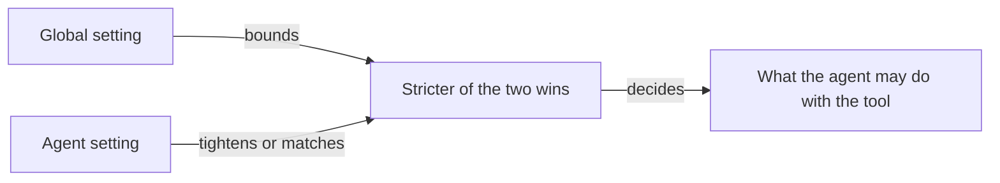

# Tools

Tools let an agent read and write files, search the web, run commands, and send email. This page covers where tools come from and how you control access.

## What it is

A tool is one capability an agent can call while it works. When an agent uses a tool, the call appears in the chat as a collapsible entry, so you can see what it did.

Tools come from two places:

- **Built-in tools** ship with Omnipus — a large catalog; the **Built-in Tools** tab under Skills & Tools lists the current set.
- **Tools from connected servers.** Omnipus speaks MCP (Model Context Protocol), an open standard many services publish tools to. Connect a server and its tools appear next to the built-in ones.

Every tool, built-in or from a server, has a policy with three values: **Allow**, **Ask** or **Deny**. You set it in two places — once for the whole installation, once per agent.

The built-in groups you will meet in practice are below. For every current name and description, use the generated [built-in tool catalog](reference/built-in-tools.md). The **Built-in Tools** tab is the live list for your installation.

| Group | Tools you will notice | What they do |
|---|---|---|
| Files | `read_file`, `write_file`, `edit_file` | Read and change workspace files |
| Shell | `bash` | Run shell commands |
| Web & Search | `search_web`, `fetch_url` | Search the web and open a page |
| Browser | `browser_navigate`, `browser_screenshot` | Drive a live browser, capture what it shows |
| Communication | `send_email`, `read_inbox`, `send_message` | Send email and chat messages |
| Delegation | `delegate` | Hand work to another agent |

**The `delegate` tool always names its target.** A call with `action="run"` must give an `agent_id` (the other actions address an existing worker by `session_id` and do not need one); one that omits it, passes null, or passes a blank value is refused before any work starts — there is no default target and no fallback to the asking agent. Naming the caller itself is allowed and forks a new session running that same agent; it needs a self-line in the workspace, exactly like any other handoff (see [workspaces](workspaces.md#how-to-set-who-may-delegate-to-whom)). The check cannot be switched off: a handoff that does not come from an identified agent is refused, and no configuration setting changes that.

When an agent calls `list_jobs`, completed and failed jobs are hidden by default, not erased. If any are hidden, `notes.terminal_suppressed` gives counts by job type and a `total`. The counts follow kind, label, and draft filtering but precede status filtering and the result limit: even a call for `status="running"` can count hidden completed jobs. If `notes.scan_truncated` or `notes.errors` appears, the count may be incomplete. Set `include_terminal=true` to make terminal rows eligible for results, or filter for `status="failed"` or `status="completed"`, which includes them automatically.

**Where reading tools can look.** `read_file`, `list_directory` and `grep` follow one rule: they reach any file your account can read, except Omnipus's protected files (such as the master key, saved credentials and `config.json`) and other agents' and other workspaces' files. `grep` given no folder searches the workspace and its mounted folders. Given a folder, it searches there instead — a workspace-relative path, a mounted folder's name, or an absolute path such as `/var/log`; a path containing `..` works too. It skips the Linux system folders `/proc`, `/sys` and `/dev`. Writing tools stay inside the workspace and mounted folders. See [security](security.md#what-reading-searching-and-listing-can-reach) for the details.

An agent sees common tools directly and searches the rest when a task calls for one. If it does not reach for a tool, name it in your request.

## When you would use it

- An agent is using a tool you do not want it to use — deny the tool.
- A tool is risky enough that you want to confirm each use — set it to Ask.
- You connected a new server and need to decide who may use its tools.
- You scheduled recurring work and nobody will be present to answer approval prompts.

## How to change an agent's tool access

1. Open the workspace's **Team** panel, find the agent's card and choose **Edit** from its **⋯** menu (for Judge, Plan Supervisor and Omnipus: **Settings → System agents → Edit**). The agent's editor opens.
2. Open its **Tools** tab, with the **Tools & Permissions** panel.
3. Optional: start from a preset — **Cautious**, **Balanced** or **Full access**. A preset sets the agent's requested policy values. The effective policy still combines them with the global ceiling: a preset cannot override a global Ask or Deny. Auto-approve and tool-specific checks can still affect whether an allowed call asks or is refused.
4. Expand a group and click **Allow**, **Ask** or **Deny** on the tool you care about. Changes save on their own.

You can also ask Omnipus in its chat to change an agent's permissions. Outside God Mode, it is instructed to show one plan summary and ask **Go / Change / Cancel** before its first change. Go does not replace any tool approval required by the effective policy; `set_agent_permissions` is on the Auto-approve ask-list. In God Mode, Omnipus shows its summary as a message and skips approval questions and global tool-policy prompts. Stricter per-agent policies remain in force.

**Omnipus itself.** Omnipus takes no per-agent **Ask**: setting one of its tools to Ask is refused with "Omnipus takes no per-agent Ask; set Ask globally or use Deny". **Deny** works for it like for any agent. Which of its tools always ask, and how God Mode changes that, are described in [security](security.md).

The installation-wide setting lives in **Settings → Security**, under **Advanced / technical details**, in **Tool Access — Global Policies**. Global tool-policy changes save immediately using your signed-in session, with no second password prompt. Changing a tool to **Allow** can enable it for every agent that follows the global setting; stricter per-agent **Ask** or **Deny** settings still apply.

Saving a global policy and applying it to running agents are separate steps. If
Omnipus reports that the settings were saved but could not be applied to running
agents, the saved change has **not** been rolled back. Running agents may still
use the previous policies. Retry applying the change, or restart Omnipus before
relying on the new permissions.

## Default tool sets for main agents and workers

A **Main** agent talks with you in chats and rooms. A **Worker** runs delegated work: a native **Subagent** or an external **subagent_3p**. New agents start with the following tool settings whether you create them in the app or through `create_agent`. These are editable starting points, not locked permissions; an agent's own setting can only tighten the global ceiling.

**Allow** means no tool-policy approval is needed. **Ask** uses the normal approval rules, including Auto-approve. **Off** means Deny. Having permission does not remove a tool's other requirements: a mailbox, a workspace delegation link or the right kind of session may still be needed.

Both `list_secrets` and `request_secret` are implemented built-in tools. Main agents (Mia, Jim, Omnipus and custom mains) allow both by default; workers allow `list_secrets` and deny `request_secret`. Listing returns names and metadata, never secret values: ordinary agents see only their own private variables in the current workspace, while Omnipus sees all stored references. `read_conversation` in the table below is still reserved for a later implementation and cannot be called yet.

`request_secret` opens a secure card in an interactive web conversation. Enter the value on the card, never in chat or a tool argument. Channel-triggered turns and unattended runs cannot open a card, even in God Mode. Ordinary helpers must ask their parent; a helper with permission under an Omnipus-rooted conversation can show its card in the Omnipus main chat. Submitting stores a version for the destination shown on the card and lets the agent continue with reference names only. Storing an integration secret does not select it for use: that still needs the integration's approved configuration tool. See [Entering a secret from a chat](security.md#entering-a-secret-from-a-chat).

| Tool or group | Main | Worker |
|---|---|---|
| Ask the user and communicate upward: `AskUserQuestion`, `send_message`, `message_parent` | Allow | Allow |
| Answer requests and read conversations: `answer_request`, `read_conversation` | Allow | Off |
| Track current work and report completion: `set_todos`, `goal_claim` | Allow | Allow |
| Define a goal: `set_goal` | Allow | Off |
| Save and recall memory: `remember`, `recall_memory`, `recall_conversation` | Allow | Allow |
| Write a retrospective: `run_retrospective` | Allow | Off |
| Delegate and inspect work: `delegate`, `list_agents`, `get_agent`, `get_agent_tools`, `inspect_session`, `list_jobs` | Allow | Allow |
| Create, run, stop or correct plans: `create_plan`, `execute_plan`, `stop_plan`, `plan_correct` | Allow | Off |
| List and update tasks: `list_tasks`, `update_task` | Allow | Allow |
| Create tasks: `create_task` | Allow | Off |
| Delete tasks: `delete_task` | Ask | Ask |
| Find and load skills and tools: `Skill`, `ToolSearch`, `find_skills`, `list_skills` | Allow | Allow |
| Create or edit a skill: `create_skill`, `edit_skill` | Ask | Ask |
| Search and open the web: `search_web`, `fetch_url` | Allow | Allow |
| Browser tools, except file upload | Allow | Allow |
| Upload a file to a website: `browser_upload_file` | Ask | Ask |
| Read and find files: `read_file`, `list_directory`, `grep`, `list_mounts`, `library_list`, `library_read` | Allow | Allow |
| Write and send files: `write_file`, `edit_file`, `append_file`, `send_file` | Allow | Allow |
| Request access to a folder: `request_mount` | Ask | Ask |
| Serve a web preview: `serve_web` | Allow | Allow |
| Read mail, draft messages and read or download received attachments: `read_inbox`, `search_email`, `read_message`, `create_email_draft`, `list_email_attachments`, `read_email_attachment`, `download_email_attachment` | Allow | Allow |
| Send mail or reply: `send_email`, `reply` | Ask | Ask |
| List secrets: `list_secrets` | Allow | Allow |
| Ask you for a secret: `request_secret` | Allow | Off — the main agent requests it on the worker's behalf |
| List and read workspace details: `list_workspaces`, `get_workspace` | Allow | Allow |
| Set up an execution environment: `environment_setup` | Ask | Ask |

**Shell access is unchanged.** A new custom Main or Worker starts with `bash` Off; the shipped global ceiling is Ask. Built-in agents retain their deliberate shell settings, including Jim's Deny. External command-line workers still use their own tool and safety settings internally; this table controls Omnipus tools, not the external program.

The five ordinary built-in agents receive at least their kind's positive defaults: Mia and Jim use the Main core; Planner, Researcher and General Purpose use the Worker core. They retain their role-specific extras, including the specialists' existing task or memory tools. Omnipus, Judge and Plan Supervisor are excluded from these role changes and keep their existing per-agent tool sets. Global policies still apply to them.

Other administration tools stay Off for new agents: creating, changing or deleting agents and workspaces; reading agent metadata or configuration (`get_config`); changing permissions or configuration; managing providers, channels and connected servers; running diagnostics or checking usage; removing or installing skills; removing or selecting secret versions; and connecting or listing mailboxes. Skill creation and editing are the explicit Ask exceptions above. Their global ceiling remains Allow: ordinary Main and Worker defaults store a per-agent Ask, while Omnipus has no per-agent entry and may create or edit skills without asking. Judge and Plan Supervisor keep Deny.

**Email sending now asks by default.** The shipped global settings for both `send_email` and `reply` are Ask, as are the Main and Worker seeds. They keep asking in a chat even with Auto-approve on. Reading mail, creating a draft and downloading a received attachment are Allow; downloading does not send a message and still follows the normal destination-path checks. Email tools require an enabled mailbox assigned to the agent and workspace. An active attachment save finishes or fails before its destination closes, even if its caller is canceled; its result reflects the actual save outcome. Cancellation while waiting for a mail-operation slot prevents the save from starting. The attachment-save audit record identifies the destination workspace and the mailbox-owning agent. In a task or plan run, a call that still needs human approval is refused rather than opening an approval card — see [unattended runs](security.md#task-plan-scheduled-and-other-unattended-runs).

Use `get_agent_tools` to inspect any existing agent by id or exact name, or to preview a new agent with `new_agent_type` set to `Main`, `Subagent` or `subagent_3p`. Both worker kinds use the Worker column. The response is compact plain text: an identity header, then one name-sorted line per catalog tool. Allowed and Ask tools show their name, effective policy (`allow` or `ask`) and a description of at most 40 characters. Denied tools show only their name and `deny`, with no description. Registered discovery (`ToolSearch`) reports `allow`, matching its intentional runtime availability; that does not grant access to any discovered target tool. It lists the real built-in catalog and the existing agent's assigned live connector tools; it does not include parameter definitions or long descriptions. A preview creates nothing and has no saved id, revision or connector assignments. For an existing agent's full configuration and the revision needed to change permissions, use `get_agent`.

These defaults apply when agents are created. They do not replace saved operator permissions on an existing agent or overwrite an existing global policy. Use the Tools tab to inspect the effective settings for your installation.

## Replacing tool policies through the API

When creating an agent or replacing its built-in tool policy map through the API,
include every implemented built-in tool returned by `GET /api/v1/tools`, using
its exact name and an `allow`, `ask` or `deny` value. A missing implemented tool,
an unknown name or a wildcard is refused; connected-server tools keep their
separate `mcp_` policy rules.

A tool name reserved for a later implementation does not have to appear in that
map before the tool is available. If an existing agent already has a saved policy
for such a name, omitting it from a replacement leaves that saved value unchanged.
The replacement does not invent a policy for a reserved name that was never saved.
Supplying the reserved name explicitly follows the normal replacement rules;
on the dedicated tool-settings endpoint, `override_names` controls which supplied
values are saved as per-agent overrides.

For the global-policy endpoint, `PUT /api/v1/security/tool-policies`, check the
save result before assuming the new permissions are active:

| Response | Meaning and recovery |
|---|---|
| HTTP 200 | The policies were saved and the running-agent reload completed successfully. |
| HTTP 503 with an `error` saying the settings were saved but could not be applied | The save remains in place, but the reload failed or could not be confirmed. Retry the same update, or restart Omnipus. Do not assume running agents are using the saved policies yet. |

## Allow, ask and deny

What each setting does, and what you see when it fires:

| Setting | What the agent can do | What you see |
|---|---|---|
| Allow | Runs the tool without checking | The call runs and shows in the chat |
| Ask | Stops and waits for your approval, unless Auto-approve lets the call through | An approval card with Approve Once, Deny and Always Allow |
| Deny | Cannot run the tool | Not offered for execution; still listed by `get_agent_tools` |

On the approval card, **Approve Once** runs the call and remembers nothing. **Always Allow** remembers that exact call for the rest of the chat, so an identical one does not ask again. For a shell command, Always Allow can instead remember a whole family of similar commands. See [security](security.md) for the exact wording and when that choice is offered.

**Auto-approve** sits on top of Ask. It never changes a tool set to Allow or Deny. When it is on, a tool set to Ask skips the card for calls Omnipus can judge safe and still shows it for the rest — this now works with or without a kernel sandbox (changed 2026-09-24). Without a kernel sandbox, shell commands ask first, except read-only ones and commands an operator rule allows; see [security](security.md#auto-approve-and-the-kernel-sandbox-changed-2026-09-24) for what that means in practice. It is on by default, and you can turn it off globally, for one agent, or for one chat.

Under Auto-approve, most tools run without a card. Reading, listing and searching files (`read_file`, `list_directory`, `grep`) run anywhere outside Omnipus's protected files, so `read_file` of `/etc/hosts` runs. Writing keeps the workspace rule: `write_file`, `edit_file` and `append_file` run only when every path is inside the workspace or a mounted folder, so `write_file` to `notes/plan.md` runs while `write_file` to your Desktop asks. The registered tools on the always-ask list keep asking when their effective policy is Ask, even with Auto-approve on, including `set_agent_permissions`, `delete_task`, `send_email`, `set_config`, `browser_evaluate` and `install_skill`. God Mode removes global Ask; a per-agent Ask or Deny still applies. `send_message` and `send_file` are **not** on that list: messages, and files from inside the workspace, go out to chat channels with no card. The shell has its own checks: it asks for writes outside the workspace and for network access. See [security](security.md) for the full list and the shell details.

The **Under Auto** column in the [built-in tool catalog](reference/built-in-tools.md) shows, for every built-in tool, **Runs**, **Runs if inside workspace** or **Asks**. The same answer appears as a small marker — **Auto: runs**, **Auto: runs inside workspace** or **Auto: asks** — next to each tool set to Ask in the **Tools & Permissions** panel and in **Tool Access — Global Policies**. `bash` has no marker, because it has its own checks.

The two layers — global and per agent — combine by one rule: **the stricter of the two wins** (Deny beats Ask, Ask beats Allow). A setting on one agent can only tighten the global setting, never loosen it.

An agent's setting can make a tool stricter than the global one, never looser.

Concrete combinations:

| Global setting | Agent setting | What happens |
|---|---|---|
| Allow | Ask | The agent asks first |
| Allow | Deny | The tool is blocked for that agent |
| Ask | Allow | Still asks — an agent setting cannot loosen this |
| Deny | Allow | Blocked — a global Deny cannot be overridden |

A tool blocked globally is greyed out in each agent's tool list, so you can see where the ceiling sits while you work.

**God-mode** (Settings → Gateway → Danger zone) overrides every tool's global policy to Allow at once, for every agent — see [security](security.md#god-mode) for what that does and does not change.

## Tools from connected servers

A connected server adds tools Omnipus was not born with — a company wiki, a design app, a database. One server can add several tools.

To connect one:

1. Open **Skills & Tools** in the sidebar.
2. Go to the **MCP Servers** tab and click **Add Server**.
3. Choose **Local program** (a command that runs on your machine) or **Network address** (an https address, for hosted services). A local program asks you to confirm you trust it.
4. Save. The server appears with its connection status, and its tools join the catalog.

Server tools carry the server's name, so you can tell where a tool came from. In both policy editors they sit in their own group under the server's name. One Allow, Ask or Deny control covers every tool from that server. The stricter-wins rule applies to them like any other tool.

From a script, `GET /api/v1/mcp-servers` answers to the gateway's command-line token (sent as `Authorization: Bearer <token>`) as well as to a signed-in session; without either it answers 401.

### Loaded tools stay with the conversation

When an agent loads a tool on demand, its definition stays advertised for that
session even after the discovery lifetime expires. Another session of the same
agent does not inherit that load. This keeps the request's tool list stable; it
does not send every allowed tool from the first turn.

Retention is not permission. A current Deny, removed server/tool assignment,
unregistered tool or disconnected server still removes access, including to a
tool loaded earlier. An unrelated configuration reload does not expire a valid
session load. A request that must offer only goal-setting tools can deliberately
narrow the list; the next ordinary request uses the session's loaded list again.

Under Auto-approve, a server tool set to Ask runs without a card only when its server labels it read-only or explicitly not destructive. A tool with no label asks. Most servers send no labels today, so most server tools still ask. Each server tool set to Ask shows its own **Auto: runs** or **Auto: asks** marker.

## Background results

When background work finishes, its notification asks the agent in the originating conversation to continue. Omnipus retries that handoff, **not the tool or command itself**: up to three actual attempts while the caller's existing time window remains open. Each attempt has at most five seconds, with cancellable waits of one and then two seconds between attempts. A shorter caller deadline can end this earlier.

If the handoff still fails, or that caller deadline expires after an unsuccessful attempt, Omnipus tries to save an ordinary system line in that conversation and show it live to viewers allowed to see that session. A saved line remains in history after reopening or reloading the chat. For an actual finished tool, it says **Tool &lt;name&gt; [&lt;short reference&gt;] finished, but the agent was not woken by this notification.** An unsafe tool name becomes **background tool**; the reference is a short digest of the actual tool-call ID, not a new job ID. Other producers use fixed wording such as **This plan update notification did not wake the agent.** That wording does not rule out a separate direct-dispatch fallback.

The notification failure is not proof that work or output was lost, that a tool succeeded, or that it is safe to rerun the command. A direct tool message may already have arrived. Intentional cancellation stops remaining retries and suppresses this new delivery warning; a background tool's natural completion is not itself an intentional cancellation.

Where the original chat platform and its canonical session are safely identified as a user conversation, Omnipus also makes one nonblocking, best-effort warning enqueue to **that original conversation only**, not another chat or account belonging to the same agent. Web chat uses its live/history path instead. Internal tasks, verifier work, steered helpers and unknown origins receive no external copy through this path. There is no network-delivery guarantee or separate outbound retry queue. A full or closed outbound queue can reject the warning even when its history row was saved; a storage error can prevent the history row too. These failures do not turn the original handoff into a successful wake. See [troubleshooting](troubleshooting.md#a-background-result-says-the-agent-was-not-woken).

## What a change tool reports

When Omnipus (or any agent allowed to) changes something through a tool — an agent, a workspace, a skill, a provider, a connected server or a channel — the result says plainly how far the change got. It is one of four outcomes:

| Outcome | What it means |
|---|---|
| `working` | Saved, and the tool's own check passed |
| `saved but not working` | Saved, but the check failed or could not run; `reason` says why |
| `partly saved` | Some parts are saved and others are not; `missing_parts` lists what is missing and `reason` says why |
| `failed: nothing saved` | Nothing changed — used only when the tool knows no part was written |

Next to the outcome, `check_scope` says what the check actually proved and `not_tested` lists what it did not prove. For example, after a provider is configured, `working` means the saved endpoint answered a request for its model list with the saved key; `not_tested` then names model execution, quota and tool support. A channel change is saved at once but connects or disconnects only on the next configuration reload, so it reports `saved but not working` with that reason. `environment_setup` gives its outcome when the installation finishes: an exit code of 0 is `working` — the command succeeded, but whether the installed program works inside the agent's sandbox is listed under `not_tested` — and any other ending is `partly saved`, because the installer may already have changed files. Omnipus only reports a part as done when the tool's outcome for that part says so.

### When a shared setting changed in the meantime

Providers, connected servers and channels are shared by the whole installation, and both you (in Settings) and an agent can change them. The tools that list them return a `revision` for each entry (for channels, each connection — such as `telegram.eu` — has its own) — a short code that changes whenever the entry's settings change (it never contains a key or password). A missing entry has the revision `absent`. The tools that change these entries — `configure_provider`, `add_mcp_server`, `remove_mcp_server`, `enable_channel`, `configure_channel`, `connect_channel` and `disable_channel` — must send the revision they planned against (`expected_revision`). If the entry changed since, for example because you saved it in Settings while Omnipus was preparing its summary, the change is refused with `CONFLICT`, nothing is saved, and Omnipus re-reads the entry and asks you again. A tool change and a Settings save of these entries never run at the same time: they take turns.

## Limits and things to watch

- **Built-in agents keep their identity, but their tool access is editable.** The ordinary built-in agents keep their identity and base instructions, but their supported tool policies, connector assignments and skills are editable. Judge and Plan Supervisor retain fixed capability surfaces. Open a built-in agent's Tools tab to tighten its access; creating a custom agent is not required for that change — see [agents](agents.md).
- **Policies do not reach external runners.** An agent on an external command-line tool manages its own tool access; Omnipus settings have no effect.
- **Task and plan runs never ask for approval (changed 2026-10-13).** This covers every task and plan run whatever started it — **Start Task**, **Create & Run now**, the Calendar's **Run now**, an agent's `run_task` or `execute_plan`, a Calendar trigger, the queue, an auto-advance, a plan's member tasks — and every helper they start, plus recurring schedules and heartbeats. Auto-approve, an operator `command_rules` rule or an "Always Allow" grant still run a call there exactly as in a chat. A call that would need a person, such as `delete_task` or a file write outside the workspace, is refused straight away and the task's conversation shows "Not run: needs approval, and task and plan runs never ask." — never an approval card, even if you are watching or write into the task's conversation. An unattended call must either clear Auto-approve, match a rule or grant, or have an effective Allow policy. Setting one agent to Allow cannot override a global Ask or Deny. If a required tool still resolves to Ask, review both policy layers. Changing the global ceiling affects every agent; use per-agent restrictions to retain tighter access elsewhere. See [security](security.md#task-plan-scheduled-and-other-unattended-runs).
- **The shell can touch files directly.** Denying `write_file` does not stop an agent with `bash` from changing files with a command. To block file access, deny `bash`.
- **Denying `read_file` alone does not stop reading.** `grep` returns the matching lines of any file it can reach, whatever `read_file` is set to. To keep a custom agent from reading files, deny `read_file`, `grep` and `bash` for it.
- **Auto-approve no longer needs a kernel sandbox (changed 2026-09-24).** On Windows, or with the process sandbox not set to Enforce, Auto-approve still runs — the composer **Auto** button stays pressed, and its tooltip adds the no-sandbox caution. There is no separate badge. Every tool except the shell behaves exactly the same either way. For the shell, without a kernel sandbox Omnipus has no operating-system check behind its own text-based one, so *(changed again 2026-09-24)* shell commands ask first, except a read-only command (listing files, printing a file's contents, `git status`/`log`/`diff`/`show`, and similar) or one an operator's `command_rules` allow rule explicitly covers — even one that only touches files inside the workspace. A deliberately disguised command can still slip past the read-only check either way. See [security](security.md#auto-approve-and-the-kernel-sandbox-changed-2026-09-24) for the concrete risk and how to avoid it.
- **Quoted routes in script text are no longer refused (changed 2026-10-29).** The shell's path guard reads the command text. It used to refuse ordinary script text such as `python3 -c "print('/api/v1/users')"`, because the quoted route looks like a path outside the working folder. A quoted value like that is now accepted when it stands on its own inside one pair of quotes (for example after `(`, `,`, `=` or `:` and before `)`, `,` or `}`), the command contains no unquoted `{` or `}` (shell brace expansion such as `{'/tm',}p` could join it into a real path; braces inside quoted script text, such as a Python dictionary, are fine), contains no `* ? [ ] { } % $` `` ` `` `~ \`, and its top folder (`/api`) does not exist and cannot be created by the account running Omnipus. Everything else keeps the guard's existing decisions: `../` anywhere in the command, joined or formatted pieces (`'/tm' 'p/x'`, `'/tm' + 'p/x'`, `f'{base}/api'`, `'/%s' % x`, `'/{}'.format(x)`), and globs. The exception is off on Windows, and whenever the account running Omnipus can write the filesystem root — normally the case when it runs as root, although a read-only root still allows it. Workaround for script text the guard cannot judge: write the script inside the workspace with `write_file`, then run the saved file with `python3 script.py`. This avoids only the false refusal; it does not grant access to files outside the workspace.
- **Email tools need a mailbox.** They are registered for every agent, so you can set permissions before any mailbox exists. A call is refused unless that agent has an enabled mailbox for the current workspace, configured on the [Connectors](connectors.md) screen — one mailbox per agent and workspace.
- **Web search works without setup**, on a default provider that needs no key. To use another provider, add its key under **Settings → Integrations**.

## Related pages

- [agents](agents.md) — the built-in roster and how to create your own agents.
- [skills](skills.md) — the other half of the Skills & Tools screen: reusable playbooks agents pick up.
- [connectors](connectors.md) — where email mailboxes and chat connectors are configured.
- [settings](settings.md) — the Settings screen, including the global tool policies under Security.
- [security](security.md) — the sandbox that contains what tools are allowed to do.
- [browser](browser.md) — the browser tools and the live browser panel.
- [built-in tool catalog](reference/built-in-tools.md) — the generated list of every built-in tool in this release.
