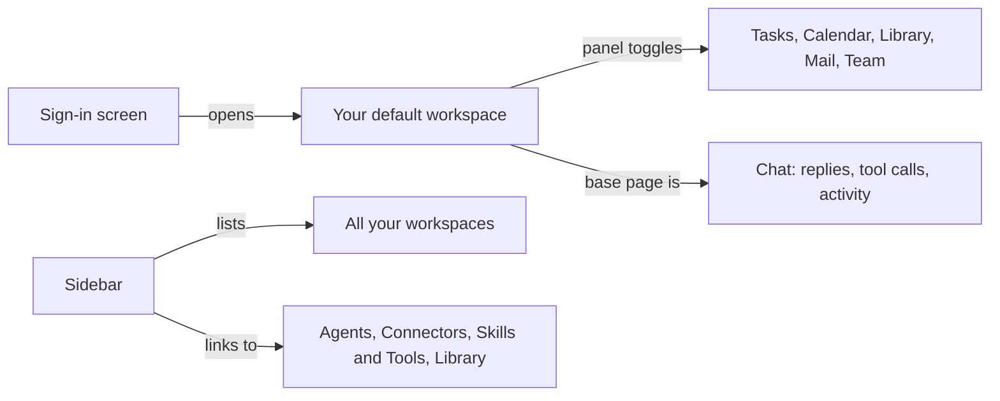

# Using the Omnipus interface

A tour of the Omnipus web app: what you see from the sign-in screen onward, and where everything lives. Each stop that has its own page gets one sentence and a link — this page is the map, not the manual.

## What it is

The web interface is every screen of Omnipus in your browser: sign-in, sidebar, workspaces, chat, and settings. Installing the server is covered by [getting started](getting-started.md); the big picture belongs to [concepts](concepts.md).

The layout has two fixed points, and everything hangs off one of them:

The diagram shows the whole shape: signing in drops you into a workspace, the sidebar reaches every workspace and every app-wide screen, and workspace panels open beside Chat, the base page.

## When you would use it

Open this page in your first week, or later when you are hunting a control you have seen once and cannot find again. To learn what a screen *does* rather than where it is, follow its link.

## How to get from sign-in to a running agent

1. Open the app's address in your browser. On the sign-in screen, enter your username and password, then select **Sign in**. A wrong combination is refused; too many attempts in a row asks you to wait. (A fresh install has no account yet — [getting started](getting-started.md) covers creating one.)
2. You land in your default [workspace](workspaces.md), on **Chat**, its base page. If setup is not finished, onboarding runs first.
3. Type in the message box at the bottom of the chat and press **Enter** to send; **Shift+Enter** adds a new line instead. The reply streams in as the agent writes it. The [agent](agents.md) is chosen in the sidebar, not beside the box. Above the box are the model and **Auto**, this chat's Auto-approve switch. When the message box has enough width, the session's token count sits on that same row.
4. While the agent works, you can steer or stop it (see the table below).
5. To hand the agent a file, use the **+** button next to the message box, drag a file onto the chat, or paste an image in.

## The sidebar

When main-chat or attention data is unavailable, Omnipus shows an unavailable notice rather than guessing a main chat or treating an unknown attention count as zero. **Retry** refreshes the data; it does not invent a missing chat or an attention count.

Unless you pinned it, the sidebar starts closed and the header shows **Show sidebar** (the hamburger). Show is visible only while the sidebar is off screen, and opening it never pins it: a click shows the sidebar over the page. To keep it there, **Pin sidebar** — inside the sidebar, shown on a window at least 1024 pixels wide — docks it beside the page and remembers that for your next visits; while pinned, a click outside no longer closes it. The same control then reads **Unpin sidebar**: unpinning removes the dock — a sidebar you opened during this visit remains open as an overlay, so a click outside closes it, and a sidebar that was visible only because of a saved pin closes when you unpin. While the sidebar is open but not pinned, **Escape**, a click outside it, or choosing a destination closes it (a pin you saved on a wider window stays saved). Opening a session from **Sessions** — including an agent's **History** — counts as choosing a destination, even when it stays in the same workspace, so the page you land on takes your next click. Escape reaches the sidebar itself only when nothing is open inside it: a menu opened from the sidebar — a row's **⋯** menu or the menu under your name at the bottom — or the new-workspace name field takes **Escape** first, and a second **Escape** then closes the sidebar. The sidebar is likewise the top layer while it shows over the page: an **Escape** then closes only the sidebar, even while a reply is streaming — it never stops the running turn and never arms or confirms Stop all. When focus is outside a field or text editor, **Cmd+B** (Mac) or **Ctrl+B** (Windows and Linux) hides a visible sidebar and shows a hidden one. Inside a field or editor, the shortcut stays with that control.

What the sidebar holds:

| Section | What you find there |
|---|---|
| Omnipus | A fixed entry above the workspaces that opens Omnipus's one ongoing chat from any workspace, without changing the workspace you are in. See [Omnipus](#omnipus). |
| Workspaces | Your active workspaces: the default workspace first, then pinned workspaces, then up to five unpinned ones. If there are more, select **more…** to reveal them; **Show fewer** collapses that workspace list again. These controls reveal workspaces, not a list of sessions. Selecting a name opens its chat. Under the name is one row for each eligible agent's main chat in that workspace — not a list of recent conversations. Workers are not listed. Omnipus has its own fixed entry above the workspaces, not a workspace agent row. Select an agent's name to open that agent's main chat. The **⋯** button on the row opens that agent's actions; on a member's row they are **History** (earlier chats for that workspace and that agent), **Hide from sidebar**, **Edit**, and **Remove**. The control beside the name is **Show <workspace> agents** or **Hide <workspace> agents**. A collapsed workspace shows only the attention dot and the count, not the agent rows. An expanded workspace shows the rows, and a main chat that needs you shows a halo on its icon. The workspace you are in starts expanded. Showing the agents or opening the workspace refreshes the team list. Below an expanded workspace's rows, **Add agent** opens Omnipus's chat with creating an agent for that workspace already started; you stay in that workspace. Under that, the **Group chats** section lists the workspace's [group chats](group-chats.md); its **+** menu creates a squad or a quick group. The **+** creates a workspace once you type a name. **Archive** reaches the retired ones. |
| Assets | App-wide screens: [tools](tools.md) (the Skills & Tools screen), [connectors](connectors.md), and the [library](library.md) panel for files and [knowledge base](knowledge.md) notes. |
| Account menu | Your username at the very bottom opens notifications, [usage](#where-settings-and-account-live), [profile](#where-settings-and-account-live), [settings](settings.md), and sign out. |

There is no Agents screen: a workspace's agents live on its **Team** (see [agents](agents.md)).

The agents form an indented group beside a vertical guide under their workspace name. The magnifier at the top of the sidebar searches conversations across workspaces, with no workspace or agent filter. The right side of an agent row has one quiet **⋯** button; on Mia's row it is labelled **More actions for Mia**. It stays visible on the selected agent's tinted row. On other rows it appears when you hover or move keyboard focus into the row; on touch screens it stays visible. On a member's row, the button opens a menu with four actions, in order: **History**, **Hide from sidebar**, **Edit**, **Remove**. **History** opens the search already limited to one workspace and one agent. The agent filter and groups use the chat's owner, not whichever agent answered most recently. Each limit shows as a filter you can remove on its own.

**Hide from sidebar** takes the row out of that workspace's list only. The agent stays on the team and keeps working — tasks, delegation and @ mentions are unaffected — and if a hidden agent's main chat needs you, its attention still counts on the collapsed workspace row's dot and count. Hidden agents leave a quiet line under the list: **1 hidden** (or however many) with a **Show** control that brings every hidden agent of that workspace back in one step. Hiding is stored with the workspace, so it survives a restart and holds in every browser.

**Remove** takes the agent off this workspace's team only. The agent still exists and stays in its other workspaces, and its chat history is kept; adding the agent back to the same workspace restores its main chat with that history. A workspace with no team can still list an agent whose saved settings outlived its membership; **Remove** on such a row clears that leftover entry and the row disappears — no notice, because the removal succeeded. In a workspace with no team, removing a leftover agent also clears the other leftover agent settings in that workspace; agents on the team are never affected. When the removal cannot be done, a notice says *Could not remove* and why. When the removal itself succeeded but reopening the chat view afterwards failed, the notice says so — it begins *Removed* — and the agent is already off the team. A built-in agent on the default workspace cannot be removed either — its **Remove** action is disabled and says why (Omnipus re-adds the built-ins there on every server start).

Agent rows are visible only while the workspace is expanded. Collapsed, a workspace shows an amber dot and the words **1 main chat needs your attention**, or the number of main chats, when that count is known and at least one needs you. The dot pulses unless reduced motion is on; the cue stays, the pulse does not. Expanded, that count is replaced by an amber halo on the agent's icon, and the halo follows the same reduced-motion rule. The cue is only for a main chat. The cue appears only when the server reports that the chat needs you; Omnipus never guesses it, so a chat the server has not said anything about shows no halo at all. With a supporting server, opening that main chat can request that the results shown to you be marked as seen. Omnipus keeps one pending request for this shown opening. When its history finishes loading, while the chat is in front on a visible tab, Omnipus captures the saved-position number from the server's attach response — the first number captured for this opening stays fixed: later frames, reconnect completions and retries never replace it. Every send attempt checks everything again: that this opening is still the current one, the tab is visible, the chat is still in front, loaded metadata identifies a main chat, attention is known, and a number was captured. Unknown attention means no request yet: if a later refresh makes attention known while everything else still holds, the request is sent then, with the same number. If this opening finished without a number, it never acknowledges — reopening the chat starts a new opening that can acknowledge its own number. A failed send keeps the request pending for retry. Sending the request is not confirmation that the server saved a seen mark; marking results seen for everyone is the server's job. The request does not answer a pending question or approve an action; while a request is pending or being retried, the browser keeps its captured saved-position number instead of substituting a newer one. If the supporting attention information becomes unavailable, the halo can disappear or the workspace count can be withheld, and the relevant unavailable notice appears instead — a missing cue is therefore not, by itself, confirmation that nothing needs your attention. An extra chat, a helper, or a tab in the background does not ask, and opening the chat does not clear the cue by itself.

If the main chats are identified but their attention count cannot be known, the sidebar says **Attention unavailable** and offers **Retry**, and it does not show zero. **Attention unavailable** means the server has not said which chats need you: the value is unknown, not zero, and it does not mean Omnipus missed an update. If a main chat cannot be identified, it says **Main chat unavailable** and offers **Retry**. Selecting an agent whose main chat is not in the list says the same under that row. If the team list fails before any agents have loaded, an expanded workspace says **Could not load team** and offers **Retry**. If a refresh fails after the list has loaded, the sidebar keeps the earlier agent rows and says **Could not refresh team — showing cached, out-of-date agents** with **Retry**. **Retry** on the cached-list warning refreshes the agents and workspace membership. The warning stays while the agent refresh is pending or fails again; it clears only after a successful agent refresh replaces the cached rows.

Opening a workspace shows **Restoring your conversation…** while Omnipus chooses the chat. It opens the conversation this browser last opened in that workspace, when that conversation still belongs there. If there is none, or it was deleted, or it belongs to another workspace, it opens the main chat of the **first conversation agent in the team's order** — workers and Omnipus are skipped. If the team has no conversation agent, the workspace shows **No agents in <workspace> yet** with **Set up a team** and **Add agent**, both of which open Omnipus's chat for this workspace; sending stays off until a chat is chosen. If the first conversation agent's main chat cannot be identified, Chat shows that member's server-provided preparation reason when available, or **This chat is unavailable right now** when no reason is provided. Sending stays off, and **Retry** reads the workspace's details again to retry preparation — Omnipus does not silently pick the next agent instead. The **Your agent is ready** welcome is hidden while the destination is being resolved, is unavailable, or could not be restored; it returns for an empty, available chat. If the reason names a storage problem, the server operator must fix it before retrying; Retry does not remove or replace a blocking file or a damaged saved chat. A remembered conversation that is visible in the loaded list still opens if loading the workspace details fails. A list the server reports as incomplete does not count as proof of deletion: a remembered conversation missing from such a list is checked on its own and still opens when it is there; the first conversation agent's main chat takes over only when that check shows the conversation is gone. If the conversation list, the workspace details or the agent list fail to load when they are needed, a warning says **Could not restore your last conversation. Retry to try again.** and offers **Retry**, which tries that choice again. The chat already on screen stays open, and Omnipus does not fall back to another chat. Sending and message retries stay blocked while the destination is loading or the restore has failed; a retry attempt shows the same warning rather than sending into the old chat. Repeated blocked attempts do not stack copies of a warning already on screen. **Retry** on that reused warning checks the workspace you are now trying to enter. Messages already queued in the open tab are kept and resume in order once the destination is available.

A workspace opened in a background browser tab waits until that tab is visible before attaching its chat; being in the background alone is not a restore failure.

If the sidebar shows **Could not load workspaces**, select **Retry** to reload the workspace list and **Archive** when it is expanded. If loading fails again, the message stays so you can retry again. If loading the list pauses because you are offline, the sidebar says **Offline — workspaces will load when you reconnect.** and loads the list once you are back online.

## Omnipus

Omnipus is the system agent that sets up and changes your agents, workspaces, teams, skills, connectors, providers and channels. It has one ongoing conversation, reached from the **Omnipus** entry at the top of the sidebar, above the workspaces. On a fresh install, its workspace-creation tool runs without a tool-approval prompt. Omnipus cannot delete workspaces, even under God Mode: delete a non-default workspace through its **Settings** instead. Agent-driven deletion is deferred to [#1363](https://github.com/elicify-ai/omnipus/issues/1363). See [workspace creation and deletion](workspaces.md#how-to-create-a-workspace).

- **It never changes your workspace.** Opening Omnipus from Sales leaves Sales as the active workspace; going back to Sales returns you to Sales's own conversation.
- **Buttons start a workflow.** **Add agent** (under a workspace in the sidebar, or **Team → Add agent → Create with Omnipus**) opens the Omnipus chat and sends "Create an agent in <workspace>". **Set up a team** (on an empty Team or an empty workspace) sends "Set up a team for <workspace>". The message carries which workspace it is for; Omnipus's own chat stays where it is. If you are offline, nothing is sent and a notice asks you to press the button again once you are reconnected.
- **Attention.** When something in the Omnipus chat needs you, the entry shows an amber dot and the words **Needs attention**. When the server has not said, it shows **Attention unknown** — unknown, not "nothing pending". When a refresh fails, the last known state is shown and marked as possibly out of date. Screen readers hear the same cue as part of the entry's name.
- **Agent changes show at once.** When Omnipus creates, changes or deletes an agent, the agent lists, Team lists, sidebar rows and pickers refresh right away; a change that failed refreshes nothing.
- **When it cannot open.** While the workspace list loads, the entry is a placeholder. If Omnipus's chat cannot be identified, the entry says **Omnipus unavailable** with **Retry**, and the Omnipus chat shows the same with no message box, so nothing can be sent to the wrong place.
- **Settings shortcut.** The gear in the Omnipus chat header opens [Settings → System agents](settings.md#system-agents), where Omnipus's model can be changed even when no model works.

## A workspace and its panels

A [workspace](workspaces.md) is where one effort lives: conversations, task board, files, team. Switch workspaces from the sidebar. Chat is the base page, not a workspace-bar entry. The bar offers five panel toggles, in this order:

| Panel | What it is for |
|---|---|
| Tasks | The workspace's work as a [board, list, or graph](tasks.md), including its [plans](plans.md). |
| Calendar | [Scheduled and recurring work](calendar.md), shown by when it fires. |
| Library | The workspace's files and notes; opens the [Library](library.md) panel. |
| Mail | The workspace agents' configured mailboxes; opens the [Mail](mail.md) panel. |
| Team | Who is on this workspace's team and which [agent](agents.md) may delegate to which. |

Select a toggle to open its panel beside Chat, select it again to close it, or choose another to replace the open panel. The header uses the widest layout that fits the space actually available, leaving room for **Open browser**. Opening a panel, pinning or hiding the sidebar, resizing the window, or changing the font size can change that space.

| Available space | Workspace header |
|---|---|
| Enough for the full row | The workspace name, then **Tasks**, **Calendar**, **Library**, **Mail**, and **Team**, each with an icon and label. Select the workspace name to open its settings. |
| Enough for icons, but not all labels | The workspace name stays; the five panel toggles show icons only. Hover an icon or focus it with the keyboard to see its label. The open panel's icon stays gold. Select the workspace name to open settings. |
| Too narrow for the icon row | The workspace name and a downward caret open a menu with **Settings** and the same five panel toggles. Select the name, then the item you want. |

The hamburger means **Show sidebar** only; there is no second hamburger for panels. Panel names and keyboard access stay the same in all three layouts. Workspace settings remain a page, not a panel.

## The chat area

The chat is a conversation with the workspace's agents. When the open conversation is the one this workspace remembers, a status line above the messages names it: **&lt;Agent name&gt; - Main Session** (for example **Jim - Main Session**) for a main chat identified by the matching server update — the agent's current name, so a rename updates the line — **Extra chat**, or **Extra chat —** plus the title when that chat has one, **Task run**, or **Helper**. That line stays while older messages are loading. For a main chat the line is derived from the team list: while the team list is still loading, the line is briefly absent rather than showing a placeholder name, and if the team list cannot be loaded, the agent's ID appears in place of the name — the same fallback the server itself uses — with a note that agent names could not be loaded. When the open conversation is a helper or a task run, that line is a breadcrumb back to the chat it came from: **&lt;parent title&gt; › Helper** (for example **Mia - Main Session › Helper**) or **&lt;parent title&gt; › Task run**. Select the parent part to open the parent chat, the same way you would open it from the sidebar or search; there is no separate button, and only the direct parent is shown, not a longer chain. When Omnipus cannot name the parent, the line stays the plain **Helper** or **Task run** with no link, and no name is invented: when the parent chat was deleted, when the session list has not loaded yet or failed to load, when the session records no parent (often the case for a task run), or when the parent is a main chat and the team list is still loading. If the team list fails to load, a main parent is named by its agent's ID instead, for example **mia - Main Session › Helper**, and still opens. A parent without a title of its own shows its kind instead: **Extra chat**, **Helper** or **Task run**. A task transcript that is not the conversation this workspace remembers still shows **Task:** and the task title. Replies stream in; each tool an agent uses appears as a card you can expand or collapse ([tools](tools.md) explains what agents can do). When an agent wants to do something sensitive, an approval card appears in that chat, above the message box, and asks you to approve it once, deny it, or always allow it. Requests for that chat are shown one at a time; a request from a helper appears in the chat that started it. While a request waits, the sidebar marks that main chat as needing your attention. Open that chat to answer; pending requests from other chats are not collected into the chat you are reading. [Security](security.md#approve-a-request) covers the rules behind it. Each active [goal](goals.md) shows as its own small pill under the message box.

### Opening a saved chat

Saved messages load quietly and appear together when loading finishes. Old tool calls and status changes do not play through as if the agent were working again. Opening a chat, switching to another chat, or refreshing the page brings you to the latest messages at the bottom. If you scroll up while a chat is loading, Omnipus keeps your reading position instead of pulling you back down.

A saved-chat link (`/sessions/<id>`) for a chat that belongs to a workspace opens inside that workspace. While Omnipus looks up the workspace, the chat area shows **Opening chat…** instead of the conversation. If the lookup takes longer than a few seconds, or is waiting because you are offline, the chat opens on its own with a note above it: **Still finding this chat's workspace. The chat moves into its workspace once it is found.** (offline: **Waiting for the connection to find this chat's workspace.**) and a **Retry** that starts the lookup again. Once the workspace is found, the chat moves into it automatically.

If the lookup fails — for example the server refuses it, or keeps failing after its automatic retries — the chat stays open here with **Couldn't find this chat's workspace, so the chat is open here instead. Retry to move it into its workspace.** Its **Retry** stops any lookup that is still hanging and asks for the workspace list again. While that new lookup runs, the note changes back to **Still finding this chat's workspace.**; if the workspace is found, the chat moves into it; if the list arrives without it, the note disappears and the chat stays open here. A chat whose workspace is not among your active workspaces, such as one in an archived workspace, opens here without a note. Background refreshes of the workspace list never reload the open chat: your reading position, focus and selected text stay where they are, and only the note above the chat changes.

When you continue a saved chat, a follow-up, a steer, a retry of a failed saved message, and a request for another answer keep that conversation's workspace. They do not pick up a different workspace selected elsewhere in the app. An unfiled chat stays unfiled. Retry on a failed saved message uses that conversation's owning agent, not the agent in another chat you have opened. If that agent is not loaded, that Retry sends nothing, leaves the message available to retry, and asks you to reopen the conversation. Delivery Retry on the first message is different: it resends the original request, as described under **If the first message loses its connection**, and it does not wait until the conversation's agent is loaded. To work in another workspace, open that workspace's conversation instead; see [workspaces](workspaces.md).

For a very large history, an informational notice says **Saved history is large. Showing messages as they load.** An initially blank history area can then show saved messages progressively instead of waiting for one update; an existing cached reader stays in place. This is history loading, not the agent starting those tool calls again. Partial messages are not confirmation that the load finished. If it is interrupted, the partial history is discarded while prior cached history and genuinely pending input are kept. The notice stays until you select **Dismiss**, and appears only while its chat is selected. Dismissing it does not interrupt loading. It is not a connection error, has no connection **Retry**, and does not automatically reconnect or repeat the load.

When you quickly leave and reopen a main chat, Omnipus uses that visit's loaded history when marking results as seen, not an older load still waiting to appear.

An answer that is still running continues to stream after the saved history appears. Opening the same conversation in another tab keeps that reply matched to the same message in both views, even when tool activity arrives before the reply's text. Earlier completed answers stay separate from a new reply. On reconnect, a saved completed answer replaces an unchanged cached partial reply once the server confirms no turn is running. This also applies when you visit another chat and return: a matching live message and its saved counterpart are reconciled, not shown as a complete answer plus its old prefix. Newer live text and finished tool results keep priority. Pending tool approvals are restored for their chat; loading history does not approve them. Secret-entry cards are not available in chat in this release while that feature is disabled. If the connection drops before history finishes loading, Omnipus retries automatically. Brief drops stay quiet; the chat's connection notice appears after two minutes disconnected, or when automatic retries give up.

If you choose a connection **Retry**, Omnipus closes the previous connection first. If closing fails, it reports the failure instead of opening another connection.

Saved tool calls keep their recorded identities and outcomes when you reopen a chat. A call recorded as **Cancelled** shows that tool outcome separately from the interrupted assistant reply. Completed calls keep their recorded outcome when another call is stopped. An interrupted answer does not by itself mark the calls it contains as **Cancelled**. Reloading does not run those tools again. If an older history never recorded a tool call, an interrupted reply alone cannot recreate it.

The token counter reports the recorded consumption for the whole session, not just the latest reply, the messages on screen, or the model's context window. Opening an older page or seeing the same completion twice does not add those tokens again. A recorded unused session shows **0 tokens**. Until a recorded total is known, it shows **Usage unavailable** from its initial display rather than guessing zero; an already-known total is kept if a later response omits usage. Different sessions keep separate counters.

### Reading earlier messages

A conversation opens at its recent end, with roughly four screens of messages rather than its entire saved history. As you scroll within two screens of the loaded beginning, Omnipus requests roughly two more screens. Message and tool heights change the amount fetched; a finished tool's start and result stay together. **Show earlier messages** also works in a short conversation or the simpler list used when your browser cannot measure virtual rows. Use **Tab** to reach it, then **Enter** or **Space**.

Helpers in saved history are rebuilt from what was saved about them: each helper's row comes from its saved start, and its saved progress and end update that same row. A helper that finished therefore shows as finished after you reopen or reload the chat, both in the conversation and in the Activity panel, instead of staying **running**; a helper whose saved end is a stop shows as stopped. If a helper started further back than the part of the chat that is loaded, it has no row yet: it appears, once and already up to date, when you load that earlier part by scrolling or with **Show earlier messages**.

While reading older history, **Return to latest** is always available, including beside an unavailable-history error and its **Retry**. It attempts to fetch the recent end and replaces your view only on success; an unavailable index or storage failure can still prevent that read. Its own **Could not load latest messages.** error has a separate **Retry** for that latest read. The unavailable-history **Retry** instead requests a recovery snapshot and keeps your older reader in place. While either action is waiting, repeated activation does not start another request. Return to latest stays visible while you remain in older history. The recovery Retry can disappear when current session state reports history available; if its focused control is removed, focus moves to Conversation history without scrolling. A newer edge removed from the loaded window can be read again with **Show newer messages** or by scrolling toward it. Neither action resends a message or changes the agent's context. Your draft and pending messages stay yours.

| What happens | What stays, and how to recover |
|---|---|
| An earlier, newer or latest read fails | Your current messages stay. The action shows its own error and **Retry**, which repeats that read, not your last instruction. Focus stays on the action while it loads or fails. |
| A replacement snapshot fails while being applied | The previous readable messages are restored, and **Could not load messages.** appears with **Retry**. Rejected replacement messages do not stay on screen. Retry deliberately reads the recent bounded page; it never resends your instruction. |
| A reconnect needs a fresh snapshot while you read older history | The recent tail and current controls refresh separately. Your loaded interval is checked directly, without walking back from the live end or automatically returning you there. |
| The interval check fails | **Could not refresh loaded messages.** appears with **Retry** and an out-of-date notice. Automatic paging pauses until that same interval is checked successfully or you deliberately leave it. |
| A page would remove your protected reading position or focused row from the bounded window | **Loading this page is paused to protect your reading position. Scroll or move focus, then retry.** appears with **Retry**. Your current window and focus stay in place; no page is silently reported as loaded. After moving to a safe position, retry explicitly. |
| Some loaded messages expire under retention | **Some loaded messages have expired.** appears. Surviving content stays in the old interval; Omnipus keeps the visible anchor where possible, otherwise a nearby survivor. |
| The whole loaded interval expires | **These loaded messages have expired.** replaces that interval. **Return to latest** is explicit; this is not a claim that the conversation is empty. |
| Current session state reports a missing, inconsistent or too-far-behind history index | **Session history is unavailable. Retry after the operator restores its index.** appears in the history area. |
| Current session state reports a history storage or projection failure | **This session could not be read because session storage failed. Check disk space and permissions, then retry. Details are in the server log.** appears in the history area. |
| The connection is down and the fallback history request fails | The history area can instead say **Could not load messages.**, without the server's more specific instruction. |

Current approvals, question controls and Stop remain separate from a history error. Once current controls have caught up, the message box remains usable, subject to its normal locks. When rows remain on screen during unavailable history, one paragraph says **Cached messages may be out of date. Live output — earlier history unavailable**; it is not a label on every new message or a claim that the transcript is gap-free. If no message records are loaded, the paragraph is omitted. Messages hidden by the display settings can still cause it to appear.

History **Retry** never repeats a user send. For an unavailable index it requests a new history snapshot while keeping already-ready current controls usable. If the same error persists, contact the operator; repeatedly retrying cannot rebuild missing history metadata. See [history-index operations](operations/chat-history-index.md).

Each loading attempt is announced once: an automatic load of earlier messages and a separate **Show earlier messages** request are announced separately, and pressing the button again while that same load is running adds no announcement. New failures are announced as alerts. Loading older answers does not announce them as new responses. If a successful action removes the focused control, focus moves to **Conversation history** without scrolling to a new message or the composer. Reduced motion does not disable paging or require smooth scrolling.

### Answering a question card

When an agent asks you questions, a card docks above the message box with one tab per question. Every question can be answered with the keyboard alone:

- **↑** and **↓** move between the options and the free-text field; **Space** selects or clears an option.
- **Enter** confirms the question and moves to the next unanswered one. Choosing an option — by click or **Space** — never moves on by itself; on a question with nothing chosen yet, **Enter** on an option picks it and moves on in one step.
- Each question except the last shows **Next**; the last is confirmed with **Answer**, which sends every answer at once and is available only when every question is answered. **Cancel** sends nothing.
- No option is chosen for you in advance — the recommended one is only listed first and marked.

### Who is replying

Replies in the web app's chat show the agent's name above the text with a small portrait of that agent beside it — the same mark the sidebar and the @-mention menu use — including streaming replies, saved history, and another agent's replies in the same chat. The name and portrait are the whole label: no status word is printed next to them. When the reply records its author, the name follows that author rather than the current agent selection. Replies without a recorded author fall back to the chat's current agent. If an agent's details cannot be found, its stored ID can appear instead of a name, and the portrait falls back to the general Omnipus mark.

During a live reply, an inline mark combines the agent's figure and role badge with a short status phrase, inside the conversation, not on the message box. The name remains above the reply. The mark stays on screen, with its animation, for the whole time the reply is working — pinned at the bottom of the conversation, after the text and tool cards already streamed — and it does not disappear between steps or once text has appeared. While agent details are loading or unavailable, the phrase can appear without the figure. The same running-tool rule applies when the chat uses its simpler message-list fallback: a tool belonging to this reply selects Working until its call finishes; a tool in another reply does not.

| What is happening | What you see |
|---|---|
| A reply is awaiting or generating a response, with no running tool or pending decision | The mark breathes and rotates through thinking phrases, starting with **Thinking…**. |
| A tool call belonging to this reply is running, whether its card is visible or hidden | The mark uses its Working motion, with a stable **Working on it…** phrase unless more specific copy applies. Showing tool cards with **Verbose chat** does not change the phase. |
| The agent is setting up a goal whose record is still empty | **Framing your goal**, or **Setting acceptance criteria** while that step runs. This phrase takes priority over a background-command label; the motion still follows whether a tool is actually running. |
| A background-command tool call is running and its card is hidden in the chat | The Working mark shows the call's short description or a label such as **Running git…**, rather than its command line. It follows that tool call, not the whole lifetime of a background process. |
| A tool needs your approval | **Waiting for your approval**, with the tool's name. The mark uses its waiting motion. |
| The agent asked you a question | **Waiting for your input**. If a question and an approval are both pending, this phrase wins. |
| The connection dropped or is reconnecting while a reply is still running | **Unavailable/reconnecting** on that running reply's mark. The mark stays still. A reply that has already finished shows no status word: connection trouble is reported by the chat's connection notice, not on the finished reply. |

**Limits of the inline mark:** it needs an assistant reply to display against, and it shows only while that reply is running — a finished reply shows no mark and no status word. A question or approval can still need attention when no inline mark is visible. Queued work has no inline **Queued** mark; check **Sessions** or Activity instead. For background processes that outlast their tool call, use the Sessions command count and the Activity panel.

In the simpler message-list fallback, live tool activity appears against the reply that owns it, before the answer finishes. If a hidden tool finishes successfully and the reply still has nothing visible, the mark returns to Thinking while the agent continues. If a tool failure makes its **Failed** card visible, that otherwise-empty reply shows the card without an extra Thinking mark, even when the failure has no separate error text.

The mark's figure and badge stay fully opaque. With normal motion they gently change size, and a separate glow animates behind them; Working also has a moving highlight that follows the figure and role-badge shapes, leaving their transparent gaps clear, while the glow can extend beyond the icon's square area. If your system requests reduced motion, these loops stop and the thinking phrase stops rotating. The name and current phrase remain visible.

A fallback-model note can include **Pick a new model in the agent's settings.** when the recorded condition is a retired model. That hint appears once: replayed notes that already contain it do not gain a duplicate line. The saved note text stays unchanged; reading it does not change the model or retry the instruction.

### Who each message is from

Your own messages sit on the right with no name. Every other message in the conversation carries a name above its text:

- A message that arrived from a chat platform — Telegram, Slack, and the like — shows who sent it and where it came from, for example **Alice · Telegram**. The source is always shown for messages from outside the web app, so a Telegram user called Dan can never be mistaken for you.
- A message another agent sent into this conversation (for example a request from a teammate agent in another workspace) shows that agent's current name, plus the workspace it belongs to when that is not the workspace you are looking at — for example **Mia · Atlas**.
- A name longer than about 40 characters is shortened with an ellipsis; point at it, or focus it with the keyboard, to see the full name.

Names are plain text. A name that contains characters that look like formatting shows them exactly as written, never styled.

When an agent answers someone — for example a reply that goes back out to a message that arrived on Telegram — the reply shows **Mia → Alice · Telegram** above the text, with the answering agent's small portrait beside it: who answered, and who it went to. If a reply records only that it was a reply, without who it went to, it shows **Mia → reply** instead. The tool card for the send that produced such a reply is hidden from the conversation, because the reply itself already shows what was sent and to whom; while that answer is still streaming in live, the card can remain until the reply finishes.

A protected-path refusal carrying the code `protected_internal_file` displays **Protected Omnipus file — refused**, explaining that approval cannot open it. Some earlier shell checks return an ordinary secret-set error instead, which can appear as a generic failed call. Read its reason; repeating an approval does not open the path. See [protected internal files](security.md#omnipuss-own-files-are-protected-from-every-agent).

A failure or refusal routed to an existing chat appears in that conversation, including when no reply has started. It does not turn into an app-wide connection banner when you open another conversation or start a new chat. Connection and routing-protocol failures remain separate app-wide problems.

Chat follows the current gateway connection. Once a replacement connection opens, an older connection closing does not disable the message box or interrupt the current reply. A genuine connection loss still triggers reconnect and reloads the chat's missing history.

When a native chat turn reaches its tool-step limit without a final answer, Omnipus shows one saved system notice explaining the limit. It is separate from any earlier narration and has no model attribution. The notice stays visible with **Verbose chat** off, including after reconnecting, reopening the conversation or reloading the page.

**Open browser** at the top of the chat shows the agent's [live browser](browser.md). Library is in the sidebar, and opens every workspace's files. When an agent builds something reviewable, like a small site, the chat links to it ([previews](previews.md)).

While a turn is running, the message box stays yours:

| Control | What it does |
|---|---|
| **Enter** (with text typed) | During a native working turn, sending a message steers that turn without stopping it. A live external-CLI helper is different: the message interrupts its subprocess and continues the same CLI conversation with the new instruction. Stopped or finished helpers follow their documented resume rules. Stop can discard an instruction that was accepted but not yet consumed; delivery is not a guarantee that its work already ran. A send button with the same effect appears next to Stop. |
| **Stop** or **Escape** | The first activation asks only this chat's current turn to stop and shows **Stopping...**. A second activation in the same chat within three seconds confirms Stop all, including its helpers. Escape reaches the turn only when nothing else is open: while the sidebar is showing over the page, Escape closes the sidebar and leaves the turn running. |
| Activity pill | Below the message box: the Agents number counts helpers whose current state is running. Select it to open the Activity panel. **Running now** excludes stopped and finished helpers; queued helpers and helpers waiting for an answer have their own sections. Stopped helpers remain inspectable with **Open**, without a growing elapsed timer or a failed-work label. A resumed helper returns to Running now when its state is running again. |

A follow-up sent just as a native reply finishes stays in the same chat. If it arrives during the finishing turn's final cleanup, Omnipus continues with that instruction and shows and saves the next reply in that conversation. A reply cut off at the output limit stays in the saved conversation with its truncation mark before the follow-up's answer. If the running turn has used its hard step limit, follow-ups it has not yet processed stay queued for the next turn in the same chat. Reloading or reconnecting includes the saved replies in the chat's catch-up history; you do not need to resend a follow-up just because it arrived at the end of the previous reply.

### If the gateway restarts during a reply

A gateway restart ends an in-flight answer; losing only your browser connection does not. The main conversation shows **Interrupted**, rather than staying **Working** forever—even if boot recovery could not save its update, as long as the saved execution is readable. A recovery storage error is reported to the operator; the label alone is not proof that the stop was saved. Its saved messages stay in the same chat, and its goal is not cleared. Whether the cut-off reply survives depends on what was saved before the restart: a reply that was partly saved keeps its saved text, while partial text this tab was showing but the gateway had not yet saved disappears when the tab reconnects, because the restarted gateway has no record of it. Your question is then the last saved message and counts as unanswered. A reply whose turn the gateway still reports as running is never removed. A native delegated helper cut off while running or queued is automatically continued from saved history; if continuation cannot start, it remains stopped and shows **Resume did not start.** Task runs and external command-line helpers are not automatically resumed. The parent's **Interrupted by a restart.** row records the earlier interruption, not a request to resume a helper that is already continuing. An open Interrupted chat also shows a notice above the message box: **Interrupted · The restart cut this answer off. Send a message to continue.** A tab that watched the reply get cut off uses this one notice as soon as it finishes reconnecting, even if the conversation list is delayed or unavailable; it does not briefly switch to a separate “couldn't be finished” line. The notice goes away as soon as you send a message or request a new answer. If the conversation continues from another tab or device while this tab is disconnected, the notice clears when its refreshed conversation state confirms that later work. If your last question never got an answer, **Generate again** stays available beside the notice, but only in a tab that was already open when the gateway restarted; a tab opened or reloaded afterwards shows the notice alone. **Generate again** resends only when you click it. If a main conversation was waiting for an approval or an answer when the gateway restarted, that old prompt is gone: the conversation shows **Interrupted**, not **Waiting for answer**, and does not re-ask the lost prompt. Your next message continues it normally. A prompt from the current gateway process still waits for its answer.

Omnipus does not automatically rerun the interrupted instruction. Send a new chat or channel message to continue the same conversation and round of work with a fresh execution; the agent can delegate again. A standing heartbeat or scheduled conversation can continue on its next normal tick or trigger after a restart stop; this is the schedule continuing, not boot replay. After a physical gateway restart, the next heartbeat interval starts from gateway startup, rather than immediately catching up on the cut turn. An automatic trigger does not override a human Stop of live work. Pressing Stop on a conversation already marked Interrupted leaves its restart reason unchanged, so a later message or normal trigger can still continue it. If the chat offers **Generate again** for an unanswered message, that is also an explicit new answer request, not an automatic replay, and it may repeat earlier work or tool actions. Another restart does not add another interruption to an already-stopped execution. Idle conversations and completed answers keep their previous state.

### Stop and redirect commands

Three slash commands in the message box control the current chat directly:

| Command | Where it works | What it does |
|---|---|---|
| `/stop` | Any chat | Exactly one **Stop** activation: first asks only this conversation's current turn to stop and opens the same three-second confirmation window. |
| `/cancel` | Any chat | Immediately requests Stop all for this chat and every helper below it. It never stops a parent or sibling chat. |
| `/stop-redirect <instruction>` | Any root or native helper chat | Stops this chat's current turn, then continues this same chat with your instruction — for example `/stop-redirect focus on the failing tests`. Its helpers keep working; the command does not target one of them. Refused in an **external-CLI helper chat** (a helper running on Claude Code, Codex or OpenCode): use Stop, or the parent's delegate actions. |

After a first **Stop**, **Escape**, or `/stop`, the same Stop button stays available for three seconds. Press Stop or Escape again in that window to confirm Stop all; `/stop` follows the same activation rule. There is no separate **Stop all** button. The window closes after three seconds, when the window loses focus, or when you switch chats; the next activation is a first, current-chat-only Stop again. `/cancel` needs no second activation.

`/stop-redirect` without an instruction (or with only spaces) replies with usage and changes nothing. The instruction is required and sent as typed after the command, with surrounding spaces removed. If no active session is attached to the current chat, a visible message asks you to reopen it; no redirect is sent. If the connection is down, the redirect cannot be sent: a visible error says so, this chat's turn keeps running, and you can run the command again once you are reconnected.

A turn stopped by `/stop-redirect` keeps its partial reply but is not labelled (interrupted), because it was redirected, not abandoned; a turn stopped with Stop, Escape, `/stop` or `/cancel` still shows (interrupted). After you reload the page this holds for a redirected main chat and a redirected helper chat. A tab that did not send the redirect may show (interrupted) until it is reloaded. One case cannot be told apart from the saved history, so after a reload it can differ from what you saw live: a turn you stopped with Stop and then redirected later, with no message of yours in between, loses its (interrupted) label.

### Clear a chat's context

`/clear` gives the agent a fresh start in the same chat. Three things happen, and nothing is deleted:

- **The agent's context moves forward.** The next turn sends only your instructions and the agent's setup — not the earlier chat content — so the reply starts from a clean slate.
- **The saved history is kept.** Every earlier message stays in the chat's saved history, and the agent can still recall it when a task needs something from before the clear.
- **The screen starts fresh.** Once the server confirms your clear, the view shows the bounded recent part of the new conversation. A reached **Conversation context cleared** divider marks its beginning; a divider outside the selected page is not inserted across an unseen gap. **Show earlier messages** at a reached divider deliberately opens one preceding saved segment. It does not restore that segment to the agent's model context, and the next clear boundary stays closed until you open it. Your `/clear` message itself is not part of the fresh view.

The `/clear` row appears in the chat immediately as a queued message. If a reply is being written when you send it, Omnipus does not refuse it: the running reply is stopped first, and then the clear runs. While Omnipus is stopping the agent's running reply so the clear can apply — a few seconds, and at most about 30 — the row shows **Not sent yet, will be sent automatically**; it appears only during that wait. A `/clear` sent to an idle or stopped agent applies at once. When the reply has stopped, the clear executes and the fresh view replaces the screen.

While the clear is held, or when the server cannot carry it out, your `/clear` row leaves the plain queued look and says why. Nothing is ever deleted, and every outcome is safe:

| The row shows | When it happens | What it means and what you can do |
|---|---|---|
| **Not sent yet, will be sent automatically** | Omnipus is stopping the agent's running reply so the `/clear` can apply, which takes a few seconds and at most about 30. The label appears only during that wait; a `/clear` sent to an idle or stopped agent applies at once. | Nothing has been cleared yet. It runs by itself once the reply has stopped; nothing needs resending. |
| **Couldn't be sent · Try again** | The server could not carry the clear out — for example, the running reply could not be stopped. The server's reason appears as a normal reply above the row. | Nothing was cleared. Select **Try again** to send the `/clear` again, or type a new `/clear` yourself. |
| **Not applied** | You stopped the turn and the `/clear` was discarded before it could run. | Nothing was cleared. Sending `/clear` again works normally. |

After the `/clear` is sent, the chat checks the server after later replies until the clear is confirmed. If a confirmed result arrives while the chat is marked as restoring saved messages or streaming a reply, Omnipus holds it while those busy states remain. Once they clear, the saved result can replace the view without another history read or another `/clear` send. Very large histories shown progressively can reach that point before history catch-up fully finishes. Catching up current controls while history is unavailable is not confirmation of the clear. If a check cannot read the history, the chat shows **Could not load messages.** and that screen's **Retry** also completes the refresh — you do not need to repeat `/clear`.

`/clear` works in a main or extra chat only. In a helper, worker, delegate or task-child session it refuses with an explanation and changes nothing — no view move, no history change, no new chat. The refusal appears as the command's reply.

`/new` is not supported, and the sidebar row has no action to start an extra conversation. Typing `/new` shows a message saying so, and nothing is sent to the server.

### If the first message loses its connection

Your first message is kept in the open tab while Omnipus checks delivery. If loading a saved chat's history fails, the message list may temporarily show **Could not load messages.** instead; select that screen's **Retry** to reload the history. Reconnecting does not resend the message automatically. **Retry** is available only while connected; delivery Retry uses the original message and delivery ID, not the current agent, model, attachment or Auto-approve choices.

| Message status | What it means and what you can do |
|---|---|
| **Sending…** | Waiting for confirmation that the first message was saved. |
| **Delivery not confirmed · Retry** | Omnipus cannot confirm whether the message was saved. This can follow a connection failure or a server-reported uncertain save. A chat-start acknowledgement without the original delivery ID does not confirm delivery and, by itself, does not change **Sending…** to this status. Select **Retry** while connected; reconnect first if needed. |
| **Checking delivery…** | Your explicit Retry is in progress. Another Retry is not available at the same time. |
| **Saved** | The server confirmed that this message was saved using its delivery ID, directly or through the saved chat's history. A chat-created acknowledgement alone does not confirm a save. The answer may still be starting or running. |
| **Checking chat…** | Omnipus knows the chat ID and is loading its history to check whether the first message was saved and whether an answer exists or is still running. |
| **Could not check this chat · Retry** | Checking delivery or loading the saved chat failed. This does not establish whether an unconfirmed message was saved. Your message is kept in the open tab; **Retry** uses the original delivery request until a save is confirmed, even if a chat ID is known. After a confirmed save, it checks the saved chat again. |
| **Could not save message · Retry** | Omnipus reported that it could not save the message. You can retry delivery. |
| **Message saved, but no answer started · Generate again** | The message was saved, but no answer began. **Generate again** deliberately starts a new answer in the saved chat. |
| **Couldn't finish · Generate again** | Checking the recovered chat finished with your message still unanswered and no answer running. You can deliberately generate a new answer. |
| **Not delivered** | You stopped the agent before it read this message, so it was discarded — the text stays in the chat, nothing is sent later, and the same status is shown again after you reload the page. |
| **Waiting — delivered when <Agent> runs again** | You addressed an agent with `@` and that agent is stopped. Your message is saved and the request is held: it is delivered when the agent runs again, after which this label goes away (it is not a failure and nothing needs resending). |

When checking a recovered chat, your original message stays in place until the requested saved-history page finishes loading and passes validation. It then becomes one saved message, not a second copy; its original attachments remain available for an explicit **Generate again**. Waiting follow-up messages stay queued until this check finishes, and still wait if an answer is running. Catching up current controls while history is unavailable does not complete the saved-history check.

For an ordinary first message, an acknowledgement without the original delivery ID does not open or confirm the pending chat, or apply its agent and Auto-approve settings. Buffered messages remain queued until a matching save receipt or checked history confirms delivery; they also wait while a reply is running. An acknowledgement without the matching delivery ID alone does not release them.

An unconfirmed message does not offer **Generate again**. That action is separate from delivery Retry: it sends a new request and may repeat work or tool actions. The saved chat's current Auto-approve setting applies, not a restored setting from the original send.

The slash menu uses the command list returned by the server, alongside available skills and web-only session-search and workspace-switch entries. `/help` lists the server commands and those web-only entries. `/clear` appears in the menu only when the server's command list includes it; choosing it sends it to the server, which performs the clear (see Clear a chat's context). `/new` is not supported: the menu never offers it and typing it refuses visibly without sending anything. An alias alone is not a separate menu entry. Typing `@` at the very start of the message box opens an agent picker styled like the command and skill menu. It lists the ready (active or idle) agents on the current workspace's team (every ready agent when the workspace has no team set), minus the agent this chat belongs to. Helpers are never listed, and an agent you hid from the sidebar is still listed, so it is not the same list the sidebar shows. Type to filter by name, move with the arrow keys, and pick with Enter or a click — the picker inserts `@<Agent name> ` into the message box and you stay exactly where you are: your chat, your history, your current agent. When you send that message, it is delivered as a request to the picked agent from this chat (the `@<Agent name>` text stays in the message as you typed it). The picked agent can answer back into this conversation, shown with the reply header that names who answered (see Who each message is from above); an answer arrives only when that agent replies to the request with its answer tool, because a plain reply in its own chat does not reach you. If the picked agent is stopped, the request is held rather than lost: your message shows as waiting, and it is delivered when that agent runs again. If the request is refused, the refusal appears as a notice in this chat, your message shows **Couldn't be sent** with a **Try again** control, and a turn running in this chat carries on. The addressing is read from the message text at send time: if you edit or delete the leading `@<Agent name>` part before sending, the message goes to this chat's own agent as ordinary text instead. Addressing needs an existing conversation — in a brand-new chat that has not started yet, an `@`-addressed send is refused with a warning and your text stays in the message box; send an unaddressed first message to open the chat, then pick the agent again. A `@` anywhere other than the very start of the message box is ordinary text and opens nothing. Another conversation with the same agent — an extra chat — has no start entry in the sidebar: the row menu offers no "new chat" action, and no other ordinary control starts one at the moment. An extra chat therefore exists only once something has created it, and from then on the row's **History** (and the Sessions search) lists the agent's earlier chats, extras included, and the agent's main chat always stays in place.

**Limits:** recovery before a chat ID is known lives only in the open tab; a full browser reload can lose it. The gateway remembers delivery IDs only for its current process, and only for a limited number of recent first messages: up to 256 per account and 10,000 in total. When those limits are reached, the oldest are forgotten first, so a Retry of a very old unconfirmed first message can create a second chat and answer twice, exactly as after a restart. If it crashes after saving the message but before acknowledging it, Retry after that restart can likewise create a second chat and answer twice. Reusing a delivery ID for a different message is refused with a conflict error instead of being treated as the same message. Delivery Retry is not a guarantee of exactly-once answers or tool actions.

## Sessions

Type `/sessions` in the web chat's message box and press Enter to open **Sessions**, or select it from the slash-command menu. It opens the same view as the sidebar's magnifier. `/resume` is not supported and is not an alias for `/sessions`.

The view is titled **Sessions** and offers two status filters:

| Filter | What it includes |
|---|---|
| **All** | The available sessions across workspaces, including queued and ended work. Search, date, and workspace filters can narrow the list. Internal verifier sessions are not included. |
| **Running** | Sessions whose current lifecycle display is **Working** and whose server execution classification is running, plus their parent rows so helpers stay in context. Queued and restart-interrupted sessions do not match Running themselves, though a non-running parent can remain above a genuinely running helper. |

Search matches a session's title, workspace, or agent name. The date-range control filters by when the session was last active, not when it started. Opening a result uses that conversation's recent bounded history; it is not a jump to a particular message. A history-index error does not mean the session was deleted: its authorized identity can still open with current controls and a separate history error.

If agent details cannot be loaded and no saved agent list is available in the open app, Sessions warns that **agent-name search is unavailable**. Title and workspace search still work, but a search by agent name alone can show no matches. Select the notice's **Retry** to load agent details again; your search stays in place, and agent-name matches return when that request succeeds.

If the required session or workspace list cannot be loaded, the error names what failed: **Could not load sessions**, **Could not load workspaces**, or **Could not load sessions and workspaces**. Select **Retry** in that view to retry the failed requests. The list returns when they succeed; another failure keeps a visible error and Retry available.

Each real session row shows its title above its status, kind, when it started, and when it was last active. On a phone, the title wraps rather than being squeezed beside the metadata, so chats with the same opening words remain distinguishable. Its token count appears when known and the screen is wide enough. A stored zero is shown as 0; a missing count is not invented.

A main chat's title is always **<Agent name> - Main Session** — for example **Jim - Main Session** — and it cannot be renamed (the app hides Rename on a main chat, and a rename sent any other way is refused). Omnipus derives it fresh from the team list every time it is shown — the agent's current name, so a rename shows up without a reload and no older copy of the title can linger anywhere. The derivation reads the team list: while the team list is still loading, the title waits (the Usage screen keeps its loading skeleton, and the chat header briefly shows no line) rather than inventing a placeholder name; if the team list cannot be loaded, the agent's ID stands in for the name — the same fallback the server itself uses — and the Usage screen says that agent names could not be loaded. A main chat is never shown as **Untitled** and never as **Unknown agent**. Every other chat keeps its own title: one without a title yet shows **Untitled session** until the server titles it.

| Status | When you see it |
|---|---|
| **Working** | The server's lifecycle record says it is working, and it is not queued. |
| **Waiting** | It is waiting for an answer. |
| **Queued** | It is queued, not executing. |
| **Done** | Its lifecycle record says it finished. If no lifecycle status is available, an archived chat also shows Done. |
| **Failed** | It failed. |
| **Stopped** | It was stopped. The cause is included when known, for example **Stopped · cascade** when a Stop all above it reached it. Work has no time limit. A saved stop cause of `timeout` is shown as **Stopped · timeout**. |
| **Interrupted** | A server restart cut the turn off. This takes priority over an old queued or running record. |
| **Unavailable** | No usable lifecycle or queued status is available, and the chat is not archived. An active chat without that information is not labelled Working. |

The server classifies queued or running work only while that same session's current lifecycle display is **Working**. After a restart, an interrupted main conversation is not itself running or queued, even if its old record still says so. It may remain in **Running** as parent context for a genuinely running helper. **Interrupted** is not a permanent label: once that conversation is actually resumed or re-adopted with a fresh execution in the current gateway process, running work shows **Working** and matches **Running** again. The gateway being back online alone does not restart the old execution. As explained [above](#if-the-gateway-restarts-during-a-reply), the Interrupted label alone does not prove that recovery saved a stop.

Kind is the session's real type: **Chat**, **Task**, **Helper**, **Scheduled**, **Channel**, or **Main chat**. A Helper is a delegated session with its own parent chat.

Helpers stay under their real parent in **All**, **Running**, and search, even when the parent itself does not match. If a complete list has no record of the parent, the helpers appear under **parent chat unavailable**. This is an expandable heading, not a chat you can open; the helpers beneath it can still be opened. Omnipus does not invent a title for the missing parent. If the list is incomplete, the heading instead says **Parent not in this partial list**: a missing page is not proof that a parent is unavailable. An incomplete-list notice offers **Retry** to load the list again.

The list is also incomplete when the server cannot read a session's saved lifecycle record, even if it can load the session itself. That row stays in **All**, but the server does not guess its lifecycle status or whether it is running. Such a row does not qualify for **Running** on its own; an empty Running result with an incomplete-list notice is not proof that no work is running. Use **Retry** after the storage problem is resolved. A session with no lifecycle record is a normal case and does not, by itself, trigger this warning.

API callers receive these warnings in the existing `partial_errors` array: `agent=<id>: session_list_failed` means session enumeration failed, while `session=<id>: lifecycle_read_unavailable` means one row's saved lifecycle could not be read. The tokens do not include local file paths or the underlying storage error. Healthy rows and pagination remain usable; the unreadable row's `lifecycle_state`, `stop_note`, and `execution` keys are omitted, not sent as `null`. Session detail, agent-specific session lists, and session create or rename responses have no page-level warning field: an unexpected lifecycle-read failure returns HTTP 500 with `session lifecycle unavailable` instead of pretending to have loaded the runtime state. A create or rename may already have saved its session or title before this response read fails; inspect the existing session before repeating a write.

Consecutive helpers with the same title under the same parent fold into **N similar helper runs**. This means similar labels, not a guarantee that their instructions or results are identical. Expand the heading to see each original session, with its own status and selectable title. Runs under different parents never fold together.

When a session itself owns running background commands, its row says **N background commands running** (or **1 background command running**). Zero or an unknown count shows no sentence. The count belongs to that session only, not its helpers. Background commands do not get synthetic session rows: open the owning chat and inspect its Activity panel.

With focus in the search field, **Up** and **Down** move the highlight, and **Enter** opens the highlighted session. You can also select a real row's title — its Open action. Opening a session, from **Sessions** or from an agent's **History**, takes you straight to that chat: no panel opens by itself, so you can click and type in it at once. When that chat has running or failed activity, its Activity pill below the message box opens the Activity panel. Folded and missing-parent headings expand or collapse instead of attaching a chat. If an update removes the highlighted target, the highlight clears and focus returns to the search field; Enter does not silently open another session in its place. A connection failure while opening a workspace chat shows an error instead of pretending the switch succeeded.

## Panels beside chat

[Tasks](tasks.md), [Calendar](calendar.md), [Library](library.md), [Mail](mail.md), and Team open from the workspace bar or its compact panels menu and use the shared panel controls, as does [Browser](browser.md). **Library** is also in the sidebar. **Open browser** at the top of the chat opens the agent's live Browser panel when a browser session is available. Only one panel sits beside Chat at a time. Choosing another replaces it; if the outgoing editor reports protected unsaved changes, you are asked before it leaves.

| Control | What it does |
|---|---|
| Panel heading and **Close** (X) | Shows which panel is open; X closes it and returns focus to Chat. Pressing **Escape** also closes a panel (not Browser), except while you are typing in a field or a dialog is open; in a full-screen panel it behaves like **Back to chat**. On a narrow screen, the panel replaces the chat area and also has **Back** at the top to return to Chat. |
| Divider between Chat and the panel | Drag it to change the panel's width. You can focus the divider and press the left or right arrow key; **Home** and **End** jump to its narrowest and widest sizes. Double-click it to reset the width. |
| **Expand** icon (named **Expand** followed by the panel's name, for example **Expand Library panel**) | In a normal browser tab, Library, Browser, Mail, Tasks, Team and Calendar open their full-screen view in a new browser tab, without the app sidebar or workspace bar. When Omnipus recognises an existing tab for the same panel and workspace (or the same Browser session and agent), it focuses that tab or offers **Switch** (or asks you to switch manually) instead of opening another. Reuse depends on Omnipus still recognising that tab; it is not guaranteed if cross-tab communication is unavailable. Reloading or closing the original Chat tab does not close an expanded panel tab. After a reload, Omnipus can offer Switch when cross-tab communication still recognises that panel; the browser may require you to switch tabs manually. After opening or reusing a tab, the docked panel closes in the source tab. If pop-ups are blocked, the docked panel stays open and Omnipus shows a short notice, for example **Library was blocked. Allow pop-ups and try again.** If opening the tab fails with an error instead, the panel stays open and a short notice says, for example **Library could not open full screen. The panel remains here.** |
| **Back to chat** in any full-screen panel | In a normal browser tab, **Back to chat** tries to close the full-screen tab. A tab that Omnipus opened can restore the panel beside Chat only in its original tab while that tab still owns the expanded panel, when that tab is still available and no different panel is open there. Reloading the original Chat tab releases that ownership, so **Back to chat** no longer restores the panel there automatically after the reload; you may need to reopen the panel. Restoration uses the last context received by the original tab. If cross-tab context updates are unavailable, it can restore an older selection. A tab that only switched to or reused an existing full-screen tab does not get that restoration. If the full-screen tab cannot close itself, the button opens workspace Chat with the panel open in that same tab. If Chat cannot be opened, an error stays visible so you can try again. |

**Installed app windows:** when Omnipus runs as an installed app or standalone Chrome window, **Expand** opens the full-screen panel in that same window, not another window. **Back to chat** returns to the workspace view in the same window with the panel reopened. Mail keeps its current mailbox, folder and selected message; Browser keeps its session and agent; Tasks, Team and Calendar keep their workspace. Library returns without reopening the selected file; select it again. If a workspace is selected in Library, it reopens that workspace. If Library is showing the all-workspaces root, returning instead opens Library in the Chat workspace; select the **Library** breadcrumb to show all workspaces again. On wider layouts the reopened panel sits beside Chat. On narrow layouts it takes Chat's place; use the panel heading's **Back** or **Close** control to reveal Chat. Library and Mail still ask before expansion or return when their editors have protected unsaved changes; cancelling keeps you where you are. This also applies to minimal-UI, window-controls-overlay and full-screen display modes. Normal browser-tab expansion is unchanged.

Tasks and Calendar follow the workspace in their full-screen tab's address, including browser Back and Forward. When child-context updates reach the original tab, its recognised workspace mapping follows too: after a child moves from workspace A to B, choosing the panel for B tries to switch to it and choosing it for A can open a docked panel at A. If cross-tab updates are unavailable, the original tab may retain an older mapping. Automatic restoration to the original Chat tab requires that tab to still own the expanded panel and have no different panel open; it uses the last workspace context that the original tab received. Installed-app returns and the same-tab fallback described above do not require an original-tab owner.

Library and Mail ask before an app-initiated close, panel switch, expansion, or full-screen return when their editors report protected unsaved changes; cancel the prompt to stay. If the unsaved-change check fails during expansion, the panel stays open and an error notice asks you to try again—for example **Library could not expand because its unsaved-change check failed. Try again.** In Mail, that covers changed drafts and Compose messages with a nonempty body, **not** a new Compose message with only recipients or subject filled in. The Browser panel has no equivalent text-edit warning. See the [Mail guide](mail.md#work-with-drafts) for Save and draft-sending steps.

## Where settings and account live

App-wide settings live behind **Settings** in the account menu, on tabs from providers and models to security, data, and chat behavior; [settings](settings.md) walks each one. Opening Settings stays on Settings, including while the app is still opening your workspace after sign-in. Your **Profile** (preferences, password, and what agents should know about you) and **Usage** (token history) are separate entries in the same menu. Settings for one workspace live in that workspace, under its name.

## Limits and things to watch

The active reader keeps at most **500 whole source groups**, plus a separate cache of at most **100 recent groups**. A source group is one saved entry with its associated tool rows; it can draw more than one row. As you browse, safe groups at the far edge leave the reader and remain reloadable. The visible anchor and focused row are protected; if safe trimming is impossible, the page waits rather than growing beyond the bound. Leaving a chat releases its loaded history and measurement/query caches, but does not stop its work or discard genuinely pending input.

Each server page has a **4 MiB soft projected-size target**. Whole groups and the estimated content for at least two screens take precedence, so a large tool group or the height floor can exceed it. This is not a hard memory or download limit. Normal opening targets about four screens; contiguous top-ups correct height estimates without crossing a closed clear divider. A true retained end, clear boundary or visible read failure can stop the fill earlier.

- The sidebar starts closed unless you pinned it. **Show sidebar** (the hamburger in the header) appears only while the sidebar is off screen and shows it without pinning. **Pin sidebar**, inside the sidebar, appears at 1024 pixels and wider and docks it for this and future visits; **Unpin sidebar** removes the dock — a sidebar opened during this visit stays open as an overlay until a click outside closes it, and one that was visible only because of the saved pin closes when you unpin. While it is open but not pinned, Escape, a click outside, or choosing a destination closes it, and a pin saved on a wider window stays saved. Escape reaches the sidebar itself only when nothing is open inside it — a row's ⋯ menu, the menu under your name, or the new-workspace name field takes Escape first. While the sidebar is showing over the page, Escape closes only the sidebar; it never stops a running turn or arms Stop all. When focus is outside a field or text editor, **Cmd+B** (Mac) or **Ctrl+B** (Windows and Linux) hides a visible sidebar and shows a hidden one. Inside a field or editor, the shortcut stays with that control.
- During a native working turn, sending a message steers that turn without stopping it. A live external-CLI helper is different: the message interrupts its subprocess and continues the same CLI conversation with the new instruction. Stopped or finished helpers follow their documented resume rules. Stop can discard an instruction that was accepted but not yet consumed; delivery is not a guarantee that its work already ran. Sending mid-turn normally steers the current turn; if it reaches its hard step limit, unprocessed instructions carry into the next turn. To let the agent finish first, wait for the reply before sending.
- Stop is a request, not a switch: the agent halts where it is, and work already finished stays finished.
- The activity pill disappears when everything has ended successfully. A failed background item keeps it visible, so failures do not vanish silently.
- The **Library** and **Mail** entries open panels beside Chat on wider screens, rather than separate workspace pages; on narrower screens a panel takes over the chat area.
- For readability, some routine tool activity is hidden from the conversation by default. **Settings**, then **Chat**, then **Verbose chat** reveals every call. The goal card stays visible, with expandable raw call details below it, both during a reply and after reopening the conversation. The same display applies to goal cards in delegated workers' tool steps.
- If a turn ends in an error after text has started streaming, the failure message replaces that text in the same reply. The message is visible even with **Verbose chat** off; **Verbose chat** shows technical details when available. A turn you stop still keeps its partial reply. **(interrupted)** belongs to that reply's message, not to the whole conversation; a later successful answer does not inherit it. Likewise, **(cut off at the output limit)** appears only on the affected reply.
- A `model_route_unavailable` notice means the named provider/model connection could not be set up from its saved settings; no request was sent to that pair, and the global-default connection was not substituted. Check the provider's API key and endpoint settings. The safe explanation remains after reopening the conversation.
- A wrong-model HTTP 400 notice names the provider, model and `bad_model` reason. A remaining, otherwise unclassified HTTP 400 names the same pair with `HTTP 400: Bad Request; format` instead of saying the cause is unknown. These safe notices are visible with **Verbose chat** off and remain in reopened history. Provider response details are live-only: enable **Verbose chat** before reproducing a failure; enabling it afterwards or reopening history does not restore discarded details. The Sessions list remains a status summary; open the conversation for its saved explanation.
- An agent saying what it plans to do is not a finished answer. If it reaches its tool-call limit before a final answer, chat keeps the narration and adds a separate limit notice. The notice remains in the saved conversation when you reopen it. An admin can raise **Max tool calls per turn** under **Settings → Performance**; an agent's own lower limit is on its profile's **Advanced** tab.
- If conflicting tool names stop a turn, chat shows the standard failure notice instead of ending without an explanation: “This turn didn’t finish, and we can’t tell why. Retry — if it keeps happening, open Verbose chat for details, or try a different model.” Any earlier narration and tool activity remain in the saved conversation, followed by the failure notice.
- When Omnipus reports a `judge_conclusion_failed` notice for a goal, chat adds a separate notice: “Omnipus could not fully save or deliver the Judge's conclusion. Check disk space, file permissions and the chat's channel connection, then reload the chat. Open Verbose chat for details.” The notice is visible with **Verbose chat** off. Technical details are available only for a live notice received while **Verbose chat** was already on, and only when a detail was supplied. Turning it on after that notice arrived does not recover details that were omitted, and replayed notices do not include those details. The notice does not replace the agent's reply, stop a reply still being written, or remove **Stop**. See [Goals](goals.md) for the specific failures covered by this notice; it does not confirm delivery through an external channel.
- **Escape acts on one surface at a time, in this order.** A menu opened from the sidebar (a row's **⋯** menu or the menu under your name), a dialog, or a popover takes Escape first and closes only that topmost layer — the sidebar stays open, an open panel stays open, and a running turn is not touched. With no menu or dialog open, a sidebar showing over the page is next: Escape closes only the sidebar, and the turn keeps streaming — it never stops the turn and never arms or confirms Stop all. Only when no menu, dialog, or sidebar overlay is in front does Escape reach a running turn: the first press stops this chat's turn, and a second press within three seconds confirms Stop all. An open side panel does not stand in front of the turn: Escape closes a panel (except Browser) only when the press starts inside it — with no dialog or menu open, no discard confirmation showing, and focus outside a field — and while a reply is streaming that same press also stops the turn. In a full-screen panel Escape behaves like **Back to chat** instead.

## Related pages

- [getting-started](getting-started.md) — install, create the account, finish onboarding.
- [workspaces](workspaces.md) — what a workspace is and what lives inside one.
- [agents](agents.md) — the roster, building your own.
- [tasks](tasks.md) — the board, list, and graph views, and plans.
- [tools](tools.md) — what agents can do, and the permissions that gate them.
- [mail](mail.md) — read, compose, and manage drafts in the Mail panel.
- [browser](browser.md) — watch or drive an agent's live browser in its panel.
- [settings](settings.md) — every settings tab in detail.
