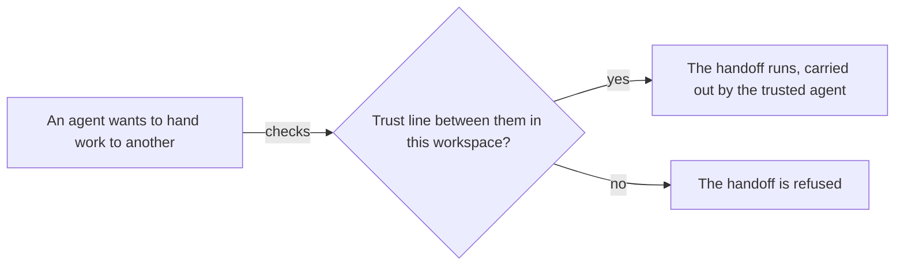

# Workspaces

A workspace is the container your work happens in. The chats, the tasks and their plans, the calendar, the files, and the team of agents who do the work all belong to one workspace. This page explains what a workspace holds, what its panels do, and how to run more than one.

## What it is

The main-chat destinations and attention cues on this page require the matching server update. If they are unavailable, follow the unavailable notice and **Retry**; Omnipus does not guess a main chat from recent conversations.

Workspaces keep related work together:

- **Chats.** Workspace chats belong to their workspace. Conversations without an associated workspace can also exist as unfiled sessions. The sidebar lists your workspaces, and under each name it shows one row for each eligible agent's main chat in that workspace (Omnipus has its own fixed entry above the workspaces). Choose an agent to open that pair's main chat, not whichever chat was most recently active. On a member's row, the **⋯** menu opens **History** — earlier chats for that workspace and that agent, with both filters shown so you can remove one — along with **Hide from sidebar**, **Edit**, and **Remove**. **Hide from sidebar** takes the row out of this workspace's list only: the agent stays on the team and keeps working, its attention still counts on the collapsed workspace row, and a quiet "**1 hidden**" line with a **Show** control brings hidden agents back. **Remove** takes the agent off this workspace's team; it stays in the Agents list and in other workspaces, and its chat history is kept. An amber dot on a collapsed workspace (or a halo on an agent's row) means the server reports that a main chat needs you; the text beside the dot says how many. Omnipus shows the cue only from what the server reports — it never guesses. If the main chats are identified but that count cannot be known, the sidebar says **Attention unavailable** and offers **Retry** instead of showing zero: the value is unknown, not zero, and it does not mean Omnipus missed an update. If the main-chat IDs are missing, it says **Main chat unavailable** with **Retry** instead. With a supporting server, opening a main chat can request that the results shown to you be marked as seen. Omnipus keeps one pending request for this shown opening. When its history finishes loading, while the chat is in front on a visible tab, Omnipus captures the saved-position number from the server's attach response — the first number captured for this opening stays fixed: later frames, reconnect completions and retries never replace it. Every send attempt checks everything again: that this opening is still the current one, the tab is visible, the chat is still in front, loaded metadata identifies a main chat, attention is known, and a number was captured. Unknown attention means no request yet: if a later refresh makes attention known while everything else still holds, the request is sent then, with the same number. If this opening finished without a number, it never acknowledges — reopening the chat starts a new opening that can acknowledge its own number. A failed send keeps the request pending for retry. Sending the request is not confirmation that the server saved a seen mark; marking results seen for everyone is the server's job.
- **Work items.** Tasks, plans, and the calendar of scheduled and repeating work are per workspace.
- **Files.** A workspace holds its own library of files and notes.
- **Team.** Each workspace picks its own agents, and sets its own rules for who may hand work to whom.
- **Memory and instructions.** What the team remembers, and the written instructions every agent on the workspace follows, belong to the workspace.

A conversation or helper cannot be moved to another workspace. Open the destination workspace's conversation instead; trying to reuse an existing conversation there returns a visible error. Changing a connector's workspace binding selects a separate conversation for the new workspace and leaves the original archive in its original workspace.

Follow-up messages, steering while an agent is working, delivery retries and requests for another answer stay with the open conversation's saved workspace, not a different workspace selected elsewhere in the app. Continuing an unfiled conversation leaves it unfiled; it does not assign the conversation to the active workspace.

Opening a workspace restores the conversation this browser last opened there, when that conversation still belongs to the workspace. Otherwise it opens the main chat of the **first conversation agent in the team's order** — workers and Omnipus are skipped. A team with no conversation agent shows **No agents in <workspace> yet** with **Set up a team** and **Add agent**, and sending stays off; nothing falls back to another chat. If the first conversation agent's main chat cannot be identified, the message box shows that member's server-provided preparation reason when available, or **This chat is unavailable right now** when no reason is provided. Sending stays off, and **Retry** reads that workspace's details again to retry preparation — Omnipus never silently picks the next agent. The **Your agent is ready** welcome is not shown while the chat is still being resolved, is unavailable, or could not be restored; it returns for an empty, available chat. The workspace switch arrow in Sessions follows this same restore rule; it does not start an extra chat or erase your remembered conversation. Chat shows **Restoring your conversation…** while it decides. If the remembered conversation is visible in the loaded list, it still opens when loading the workspace details fails. A list the server reports as incomplete (an agent's conversations failed to enumerate) is not proof of deletion: if the remembered conversation is missing from such a list, Omnipus checks that conversation on its own, opens it when it is still there, and only lets the first conversation agent's main chat take over when that check answers that it is gone. If loading the conversation list, the workspace details or the agent list fails when they are needed, a warning says **Could not restore your last conversation. Retry to try again.** and offers **Retry**, which tries that choice again. Repeated blocked attempts reuse an identical warning already on screen rather than stacking copies; **Retry** on that reused warning checks the workspace you are now trying to enter. The open chat stays; Omnipus does not switch to another chat. Sending is off while the target chat is being checked. If loading or attaching the target chat fails, sending stays off and the message box also offers **Retry**, which checks that target workspace again rather than only reconnecting the old chat. A page that has only just loaded may still be opening its connection to Omnipus: Chat then keeps showing **Restoring your conversation…** until the connection opens (up to 15 seconds) and attaches the chat as usual; a connection that is still opening is not a failed attach.

Omnipus is reached through its fixed entry above the workspaces, not a workspace agent row. Workers are not listed. The agent list refreshes when you expand a workspace, when you select its name, and when you return to this browser tab. The visibility-change refresh runs when this tab becomes visible. You do not need to reload the page. If that list fails before any agents have loaded, an expanded workspace says **Could not load team** and offers **Retry**. If an earlier list is still held, that list stays.

On a fresh install, Omnipus creates one workspace for you, named **My Workspace**, with Mia, Jim, Omnipus, Planner, Researcher and General Purpose on the team. Omnipus, the system agent, belongs to this default workspace only: it cannot be added to another workspace or removed from this one. It is the default workspace: it is where Omnipus sends you when no other workspace is chosen, and it cannot be archived or deleted.

### Each agent's own chat, per workspace

Every eligible chat colleague on a workspace has one standing chat of its own — its **main** chat for that workspace. Workers and hidden system agents do not have main chats, even when workers are on the team. Clicking the agent in the roster opens it, and it is the conversation that agent keeps with you in that workspace. The agent's row carries a **⋯** menu; on a member's row, **History** opens the pair's earlier chats (extra chats among them — ordinary conversations, deletable as usual), **Hide from sidebar** and **Remove** manage the row and the team membership, and **Edit** opens the agent's profile. Starting a new extra chat is not offered in the sidebar at the moment.

Some things about the main chat are fixed:

- **It is kept, not deleted.** The main chat cannot be deleted: Sessions disables its delete control, and the API refuses deletion. If you take an agent off the team — **Remove** in the row's **⋯** menu — its main chat disappears from the list but is not erased; put that agent back on the same team and the very same chat returns, with its history.
- **It is the workspace's, not a setting's.** Enabling or disabling an agent's heartbeat does not create, replace or delete this chat. Heartbeat runs happen in it — there is no separate heartbeat chat to find or clean up.
- **Omnipus's main chat lives in the default workspace only.** Omnipus is a member of the default workspace and of no other, so in any other workspace it has no main chat, and a chat with Omnipus is accepted only in the default workspace.
- **Workers and system agents have none.** They are not chat targets, so they have no standing chat.

Each eligible workspace-and-agent pair has one computed main-chat ID: `main-session-<workspace ID>+<agent ID>`. It uses IDs, not editable display names, so renaming a workspace or agent does not change it. The complete computed ID is capped at 255 bytes. An oversized ID is rejected rather than shortened or hashed; changing only a display name cannot fix that error. Nothing is guessed, shortened or renamed behind your back.

**When the main chat cannot be created.** Omnipus creates every eligible member's main chat when it starts (and when you create a workspace or change its team), so a fresh install already has one per team member, Omnipus's included. A storage failure at that moment does not stop the gateway. The team membership can be saved even though a member's main chat is not usable. Workspace details return a safe reason for that member instead of a main-chat address; they do not undo the membership or claim that the chat is ready. For example, a file occupying a required session folder is reported as: "The main chat could not be prepared because session storage has a file where a folder is required. Ask the server operator to fix it, then retry." Full filesystem details remain in the server log.

Reading that workspace's details again — the read used by **Retry** — makes one new preparation attempt for each eligible member. It does not repeatedly retry in the background. Once an operator fixes the storage problem, the next detail read creates a genuinely absent main or reuses the matching saved one, returns its address and clears its preparation error. Listing workspaces does not prepare chats. Preparation is ordered with workspace deletion: a detail request admitted after deletion returns **workspace not found**, rather than recreating that workspace's main chats. Omnipus never replaces a damaged saved chat by itself. Directly opening a main chat that cannot be created or trusted still returns the fixed message: "This agent's main chat could not be prepared because session storage failed. Check disk space and permissions, then retry. Details are in the server log." See [Troubleshooting](troubleshooting.md#an-agents-main-chat-says-it-could-not-be-prepared).

## When you would use it

Use more than one workspace when your work splits into contexts that should stay separate. One workspace per client keeps that client's chats, files, and task history inside it; a separate one for internal operations can carry a different team. The rosters can overlap, because the same agent can sit on several workspaces, but each workspace keeps its own chats, tasks, files, memory, and trust lines. A single workspace is a perfectly good way to run everything if you have one context.

## The panels of a workspace

Open a workspace from the sidebar and it lands on Chat. Chat stays underneath the panels; it is not an entry in the top bar or its compact menu.

The top bar offers these panels, in order:

| Panel | What it is for | Read more |
|---|---|---|
| Tasks | Tasks as a board, a list, or a graph of dependencies | [tasks](tasks.md) |
| Calendar | Scheduled and repeating work by date | [calendar](calendar.md) |
| Library | The workspace's files | [library](library.md) |
| Mail | Configured agent mailboxes | [mail](mail.md) |
| Team | The agents on this workspace, and who may delegate to whom | [agents](agents.md) |

Click an entry to open its panel beside Chat. Click it again to close the panel and reveal Chat, or choose another entry to replace the open panel. The bar adapts to its measured space: first the workspace name and five icon-and-label toggles, then the name and five icons with hover/keyboard-focus labels, then the workspace name with a downward caret opening **Settings** and those same five panels. It keeps room for **Open browser** and adapts when panels, the sidebar, the window size or the font size change. The hamburger is only for showing the sidebar. Mail remains between Library and Team in all three layouts; opening it without a selected mailbox lets you choose one.

For panel resizing and full-screen view, see [panels beside chat](using-omnipus-ui.md#panels-beside-chat). In an installed app or standalone Chrome window, all six panels—Tasks, Calendar, Library, Mail, Team and Browser—expand full screen in the same window. **Back to chat** reopens the panel there. Mail keeps its current mailbox, folder and selected message; Browser keeps its session and agent; Tasks, Calendar and Team keep their workspace. Library returns without reopening the selected file; select it again. If a workspace is selected in Library, it reopens that workspace. If Library is showing the all-workspaces root, returning instead opens Library in the Chat workspace; select the **Library** breadcrumb to show all workspaces again. On wider layouts the reopened panel sits beside Chat; on narrow layouts it takes Chat's place until you use its **Back** or **Close** control. In a normal browser tab, they open full screen in a new tab instead. When Omnipus recognises an existing tab for the same panel and workspace (or Browser session), it focuses that tab or offers to switch instead of opening another; this depends on Omnipus still recognising that tab. If a pop-up is blocked, the docked panel stays open. **Back to chat** tries to close the full-screen tab; a tab Omnipus opened can restore the panel only in its original tab while that tab still owns the expanded panel, when that tab is still available and no different panel is open there. Reloading the original Chat tab releases that ownership, so automatic re-docking there is lost and you may need to reopen the panel. Restoration uses the last context the original tab received, so unavailable cross-tab updates can leave it at an older selection. If the full-screen tab cannot close itself, the button opens workspace Chat with the panel open in that same tab. Settings stays a page, not a panel. Select the workspace name in the full or icon-only row, or open the name menu and choose **Settings** on a narrow row, to rename the workspace, edit its description, write its instructions, and archive or delete it.

The Tasks panel shows three views of workspace work, switched with the selector at the top of the screen. Board lays tasks out as cards by status. List is a table. Graph shows top-level plan members and tasks with dependency relationships, with dependencies drawn as lines between nodes. Unplanned tasks without dependency relationships and nested tasks are not graph nodes. This is where a [plan](plans.md) is easiest to see whole.

## How to create a workspace

1. In the sidebar, find the **Workspaces** section and click the **+** next to its title. A name field appears in the list.
2. Type a name and press **Enter**. The workspace opens on Chat. Press **Escape** to cancel instead.
3. A new workspace starts with an empty team. The server attempts to post an offer in Omnipus's main chat to help set up its team; if the offer appears, answer there to accept or skip it. The new workspace's Chat shows **No agents in <workspace> yet** with **Set up a team** and **Add agent**; **Set up a team** opens Omnipus's chat with designing a team for this workspace already started (you stay in the new workspace). You can skip both and add agents later.
4. To build the team yourself, open the **Team** panel. An empty team shows **No agents yet** with **Set up a team** (Omnipus designs a team with you in its chat) and **Add agent**.

You can also ask Omnipus in its chat to create a workspace. On a fresh install with the shipped policies, `create_workspace` runs without a tool-approval prompt. Omnipus cannot delete workspaces: its `delete_workspace` permission is Deny, including under God Mode, and a refused call opens no approval prompt and changes nothing. To delete a non-default workspace, open that workspace's **Settings** and choose **Delete**. Agent-driven deletion is deferred to [#1363](https://github.com/elicify-ai/omnipus/issues/1363), following the founder's 2026-10-18 decision **delete later, track**. The default workspace cannot be deleted. These fresh-install defaults do not rewrite existing saved permissions.

Deleting a non-default workspace through Settings or the workspace API disables and unbinds its channel instances before removing the workspace. Their workspace and agent bindings are cleared; the configured channel entries and saved credentials are not removed, and channels bound elsewhere are unchanged. If that cleanup cannot be saved or applied, deletion reports an error and the workspace remains; channel changes already saved are not undone. The lower-level default-workspace refusal and channel-cleanup hardening remain in place while agent-driven deletion is deferred; they do not grant Omnipus permission to delete.

For a workspace created through the app or workspace API with an empty team, the server attempts to post a setup offer in Omnipus's existing main chat. After a successful post, another claim does not post the offer again. Omnipus-created workspaces do not trigger this automatic offer.

If the offer entry was saved but its turn could not start, the chat attempts to add a failure note pointing to **Team**. Earlier failures — preparing the main chat, claiming pending state or saving the offer — can appear only in the gateway log. If no offer appears, open the workspace's **Team** panel and use **Set up a team**; do not wait for a chat error that may not have been saved.

## How to set who may delegate to whom

Delegation is one agent handing work to another: passing a research question to a worker, or creating a task for a builder. Whether that is allowed is decided inside each workspace, on the **Team** panel. There is no global trust setting anywhere in the product.

While Team first loads, it shows **Loading team…**. If loading fails before the team is available, it shows a reason and **Retry**; the reason stays visible during a retry. A successful retry shows the normal Team editor without reloading the page.

If Team is already visible and refreshing the workspace fails, the editor stays usable. A notice above it shows the failure reason and **Retry**, and identifies the displayed team as the last known data. The notice stays visible while a retry is waiting; if retries keep failing, it shows the latest reason and still offers **Retry**. A successful retry removes the notice and updates the team in place, without reloading the page. This works both beside Chat and in the full-screen Team panel.

**The Team list.** The Team panel opens on **List**; **Graph** (the switch in its header, also reachable with the arrow keys) shows the trust picture described below. The list has one card per agent on the team: its portrait and name, whether it is a **Conversation agent** or a **Worker** (conversation agents are listed under **Agents you chat with**; workers, including **Worker · external program**, have their own **Workers** section), its model, and the other active workspaces in the loaded list that include it. Omnipus never appears in the list; in the default workspace it appears only in the Graph view, as its own self-line. Each card's **⋯** button — reachable by keyboard and touch, not only by hovering — offers **Edit** (the agent's profile, used in every workspace), **Remove from this workspace** (after a confirmation; the agent stays in its other workspaces) and **Delete everywhere…**, which first lists the agent's memberships from the loaded active-workspace list and stays unavailable while that list cannot load; if the server refuses the deletion, a notice says why. While the team loads the list shows placeholders; if it cannot load it shows the error with **Retry** — never the empty-team offer; if a refresh fails, the cards stay with **this team may be out of date** and **Retry**.

**Adding agents.** **Add agent** opens a menu with **Create with Omnipus** — Omnipus's chat opens with creating an agent for this workspace already started, and you stay in this workspace — and **Add an existing agent**, a searchable list of your agents that are not on the team yet. Omnipus, Judge and Plan Supervisor are never offered; an agent absent from all teams in the loaded active-workspace list is marked **Not in any workspace**. Picking one adds it at once and says **Added … · Undo**. If the server's answer is lost, a notice says the change **was not confirmed** with **Retry**, which re-reads the workspace before trying again so nothing is added twice.

The Team view's other-workspace labels, deletion preview and **Not in any workspace** badge use the loaded active-workspace list, not a complete inventory of archived memberships. An agent can have that badge even when an archived workspace still lists it. A successful **Delete everywhere** also removes its references from archived workspaces, so inspect archived teams before confirming an irreversible deletion.

1. To work on trust lines, switch the Team panel to **Graph**. Each agent on the team appears as a node in a picture.
2. To grow the team from the picture, use **Add agent** in the Graph toolbar: pick one of your agents (it joins as a new node and saves with the picture), or choose **Create with Omnipus instead**. Membership and trust lines save on their own; the indicator in the Graph toolbar shows when they have saved, and a member that is not saved yet is named in a notice until it is. If refreshing the picture fails, it stays on screen with **Could not refresh the graph — it may be out of date.** and **Retry**.
   If you added an agent in another tab or window, return to this tab or expand the workspace in the sidebar. The agent list and this workspace's membership refresh without a page reload. The message box has no agent picker beside it: your chat's agent is chosen in the sidebar. Typing `@` at the very start of the message opens a menu to address another agent; it does not switch your chat's agent. If loading workspaces fails, the workspace view is replaced by **Failed to load workspace. Check your connection and try again.** Select **Retry** there.
3. To trust one agent to delegate to another, drag from the small gold dot on the first agent's node onto the second node. A line appears between them. That line is the trust.
4. Click the line to tune it with the settings in the table below.
5. To take trust away, delete the line. Removing an agent from the team removes every line touching it.

| Setting | What it means |
|---|---|
| Direct | The trusted agent can be handed a request directly, in conversation or in the background |
| Task | The trusted agent can be assigned tasks |
| Depth | How many times the handoff may be passed on. Zero means it stops with that agent |

The editor requires at least one delegation mode on a line. Delete the line to prevent handoffs in that direction. An untouched depth follows the workspace/global default.

A handoff is allowed only when a trust line for that pair exists in the workspace where the work is running; with no line, it is refused. A workspace you create starts with an empty team and no lines; every agent you add gets its own **self-line** (for example Mia → Mia; Omnipus's self-line in the default workspace allows a depth of 1), because handing work back to the same agent is an ordinary handoff and follows the same rule. The auto-created first workspace is the exception — it ships with the default team listed above and their standard trust lines.

**A self-line is an ordinary line.** Naming an agent as its own target — handing a fresh piece of work back to the same agent, in a new session — needs a line from that agent to itself, exactly like handing work to any other agent. Every agent normally starts with one. It appears in the Team picture like any other line, and you edit or remove it the same way; removing it stops future self-handoffs. A new agent added to a team gets its own self-line at the moment it joins, whichever way it was added — including Team → Add agent, which saves a complete list of lines: Omnipus adds the new member's self-line even when that list does not contain it. The lines of members who were already on the team are saved exactly as you sent them, so a self-line you removed stays removed **while that agent stays on the team**. If you take the agent off the team and add it back, it is a new member again and gets a fresh self-line. A seed-exclusion id (below) suppresses the self-line in every one of these cases.

**The rules always apply.** There is no setting that turns the trust-line check off, and every handoff must come from an identified agent; a handoff without one is refused with an error. Agents can hand work only to the agents they have a line to.

**Where the default lines come from.** The lines a *new* team member receives are decided by a private bootstrap list in `config.json` (`workspace_seed_defaults.self_edge.exclude_agent_ids`), not by fixed code. That list affects only lines seeded from then on: it never changes the lines a workspace already has, and never brings a removed line back for an agent that stays on the team. It also does not decide who can join a team: the two hidden engine agents (Judge and Plan Supervisor) cannot be team members, and Omnipus can be a member of the default workspace only, whatever the list says. See [settings](settings.md#which-new-agents-get-a-self-line) for the key, its shipped value, and how to add or remove an exclusion.

The same two agents can be trusted together in one workspace and not in another, because each workspace keeps its own lines. That is deliberate: trust describes a working relationship inside a team, not a property of an agent.

## Sending work to another workspace

An agent can create a task on a DIFFERENT workspace's board by naming that
workspace explicitly (`workspace_id` on `create_task`). The task is delivered,
not run: it lands in the target board's **Inbox** as not-started work, and that
workspace's own team picks it up locally. The sending agent cannot start, run,
re-run or reassign it from outside — running work is what a workspace's own
team does, under that workspace's own delegation rules. A task created in the
agent's own workspace still lands in `next` (ready to run), exactly as before.

The same optional `workspace_id` is accepted by `update_task` and `list_tasks`;
omitting it means "my own current workspace". Reading a workspace other than
your own returns only the read-only status and identity of the tasks you
created or are assigned there — never their content, results or plans.

## When an agent changes a workspace

Omnipus can change a workspace's name, description, team and delegation lines with `update_workspace`, using the workspace's current revision from `get_workspace`:

- An empty name is refused ("name is required"); leaving the name out keeps it.
- A team member must be a real agent — an id that names no agent is refused, and so is a delegation line to an agent outside the team. Nothing is saved in either case.
- After saving, the tool reads the workspace back from disk and checks that the delegation graph is valid and that every new line joins two team members. If not, the result says `saved but not working` with the reason. When a team is supplied, the tool also attempts to prepare its eligible members' main chats, even if the team is unchanged. An inactive chat colleague, or an inactive member whose saved agent record cannot be read, produces a `main_chat_warning` and `saved but not working`, not a claim that the chat is ready. Other eligible members are still prepared. Repair the unreadable agent record or remove that member, then retry the team. See [tools](tools.md#what-a-change-tool-reports) for the four outcomes.
- The result carries the workspace's new `revision`, so the next change does not need another read. A change that would alter nothing writes nothing and keeps the revision.
- Every workspace result has the same fields, with lists that are empty rather than missing.

## Limits and things to watch

- **No line, no delegation.** Adding an agent to the team does not trust them for handoffs. Draw the line.
- **Team saves depend on the edit.** When membership changes, membership and trust lines are sent together in one workspace update. An edit to trust lines alone uses the delegation update. If saving fails, read the save indicator's error; do not assume membership has already landed.
- **Clicking a node edits the agent everywhere.** The profile that opens from a Team panel node is the agent's global definition, used by every workspace it belongs to.
- **A built-in agent cannot be removed from the default workspace** — Omnipus re-adds the built-ins there every time the server starts.
- **Deleting a workspace is permanent.** Archive instead: archived workspaces move to the sidebar's Archive section and can be restored from there. The default workspace can be neither archived nor deleted.
- **A workspace's instructions apply to every agent in it.** Write them in settings, under Workspace / Project Instructions. They layer on top of each agent's own persona.

## Related pages

- [tasks](tasks.md) — the Tasks panel in depth: board, list, and graph views.
- [plans](plans.md) — what a plan is, and how the graph view shows one.
- [calendar](calendar.md) — scheduled and repeating work inside a workspace.
- [agents](agents.md) — who the built-in agents are, and how to add your own.
- [library](library.md) — the files a workspace holds.
- [mail](mail.md) — the agent mailbox associated with this workspace.
- [memory](memory.md) — what a team remembers, per workspace.
